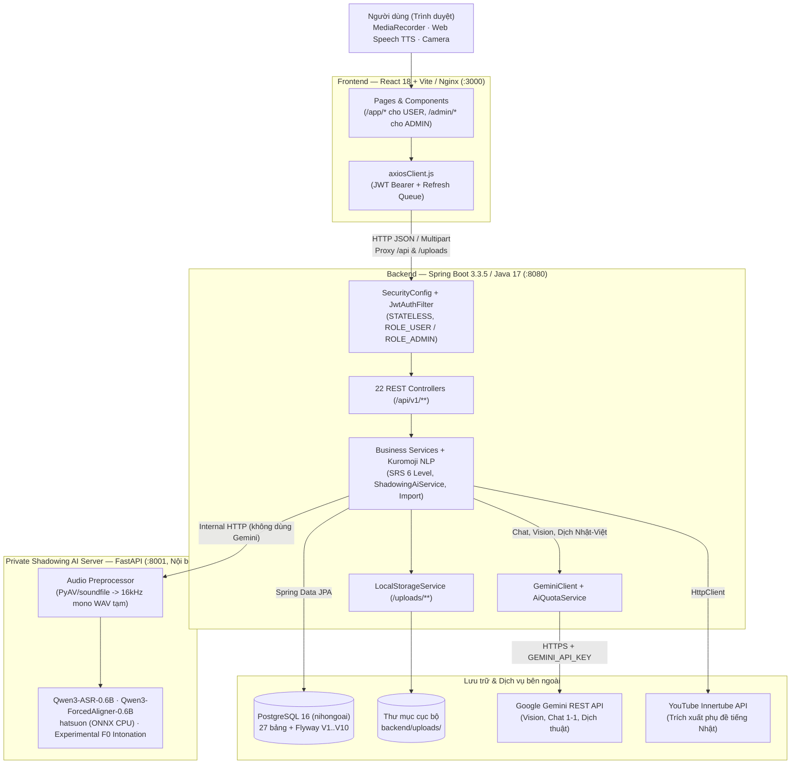

# PQ Nihongo — Nền tảng Học Tiếng Nhật Tích Hợp AI


> **Trạng thái dự án:** Đang hoạt động ổn định (Full-stack Web Application — Spring Boot + React + PostgreSQL + Private Local Shadowing AI Server).
>
> **Tài liệu chuyên sâu đi kèm:**
> - [Hướng dẫn Kiến trúc & API Shadowing Local AI (`docs/SHADOWING_AI_GUIDE.md`)](docs/SHADOWING_AI_GUIDE.md)
> - [Cài đặt & Vận hành Private AI Model Server (`ai-shadowing/README.md`)](ai-shadowing/README.md)
> - [Báo cáo Kiểm thử & Đo lường Shadowing AI (`docs/SHADOWING_AI_TEST_REPORT.md`)](docs/SHADOWING_AI_TEST_REPORT.md)
> - [Hướng dẫn Thiết lập, Migration & Backup PostgreSQL (`database-setup/README.md`)](database-setup/README.md)
> - [Giáo trình Đọc hiểu Source Code (`docs/LEARNING_GUIDE.md`)](docs/LEARNING_GUIDE.md)

---

## Mục lục

1. [Giới thiệu dự án](#1-giới-thiệu-dự-án)
2. [Screenshots / Demo](#2-screenshots--demo)
3. [Tính năng chính](#3-tính-năng-chính)
4. [Tech Stack](#4-tech-stack)
5. [Kiến trúc hệ thống](#5-kiến-trúc-hệ-thống)
6. [Cấu trúc thư mục](#6-cấu-trúc-thư-mục)
7. [Yêu cầu môi trường (Prerequisites)](#7-yêu-cầu-môi-trường-prerequisites)
8. [Hướng dẫn cài đặt & khởi chạy](#8-hướng-dẫn-cài-đặt--khởi-chạy)
9. [Biến môi trường (Environment Variables)](#9-biến-môi-trường-environment-variables)
10. [Cơ sở dữ liệu (Database)](#10-cơ-sở-dữ-liệu-database)
11. [Tổng quan API](#11-tổng-quan-api)
12. [Kiểm thử (Testing)](#12-kiểm-thử-testing)
13. [Triển khai (Deployment)](#13-triển-khai-deployment)
14. [Xử lý sự cố thường gặp (Troubleshooting)](#14-xử-lý-sự-cố-thường-gặp-troubleshooting)
15. [Roadmap](#15-roadmap)
16. [License & Credits](#16-license--credits)

---

## 1. Giới thiệu dự án

**PQ Nihongo** (`vn.vku:nihongoai`) là ứng dụng web học tiếng Nhật theo lộ trình JLPT (**N5 → N1**), kết hợp quản lý từ vựng, ôn tập ghi nhớ ngắt quãng (SRS 6 cấp độ), luyện nói Shadowing bằng **mô hình AI giọng nói chạy cục bộ**, và hội thoại / nhận diện từ vựng qua ảnh bằng **Google Gemini API**.

- **Vấn đề giải quyết:** Người học tiếng Nhật thường phải dùng rời rạc nhiều công cụ khác nhau cho flashcard, luyện nghe–nói Shadowing, tra phiên âm Furigana và thực hành hội thoại, đồng thời thiếu phản hồi phát âm tiếng Nhật chi tiết ở mức âm tiết (mora), trọng âm Tokyo và ngữ điệu câu.
- **Đối tượng sử dụng:**
  - **Học viên (`ROLE_USER` — không gian `/app/*`):** Học từ vựng, ôn tập SRS, làm Quiz, luyện Shadowing (chủ đề/hội thoại A–B, video YouTube, câu tự nhập), nhận diện đồ vật qua ảnh và hội thoại với Gia sư AI.
  - **Quản trị viên (`ROLE_ADMIN` — không gian `/admin/*`):** Quản lý người dùng, chủ đề, từ vựng, bộ thẻ mẫu, bài học Shadowing, chủ đề hội thoại, cấu hình hệ thống, nhật ký gọi AI và Audit Log.
- **Giá trị nổi bật:**
  - **Shadowing Local AI độc lập (không phụ thuộc Gemini API):** Tích hợp server nội bộ `ai-shadowing/` chạy `Qwen3-ASR-0.6B`, `Qwen3-ForcedAligner-0.6B`, `hatsuon` và phân tích đường cao độ `F0` thử nghiệm, kết hợp phân tích hình thái `Kuromoji` trên backend.
  - **SRS 6 cấp độ (Level 0 → Level 5):** Bảo toàn thẻ đã thuộc (`Level 5`), hỗ trợ chế độ học lại bộ thẻ (`SET_RELEARN`) và lưu lịch sử ôn tập trong `review_logs`.
  - **Phân quyền tách biệt chặt chẽ:** `SecurityConfig` cô lập hoàn toàn API `/api/v1/admin/**` (`ROLE_ADMIN`) khỏi API học tập (`/api/v1/vocab/**`, `/api/v1/shadowing/**`, `/api/v1/srs/**`... `ROLE_USER`).
  - **Cache phụ đề & bản dịch YouTube trong PostgreSQL:** Lưu trữ transcript và bản dịch ngữ cảnh theo từng câu để tái sử dụng nhanh.

---

## 2. Screenshots / Demo

> **Ghi chú:** Hiện tại repository chưa đính kèm ảnh chụp màn hình giao diện (chỉ có biểu tượng ứng dụng tại [`frontend/public/logo.png`](frontend/public/logo.png)). Bạn có thể bổ sung ảnh chụp màn hình thật vào thư mục `docs/screenshots/` trước khi công bố rộng rãi.

| Màn hình | Trạng thái | Đường dẫn gợi ý |
|---|---|---|
| Dashboard & Biểu đồ tiến độ học tập | Chưa đính kèm ảnh | `docs/screenshots/dashboard.png` |
| Luyện Shadowing & Báo cáo Mora / Trọng âm / F0 | Chưa đính kèm ảnh | `docs/screenshots/shadowing-local-ai.png` |
| Ôn tập Flashcard SRS 6 cấp độ & Quiz | Chưa đính kèm ảnh | `docs/screenshots/srs-flashcard.png` |
| Hội thoại AI 1-1 & Nhận diện từ vựng qua ảnh | Chưa đính kèm ảnh | `docs/screenshots/ai-conversation-vision.png` |
| Trang quản trị hệ thống (`ADMIN`) | Chưa đính kèm ảnh | `docs/screenshots/admin-dashboard.png` |

---

## 3. Tính năng chính

### Xác thực, Phân quyền & Hồ sơ (`Public` / `USER` / `ADMIN`)
- Đăng ký, đăng nhập JWT Access Token + Refresh Token xoay vòng (lưu hash SHA-256 trong DB), quên mật khẩu & đặt lại mật khẩu.
- Cập nhật hồ sơ cá nhân, ảnh đại diện (`/uploads/avatars/`), trình độ JLPT mục tiêu và tốc độ đọc TTS mặc định.

### Từ vựng, Flashcard, SRS 6 cấp độ & Quiz (`USER`)
- **Sổ từ vựng cá nhân & Từ vựng theo chủ đề:** Tìm kiếm, lọc JLPT, phát âm tiếng Nhật và hiển thị Furigana tự động bằng Kuromoji.
- **Nhận diện từ vựng qua ảnh (Gemini Vision):** Tải ảnh hoặc chụp trực tiếp từ camera để nhận diện đồ vật và thêm nhanh vào sổ từ / bộ thẻ.
- **Quản lý bộ thẻ & Import Excel/CSV:** Tạo bộ thẻ cá nhân, tải template chuẩn `.xlsx`/`.csv`, import hàng loạt qua Apache POI & Commons CSV.
- **Ôn tập SRS 6 cấp độ & Quiz:** Lịch ôn tự động theo mức độ ghi nhớ (`Level 0`–`5`), biểu đồ phân bố thẻ và bài kiểm tra trắc nghiệm.

### Luyện Shadowing tiếng Nhật với Local AI (`USER`)
- **3 chế độ luyện tập:**
  1. **Shadowing theo chủ đề & Hội thoại A/B:** Nghe toàn bộ hội thoại hoặc từng câu, điều chỉnh tốc độ, ẩn/hiện bản dịch.
  2. **YouTube Video Shadowing:** Nhúng YouTube IFrame Player, tự trích xuất phụ đề tiếng Nhật (hoặc tải file `.SRT`/`.VTT`), dịch ngữ cảnh tiếng Việt theo lô và lưu cache PostgreSQL, lặp câu theo mốc thời gian.
  3. **Tự nhập đoạn/nhiều câu tiếng Nhật:** Tự tách câu, sinh Hiragana bằng Kuromoji, dịch toàn bộ câu và luyện từng câu.
- **Đánh giá phát âm bằng Private Local AI Server (không dùng Gemini):**
  - Ghi âm trực tiếp bằng `MediaRecorder` (`audio/webm` / `ogg` / `mp4`), hỗ trợ nghe lại giọng của mình và giữ chế độ đối chiếu văn bản thủ công.
  - Nhận diện giọng nói tiếng Nhật (`Qwen3-ASR-0.6B`), căn chỉnh timestamp (`Qwen3-ForcedAligner-0.6B`), chấm mora / mora đặc biệt (`っ`, `ん`, trường âm) & trọng âm Tokyo (`hatsuon`), phân tích ngữ điệu câu `F0` thử nghiệm (`experimental=true`, chuẩn hóa bán cung + DTW khi có audio mẫu), đối chiếu từ `Kuromoji` và sinh nhận xét + gợi ý luyện tập tiếng Việt.
  - Lưu chi tiết vào `shadowing_attempts.evaluation_json` để xem lại trong Lịch sử Shadowing (tương thích hoàn toàn với bản ghi cũ).

### Hội thoại AI 1-1 (`USER`)
- Luyện hội thoại theo chủ đề cùng Gia sư AI (Gemini), hỗ trợ nhập giọng nói tiếng Nhật, lưu lịch sử hội thoại và nhận gợi ý sửa lỗi ngữ pháp/cách diễn đạt.

### Bảng điều khiển Quản trị (`ADMIN`)
- Thống kê hệ thống, quản lý người dùng (khóa/mở khóa, phân quyền), chủ đề, từ vựng, bộ thẻ mẫu, bài học Shadowing (kèm import hội thoại), chủ đề hội thoại AI, cấu hình hệ thống (`system_settings`), giám sát `ai_call_logs` và `audit_logs`.

---

## 4. Tech Stack

| Layer | Technology | Purpose |
|---|---|---|
| **Frontend** | React `18.3.1`, Vite `5.2.11`, React Router `6.23.1`, Axios `1.7.2`, Bootstrap `5.3.3`, Lucide React `0.379.0`, Recharts `2.12.7`, TanStack React Query `5.39.0` | Giao diện SPA, định tuyến theo vai trò, ghi âm `MediaRecorder`, phát âm Web Speech TTS và biểu đồ tiến độ |
| **Backend** | Java `17` (tương thích JDK 17–23), Spring Boot `3.3.5` (Web, Security, Data JPA, Validation, WebFlux), Kuromoji IPADIC `0.9.0`, Apache POI `5.2.5`, Commons CSV `1.10.0`, Springdoc OpenAPI `2.6.0` | REST API, nghiệp vụ học tập/quản trị, phân tích tiếng Nhật Kuromoji, import Excel/CSV và cầu nối AI |
| **Local Shadowing AI** | Python `3.10–3.13`, FastAPI, Uvicorn, PyTorch (`CPU` hoặc `CUDA 12.6`), `qwen-asr 0.0.6` (`Qwen3-ASR-0.6B`, `Qwen3-ForcedAligner-0.6B`), `hatsuon >=0.1.2` + `pyopenjtalk-plus`, `librosa`, `scipy`, `soundfile`, `PyAV` | Máy chủ AI nội bộ đánh giá phát âm Shadowing tiếng Nhật ngoại tuyến (không dùng Gemini) |
| **External AI & API** | Google Gemini REST API (`gemini-3-flash-preview` mặc định), YouTube Innertube API | Nhận diện ảnh Vision, Hội thoại AI 1-1, dịch câu & phụ đề Nhật–Việt (chỉ gọi từ Backend, có giới hạn quota) |
| **Database** | PostgreSQL `16` (`postgres:16-alpine`), Flyway Migration (`V1`–`V10`), H2 (profile chạy thử in-memory) | Lưu trữ 27 bảng nghiệp vụ, lịch sử học tập và cache phụ đề YouTube |
| **Authentication** | Spring Security (Stateless), JJWT `0.12.6` (HMAC-SHA), BCrypt (`strength=10`), SHA-256 Refresh Token hash | Xác thực JWT, xoay vòng token và phân quyền `ROLE_USER` / `ROLE_ADMIN` |
| **Deployment** | Docker Compose v3.8, Multi-stage Dockerfiles (Maven/JRE 17, Node 20/Nginx Alpine, Python 3.11-slim), Windows `.bat` scripts | Đóng gói và triển khai đồng bộ 4 dịch vụ (`postgres`, `backend`, `ai-shadowing`, `frontend`) |

---

## 5. Kiến trúc hệ thống



> **Nguyên tắc bảo mật kiến trúc:** Trình duyệt chỉ giao tiếp với **Spring Boot Backend**. Cả `GEMINI_API_KEY` lẫn Private Shadowing AI Server (`:8001`) đều nằm hoàn toàn phía sau Backend và không bao giờ mở trực tiếp ra trình duyệt.

---

## 6. Cấu trúc thư mục

```text
PQ-Nihongo/
├── .env.example                     # Mẫu biến môi trường cho Backend & Docker Compose
├── .gitignore                       # Loại trừ .env, build outputs, .venv, .cache, uploads
├── docker-compose.yml               # Triển khai 4 container: postgres, backend, ai-shadowing, frontend
├── run-ai-shadowing.bat             # Khởi chạy nhanh Private Shadowing AI Server (Windows, :8001)
├── run-backend.bat                  # Khởi chạy nhanh Spring Boot Backend (Windows, :8080)
├── run-frontend.bat                 # Khởi chạy nhanh Frontend Vite dev server (Windows, :3000)
├── start-app.bat                    # Khởi chạy nhanh Backend + Frontend (Windows)
├── ai-shadowing/                    # Private Python AI Model Server cho Shadowing
│   ├── app/
│   │   ├── main.py                  # FastAPI app & exception handlers
│   │   ├── container.py             # Singleton quản lý model & cache
│   │   ├── api/                     # health, asr, alignment, pronunciation, intonation, shadowing
│   │   ├── config/settings.py       # Pydantic Settings từ biến môi trường
│   │   ├── schemas/shadowing.py     # Schema JSON đầu ra ổn định
│   │   └── services/                # device_manager, audio_preprocessor, asr, alignment, hatsuon, F0, feedback, pipeline
│   ├── scripts/                     # export_hatsuon_model.py, run_evaluation_suite.py
│   ├── tests/                       # Bộ pytest kiểm thử preprocessing, F0 & endpoints
│   ├── requirements.txt             # Dependencies Python
│   ├── .env.example                 # Mẫu cấu hình AI Server
│   ├── Dockerfile                   # Docker image cho AI Server
│   └── README.md                    # Hướng dẫn cài đặt & vận hành chi tiết
├── backend/                         # Spring Boot 3.3.5 REST API Backend
│   ├── pom.xml & mvnw / mvnw.cmd    # Cấu hình Maven & Maven Wrapper
│   ├── Dockerfile & .env.example
│   └── src/
│       ├── main/java/vn/vku/nihongoai/
│       │   ├── admin/               # 9 Admin Controllers, SystemSetting, AuditLog
│       │   ├── ai/                  # GeminiClient, PromptTemplates, AiQuotaService, AiCallLog
│       │   ├── auth/ & security/    # JWT, RefreshToken, PasswordResetToken, AuthController
│       │   ├── common/ & config/    # ApiResponse, GlobalExceptionHandler, SecurityConfig, CorsConfig
│       │   ├── conversation/        # Hội thoại AI 1-1
│       │   ├── flashcard/           # Deck, Flashcard, SRS 6 cấp độ, Quiz
│       │   ├── furigana/            # Kuromoji IPADIC tokenizer & sinh Furigana
│       │   ├── imports/             # Import Excel (.xlsx) & CSV
│       │   ├── progress/            # Dashboard & thống kê tiến độ
│       │   ├── recognition/         # Nhận diện từ vựng qua ảnh (Gemini Vision)
│       │   ├── shadowing/           # ShadowingController, Service, Kuromoji Scoring, YouTubeTranscript & shadowing/ai/*
│       │   ├── storage/             # LocalStorageService
│       │   └── user/ & vocab/       # Hồ sơ người dùng, từ vựng & chủ đề
│       ├── main/resources/
│       │   ├── application*.yml     # Cấu hình chung, profile dev (PostgreSQL) & h2 (in-memory)
│       │   └── db/migration/        # 10 file Flyway SQL (V1__init_schema.sql .. V10__add_shadowing_ai_evaluation.sql)
│       └── test/                    # Unit tests (Auth, SRS, ShadowingScoring, ShadowingAi)
├── frontend/                        # React 18 + Vite Frontend SPA
│   ├── package.json & vite.config.js
│   ├── Dockerfile & nginx.conf      # Build production + Nginx reverse proxy (20MB upload, 150s timeout)
│   └── src/
│       ├── api/axiosClient.js       # Axios instance + JWT interceptor + Refresh Token queue
│       ├── auth/ & layouts/         # AuthContext, ProtectedRoute, AdminRoute, Public/User/Admin Layouts
│       ├── components/              # common/, srs/, shadowing/ShadowingEvaluationPanel.jsx
│       ├── pages/                   # public/ (4), user/ (14), admin/ (9)
│       └── utils/                   # tts.js (Web Speech), shadowingRecorder.js (MediaRecorder)
├── database-setup/README.md         # Hướng dẫn cài đặt, migration, backup & restore PostgreSQL
└── docs/                            # LEARNING_GUIDE.md, SHADOWING_AI_GUIDE.md, SHADOWING_AI_TEST_REPORT.md
```

---

## 7. Yêu cầu môi trường (Prerequisites)

| Công cụ | Phiên bản yêu cầu | Ghi chú |
|---|---|---|
| **Java JDK** | `17` trở lên (đã kiểm thử với JDK 17–23) | Backend cấu hình `<java.version>17</java.version>`, có sẵn Maven Wrapper (`mvnw` / `mvnw.cmd`) |
| **Node.js & npm** | Node `20.x` LTS, npm `10+` | Phục vụ cài đặt và build Frontend React/Vite |
| **PostgreSQL** | `15` hoặc `16` | Dùng làm CSDL chính (`nihongoai`, cổng `5432`); có thể dùng profile `h2` để chạy thử nhanh không cần PostgreSQL |
| **Python** *(cho Shadowing Local AI)* | `3.10` – `3.13` | Cần ổ đĩa trống tối thiểu ~12–15 GB cho `.venv` và trọng số model (`Qwen3-ASR-0.6B`, `Qwen3-ForcedAligner-0.6B`, `hatsuon`) |
| **GPU NVIDIA** *(tùy chọn)* | CUDA 12.x, VRAM ≥ 4 GB | Tự động chạy `lowVramMode` cho GPU ≤ 6 GB VRAM; nếu không có GPU vẫn chạy được ở chế độ CPU |
| **Docker & Docker Compose** *(tùy chọn)* | Docker Engine + Compose v2 | Dùng khi triển khai toàn bộ hệ thống bằng container |

---

## 8. Hướng dẫn cài đặt & khởi chạy

### Bước 1: Clone repository

```bash
git clone <URL_REPOSITORY_CUA_BAN>
cd "PQ NihonGo"
```

### Bước 2: Chuẩn bị Database PostgreSQL

Tạo cơ sở dữ liệu trống tên `nihongoai` trong PostgreSQL (chi tiết cài đặt Windows/Ubuntu xem tại [`database-setup/README.md`](database-setup/README.md)):

```sql
CREATE DATABASE nihongoai;
```

*(Khi Backend khởi động ở profile `dev`, Flyway sẽ tự động chạy tuần tự `V1` → `V10` và khởi tạo dữ liệu mẫu.)*

### Bước 3: Cấu hình biến môi trường

Sao chép file mẫu và điền thông tin thực tế của máy bạn:

```bash
# Tại thư mục gốc
cp .env.example .env

# Cho AI Shadowing Server (tùy chọn, mặc định chạy tốt ngay)
cp ai-shadowing/.env.example ai-shadowing/.env
```

Chỉnh sửa `.env` với mật khẩu PostgreSQL thật, `APP_JWT_SECRET` ngẫu nhiên tối thiểu 32 ký tự, `ADMIN_PASSWORD` mạnh và `GEMINI_API_KEY` (dùng cho Vision, Chat 1-1 và dịch thuật; **Shadowing Local AI không cần Gemini key**).

### Bước 4: Cài đặt & khởi động Private Shadowing AI Server (`:8001`)

```powershell
cd ai-shadowing
python -m venv .venv
.\.venv\Scripts\python.exe -m pip install --upgrade pip

# Chọn 1 trong 2 bản PyTorch phù hợp với phần cứng:
# (a) Có GPU NVIDIA (CUDA 12.6):
.\.venv\Scripts\python.exe -m pip install torch --index-url https://download.pytorch.org/whl/cu126
# (b) Không có GPU rời (CPU-only):
# .\.venv\Scripts\python.exe -m pip install torch --index-url https://download.pytorch.org/whl/cpu

# Cài dependencies của AI Server
.\.venv\Scripts\python.exe -m pip install -r requirements.txt

# Export acoustic model hatsuon (chỉ chạy 1 lần)
$env:HF_HOME = "$PWD\.cache\huggingface"
$env:HATSUON_MODEL_DIR = "$PWD\.cache\hatsuon"
.\.venv\Scripts\python.exe scripts\export_hatsuon_model.py
```

Khởi động AI Server (trên Windows có thể chạy trực tiếp `.\run-ai-shadowing.bat` ở thư mục gốc):

```powershell
.\.venv\Scripts\python.exe -m uvicorn app.main:app --host 127.0.0.1 --port 8001 --workers 1
```

*(Lần khởi chạy đầu tiên sẽ tải `Qwen/Qwen3-ASR-0.6B` và `Qwen/Qwen3-ForcedAligner-0.6B` về `ai-shadowing/.cache/huggingface`; các lần sau nạp trực tiếp từ cache cục bộ.)*

### Bước 5: Khởi động Backend Spring Boot (`:8080`)

Mở terminal mới tại `backend/`:

```bash
cd backend
# Windows:
.\mvnw.cmd spring-boot:run -Dspring-boot.run.profiles=dev
# Linux / macOS:
./mvnw spring-boot:run -Dspring-boot.run.profiles=dev
```

*(Hoặc chạy `.\run-backend.bat` trên Windows. Để chạy thử nhanh không cần PostgreSQL, đổi profile sang `h2`.)*

### Bước 6: Cài đặt & khởi động Frontend React (`:3000`)

Mở terminal mới tại `frontend/`:

```bash
cd frontend
npm install
npm run dev
```

*(Hoặc chạy `.\run-frontend.bat` trên Windows.)*

### Bước 7: Truy cập hệ thống

- **Ứng dụng Web:** `http://localhost:3000`
- **Backend Swagger UI:** `http://localhost:8080/swagger-ui.html`
- **Private AI Server Health (chỉ nội bộ):** `http://127.0.0.1:8001/health`
- **Tài khoản khởi tạo mặc định cho môi trường phát triển (`DataInitializer.java`):**
  - Tài khoản học viên (`USER`): `user@nihongoai.local` / `user1234`
  - Tài khoản quản trị (`ADMIN`): đọc từ `ADMIN_EMAIL` / `ADMIN_PASSWORD` trong `.env` (hãy đổi ngay mật khẩu mạnh trước khi triển khai thực tế).

---

## 9. Biến môi trường (Environment Variables)

### 9.1. Root & Backend (`.env` / `backend/.env`)

| Variable | Description | Required | Example |
|---|---|---:|---|
| `SERVER_PORT` | Cổng chạy Spring Boot Backend | Không | `8080` |
| `SPRING_PROFILES_ACTIVE` | Profile Spring (`dev` dùng PostgreSQL, `h2` dùng H2 in-memory) | Không | `dev` |
| `SPRING_DATASOURCE_URL` | Chuỗi JDBC kết nối PostgreSQL | Có *(khi dùng `dev`)* | `jdbc:postgresql://localhost:5432/nihongoai` |
| `SPRING_DATASOURCE_USERNAME` | Tên đăng nhập PostgreSQL | Có *(khi dùng `dev`)* | `postgres` |
| `SPRING_DATASOURCE_PASSWORD` | Mật khẩu PostgreSQL | Có *(khi dùng `dev`)* | `your_strong_db_password` |
| `APP_JWT_SECRET` | Khóa bí mật ký JWT (tối thiểu 256-bit / 32 ký tự ngẫu nhiên) | Có *(production)* | `CHANGE_ME_GENERATE_64_HEX_CHARS` |
| `ADMIN_EMAIL` | Email tài khoản ADMIN khởi tạo lần đầu | Không | `admin@nihongoai.local` |
| `ADMIN_PASSWORD` | Mật khẩu tài khoản ADMIN khởi tạo lần đầu | Có *(production)* | `CHANGE_ME_STRONG_ADMIN_PASSWORD` |
| `APP_STORAGE_LOCAL_DIR` | Thư mục lưu tệp tải lên (avatar, ảnh nhận diện) | Không | `./uploads` |
| `GEMINI_API_KEY` | Khóa Google Gemini API cho Vision, Chat 1-1 và dịch thuật | Chỉ cho tính năng Gemini | `YOUR_GEMINI_API_KEY_HERE` |
| `GEMINI_MODEL` | Tên model Gemini mặc định | Không | `gemini-3-flash-preview` |
| `GEMINI_BASE_URL` | Base URL của Google Gemini API | Không | `https://generativelanguage.googleapis.com` |
| `SHADOWING_AI_ENABLED` | Bật/tắt gọi Private Shadowing AI Server | Không | `true` |
| `SHADOWING_AI_BASE_URL` | URL nội bộ của Private Shadowing AI Server | Không | `http://localhost:8001` |
| `SHADOWING_TIMEOUT_SECONDS` | Thời gian chờ tối đa (giây) cho mỗi lượt đánh giá Shadowing | Không | `120` |
| `SHADOWING_MAX_AUDIO_MB` | Giới hạn kích thước file ghi âm (MB) | Không | `15` |

### 9.2. Frontend (`frontend/.env`)

| Variable | Description | Required | Example |
|---|---|---:|---|
| `VITE_API_BASE_URL` | Base URL gọi REST API (mặc định dùng proxy `/api/v1`) | Không | `/api/v1` |
| `FRONTEND_PORT` | Cổng host ánh xạ trong `docker-compose.yml` | Không | `3000` |

### 9.3. Private Shadowing AI Server (`ai-shadowing/.env`)

| Variable | Description | Required | Example |
|---|---|---:|---|
| `SHADOWING_HOST` / `SHADOWING_PORT` | Địa chỉ lắng nghe nội bộ của AI Server | Không | `127.0.0.1` / `8001` |
| `SHADOWING_DEVICE` | Thiết bị suy luận (`auto`, `cpu`, `cuda`) | Không | `auto` |
| `SHADOWING_LOW_VRAM_MODE` | Tự động offload tuần tự model khi GPU ≤ 6 GB VRAM (`auto`, `true`, `false`) | Không | `auto` |
| `SHADOWING_PRELOAD_MODELS` | Nạp sẵn model khi khởi động server để lượt chấm đầu tiên nhanh | Không | `true` |
| `SHADOWING_ASR_MODEL` | Model nhận diện giọng nói tiếng Nhật | Không | `Qwen/Qwen3-ASR-0.6B` |
| `SHADOWING_ALIGNER_MODEL` | Model căn chỉnh mốc thời gian chữ – âm thanh | Không | `Qwen/Qwen3-ForcedAligner-0.6B` |
| `SHADOWING_PRONUNCIATION_ENABLED` | Bật/tắt chấm phát âm mora & trọng âm Tokyo (`hatsuon`) | Không | `true` |
| `SHADOWING_INTONATION_ENABLED` | Bật/tắt phân tích ngữ điệu câu `F0` thử nghiệm | Không | `true` |
| `SHADOWING_FEEDBACK_MODEL_ENABLED` | Bật/tắt model giải thích cục bộ `Qwen3-4B` (mặc định dùng template tiếng Việt) | Không | `false` |
| `SHADOWING_FEEDBACK_MODEL` | Model LLM phản hồi tùy chọn khi bật cờ trên | Không | `Qwen/Qwen3-4B` |
| `HF_HOME` / `HATSUON_MODEL_DIR` | Đường dẫn lưu trọng số HuggingFace và ONNX model `hatsuon` | Không | `./.cache/huggingface` / `./.cache/hatsuon` |
| `SHADOWING_MAX_FILE_SIZE_MB` / `SHADOWING_MAX_AUDIO_SECONDS` | Giới hạn dung lượng (MB) và thời lượng tối đa (giây) của audio | Không | `15` / `35` |

---

## 10. Cơ sở dữ liệu (Database)

- **Hệ quản trị:** PostgreSQL 16 (tương thích 15/16), schema `public`, tên database mặc định `nihongoai`.
- **Quản lý schema:** **Flyway** gồm 10 bản migration (`V1` → `V10`) trong `backend/src/main/resources/db/migration/`, kết hợp `spring.jpa.hibernate.ddl-auto=validate` để đảm bảo an toàn dữ liệu.
- **Các nhóm bảng nghiệp vụ chính (27 bảng):**
  - *Người dùng & Bảo mật:* `users`, `refresh_tokens`, `password_reset_tokens`.
  - *Từ vựng & Chủ đề:* `topics`, `vocabularies`, `user_vocabularies`, `image_recognitions`.
  - *Flashcard, SRS & Quiz:* `flashcard_decks`, `flashcards`, `card_progress`, `review_logs`, `quiz_sessions`, `quiz_answers`, `import_jobs`.
  - *Shadowing & YouTube:* `shadowing_lessons`, `shadowing_dialogue_lines`, `shadowing_attempts` *(có cột `evaluation_json` từ `V10`)*, `youtube_video_transcripts`, `youtube_video_sentences`.
  - *Hội thoại AI 1-1:* `conversation_topics`, `conversations`, `conversation_messages`, `conversation_corrections`.
  - *Thống kê & Quản trị:* `user_daily_stats`, `ai_call_logs`, `system_settings`, `audit_logs`.
- **Khởi tạo dữ liệu:** Tự động nạp qua các migration `V2`, `V3`, `V4`, `V5`, `V8` và `DataInitializer.java` khi backend khởi động. Xem chi tiết cài đặt, backup & restore tại [`database-setup/README.md`](database-setup/README.md).

---

## 11. Tổng quan API

Backend cung cấp 22 REST Controller dưới tiền tố `/api/v1` với cấu trúc phản hồi thống nhất `ApiResponse<T>` và tài liệu tương tác trực tiếp tại **`http://localhost:8080/swagger-ui.html`** (`/v3/api-docs`).

| Nhóm API | Base Path | Quyền truy cập | Chức năng chính |
|---|---|---|---|
| **Authentication** | `/api/v1/auth/**` | Public | Đăng ký, đăng nhập, refresh token, đăng xuất, quên/đặt lại mật khẩu |
| **User & Furigana** | `/api/v1/users/**`, `/api/v1/furigana/**` | `USER`, `ADMIN` | Hồ sơ cá nhân, avatar, tốc độ TTS, tách từ & sinh Furigana bằng Kuromoji |
| **Vocab & Topics** | `/api/v1/vocab/**`, `/api/v1/topics/**` | `USER` | Sổ từ vựng cá nhân, kho từ vựng hệ thống và chủ đề |
| **Vision Recognition** | `/api/v1/recognitions/**` | `USER` | Nhận diện từ vựng qua ảnh (Gemini Vision) |
| **Decks, SRS & Quiz** | `/api/v1/decks/**`, `/api/v1/cards/**`, `/api/v1/srs/**`, `/api/v1/quiz/**` | `USER` | Bộ thẻ, import Excel/CSV, ôn tập SRS 6 cấp độ, làm Quiz |
| **Shadowing** | `/api/v1/shadowing/**` | `USER` | Bài học, lịch sử, YouTube transcript/dịch, và đánh giá phát âm Local AI (`/ai-status`, `/evaluate`, `/lessons/{id}/evaluate`, `/custom/evaluate`) |
| **AI Conversation** | `/api/v1/conversations/**` | `USER` | Hội thoại AI 1-1 theo chủ đề và sửa lỗi câu |
| **Progress & Dashboard** | `/api/v1/progress/**`, `/api/v1/dashboard/**` | `USER` | Thống kê chuỗi ngày học, biểu đồ tiến độ 7/30/90 ngày |
| **Admin Management** | `/api/v1/admin/**` | `ADMIN` | Quản trị toàn hệ thống (9 controller chuyên biệt) |

Chi tiết hợp đồng JSON cho luồng **Shadowing Local AI** và các endpoint nội bộ của `ai-shadowing/` được tài liệu hóa tại [`docs/SHADOWING_AI_GUIDE.md`](docs/SHADOWING_AI_GUIDE.md).

---

## 12. Kiểm thử (Testing)

### Kiểm thử tự động

```powershell
# 1. Backend unit tests (Auth, SRS, ShadowingScoring, ShadowingAi)
cd backend
.\mvnw.cmd test

# 2. Private AI Shadowing Server tests (audio preprocessor, F0 intonation, FastAPI endpoints)
cd ..\ai-shadowing
.\.venv\Scripts\python.exe -m pytest -v

# 3. Bộ đánh giá 20 câu tiếng Nhật + 2 edge cases cho Shadowing AI
.\.venv\Scripts\python.exe scripts\run_evaluation_suite.py

# 4. Kiểm tra build production Frontend
cd ..\frontend
npm run build
```

### Kiểm thử thủ công & Báo cáo đo lường
- Sau khi khởi động cả 3 dịch vụ (`ai-shadowing`, `backend`, `frontend`), kiểm tra: đăng nhập (`USER` và `ADMIN`), phân quyền chéo, ôn tập SRS, tạo/import Flashcard, ghi âm và chấm phát âm Shadowing (kiểm tra badge `Local AI sẵn sàng`, nghe lại bản ghi, xem chi tiết Mora/Trọng âm/F0 và Lịch sử).
- Số liệu đo đạc thực tế trên 20 mẫu câu tiếng Nhật (Hiragana, Katakana, Kanji, trường âm, `っ`, `ん`, câu hỏi/trần thuật, cặp trọng âm, tốc độ, ngắt nghỉ, lỗi mô phỏng) cùng các giới hạn đã biết được ghi đầy đủ tại [`docs/SHADOWING_AI_TEST_REPORT.md`](docs/SHADOWING_AI_TEST_REPORT.md).

---

## 13. Triển khai (Deployment)

Dự án đã có sẵn cấu hình triển khai bằng **Docker Compose** ([`docker-compose.yml`](docker-compose.yml)) gồm 4 container: `postgres`, `backend`, `ai-shadowing` *(chỉ `expose: 8001` trong mạng nội bộ Docker)* và `frontend` *(Nginx reverse proxy đã cấu hình `client_max_body_size 20M` và `proxy_read_timeout 150s`)*.

```bash
# 1. Chuẩn bị file .env với thông tin bảo mật production
cp .env.example .env

# 2. Build và khởi chạy toàn bộ stack
docker compose up -d --build

# 3. Export acoustic model hatsuon một lần vào volume cache của container ai-shadowing
docker compose exec ai-shadowing python scripts/export_hatsuon_model.py
```

**Lưu ý bảo mật trước khi đưa lên môi trường Production:**
- Thay đổi bắt buộc `SPRING_DATASOURCE_PASSWORD`, `APP_JWT_SECRET` (ngẫu nhiên ≥ 32 byte) và `ADMIN_PASSWORD`.
- Giới hạn lại `CorsConfig.java` theo domain triển khai thực tế nếu chạy sau tên miền riêng.
- Luôn giữ `ai-shadowing` ở mạng nội bộ, không publish cổng `8001` ra Internet công khai.
- Thiết lập HTTPS (TLS) ở tầng reverse proxy trước khi dùng tính năng micro (`MediaRecorder`) và camera trên tên miền ngoài `localhost`.

---

## 14. Xử lý sự cố thường gặp (Troubleshooting)

| Sự cố | Nguyên nhân phổ biến | Cách khắc phục |
|---|---|---|
| **Không kết nối được PostgreSQL** | Dịch vụ PostgreSQL chưa chạy, sai mật khẩu trong `.env`, hoặc chưa tạo DB `nihongoai` | Kiểm tra dịch vụ `postgresql`, xác minh `SPRING_DATASOURCE_*` trong `.env`, tạo DB `nihongoai` |
| **Backend báo lỗi Flyway / Hibernate validate** | Schema DB bị sửa thủ công không khớp migration `V1`–`V10` | Không sửa tay bảng đã migrate; xem hướng dẫn xử lý Flyway tại [`database-setup/README.md`](database-setup/README.md) |
| **Port `3000`, `8080` hoặc `8001` bị chiếm** | Tiến trình cũ chưa tắt | Kiểm tra bằng `netstat -ano` và dừng tiến trình cũ trước khi khởi động lại |
| **Chấm phát âm Shadowing chờ lâu ở lần đầu** | `ai-shadowing` đang tải hoặc nạp lần đầu 2 model `Qwen3-ASR-0.6B` & `Qwen3-ForcedAligner-0.6B` | Chạy qua `run-ai-shadowing.bat` (đã bật sẵn `SHADOWING_PRELOAD_MODELS=true`) và chờ terminal báo `Application startup complete`; không click bôi đen vào cửa sổ CMD Windows (tránh QuickEdit tạm dừng tiến trình) |
| **Lỗi cài `pyopenjtalk` trên Windows Python 3.13** | `pyopenjtalk` gốc yêu cầu biên dịch C++/CMake | Sử dụng `requirements.txt` có sẵn (`hatsuon[audio,onnx,export]` + `pyopenjtalk-plus` wheel prebuilt) |
| **Thiếu acoustic model `hatsuon`** | Chưa export `model.onnx` lần đầu | Chạy `python scripts/export_hatsuon_model.py` trong `ai-shadowing/` |
| **GPU 4GB VRAM bị hết bộ nhớ (OOM)** | Tắt `lowVramMode` hoặc nhiều app chiếm VRAM | Giữ `SHADOWING_LOW_VRAM_MODE=auto` (mặc định) hoặc đặt `SHADOWING_DEVICE=cpu` |
| **Trình duyệt không ghi âm được** | Chưa cấp quyền Micro hoặc truy cập qua HTTP không phải `localhost` | Cấp quyền Micro cho trình duyệt; truy cập qua `http://localhost:3000` hoặc HTTPS |
| **Chat AI / Vision / Dịch thuật báo lỗi AI** | Chưa điền `GEMINI_API_KEY` trong `.env` hoặc hết quota ngày | Cập nhật `GEMINI_API_KEY` hợp lệ trong `.env` và khởi động lại Backend |

---

## 15. Roadmap

Dựa trên kiến trúc và các thành phần thực tế đang có trong mã nguồn:
- Thu thập và đánh giá trên tập bản ghi thực tế của học viên tiếng Nhật (L2) để hiệu chuẩn ngưỡng chấm `hatsuon` tốt hơn cho người Việt.
- Cải thiện độ chính xác của mô-đun phân tích ngữ điệu câu `F0` thử nghiệm (đặc biệt với các câu ngắn có nguyên âm cuối vô thanh hóa).
- Hỗ trợ tùy chọn kích hoạt model giải thích cục bộ `Qwen/Qwen3-4B` trên máy chủ có VRAM lớn (≥ 10–12 GB).
- Bổ sung kiểm thử tự động tích hợp giao diện (Frontend component / E2E tests).

---

## 16. License & Credits

- **License:** Hiện tại repository **chưa khai báo file `LICENSE`**. Nếu dự định phát hành công khai mã nguồn mở, hãy bổ sung file `LICENSE` phù hợp trước khi publish.
- **Credits & Thư viện mã nguồn mở chính:**
  - [Qwen3-ASR & Qwen3-ForcedAligner](https://github.com/QwenLM/Qwen3-ASR) — Nhận diện giọng nói và căn chỉnh chữ – âm thanh tiếng Nhật.
  - [hatsuon](https://pypi.org/project/hatsuon/) & [pyopenjtalk-plus](https://pypi.org/project/pyopenjtalk-plus/) — Đánh giá phát âm mora và trọng âm Tokyo.
  - [Kuromoji IPADIC](https://github.com/atilika/kuromoji) — Phân tích hình thái và tách từ tiếng Nhật trên Java.
  - [Spring Boot](https://spring.io/projects/spring-boot), [React](https://react.dev/), [Vite](https://vitejs.dev/), [FastAPI](https://fastapi.tiangolo.com/), [librosa](https://librosa.org/), [PyAV](https://pyav.basswood-io.com/), [Bootstrap](https://getbootstrap.com/), [Lucide Icons](https://lucide.dev/), [Recharts](https://recharts.org/).
