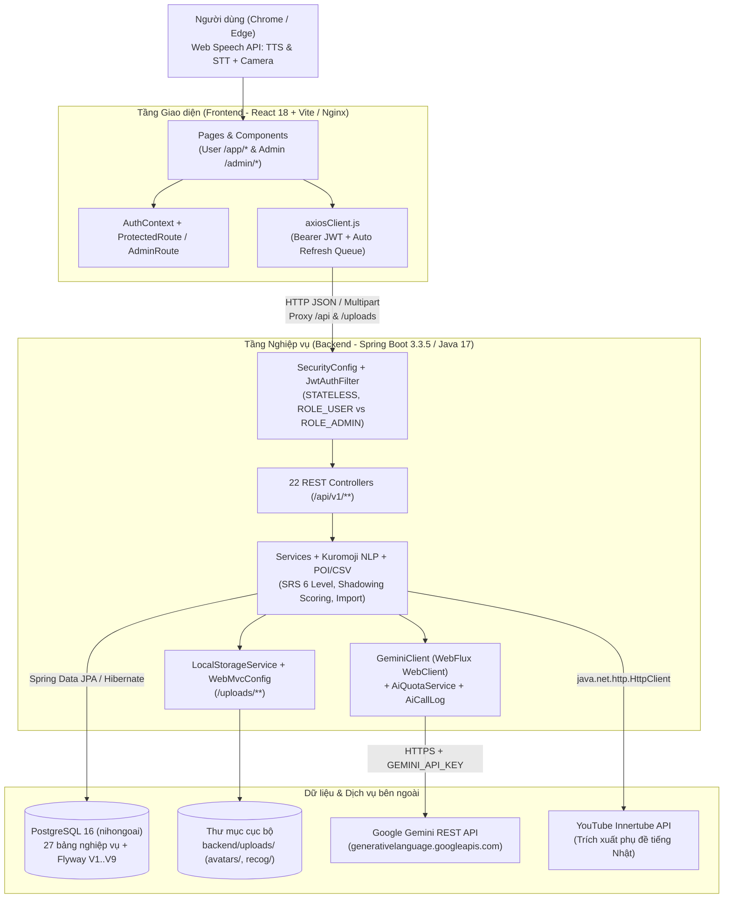
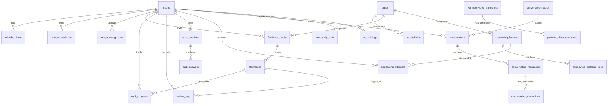

# PQ Nihongo — Hệ thống Học Tiếng Nhật Tích Hợp AI

> **Tài liệu kỹ thuật chính thức của dự án PQ Nihongo** — được biên soạn và đối chiếu trực tiếp từ mã nguồn thực tế (`frontend/`, `backend/`, `backend/src/main/resources/db/migration/`).
>
> - Muốn **học đọc hiểu toàn bộ source code từ cơ bản đến nâng cao** và tự tin sửa/phát triển code: xem **[Giáo trình học Source Code (`docs/LEARNING_GUIDE.md`)](docs/LEARNING_GUIDE.md)**.
> - Muốn **cài đặt PostgreSQL trên máy mới, khởi tạo migration, sao lưu hoặc di chuyển database**: xem **[Hướng dẫn thiết lập Database (`database-setup/README.md`)](database-setup/README.md)**.

---

## Mục lục

1. [Giới thiệu dự án](#1-giới-thiệu-dự-án)
2. [Công nghệ sử dụng](#2-công-nghệ-sử-dụng)
3. [Kiến trúc tổng thể](#3-kiến-trúc-tổng-thể)
4. [Cấu trúc thư mục](#4-cấu-trúc-thư-mục)
5. [Các chức năng hệ thống](#5-các-chức-năng-hệ-thống)
6. [Cài đặt và chạy dự án](#6-cài-đặt-và-chạy-dự-án)
7. [Cấu hình môi trường](#7-cấu-hình-môi-trường)
8. [API Documentation](#8-api-documentation)
9. [Database tổng quan](#9-database-tổng-quan)
10. [Authentication và bảo mật](#10-authentication-và-bảo-mật)
11. [Kiểm thử và xử lý lỗi](#11-kiểm-thử-và-xử-lý-lỗi)
12. [Backup và khôi phục](#12-backup-và-khôi-phục)

---

## 1. Giới thiệu dự án

**PQ Nihongo** (mã artifact: `vn.vku:nihongoai`) là ứng dụng web học tiếng Nhật theo chuẩn JLPT từ **N5 đến N1**, kết hợp quản lý từ vựng, ôn tập ghi nhớ dài hạn và thực hành nghe – nói có hỗ trợ trí tuệ nhân tạo (**Google Gemini API**).

### Vấn đề hệ thống giải quyết
- Người học tiếng Nhật thường học rời rạc nhiều công cụ: một ứng dụng lưu từ, một ứng dụng lật thẻ Flashcard, một nguồn xem YouTube không có phiên âm/dịch theo từng câu và thiếu môi trường luyện nói phản xạ 1-1.
- PQ Nihongo hợp nhất toàn bộ quy trình học tập trên một nền tảng duy nhất với cơ sở dữ liệu quan hệ PostgreSQL tập trung và cơ chế phân quyền tách biệt giữa **Học viên** và **Quản trị viên**.

### Đối tượng sử dụng
| Vai trò | Mã quyền (`users.role`) | Không gian giao diện | Phạm vi chức năng |
| :--- | :--- | :--- | :--- |
| **Học viên** | `USER` | `/app/*` | Học tập: Dashboard, Nhận diện ảnh AI, Sổ từ vựng, Bộ thẻ Flashcard, Import Excel/CSV, Ôn tập SRS 6 cấp độ, Quiz, Shadowing (3 chế độ), Hội thoại AI 1-1, Hồ sơ cá nhân. |
| **Quản trị viên** | `ADMIN` | `/admin/*` | Quản trị hệ thống: Thống kê tổng quan, Quản lý người dùng, Chủ đề, Bộ thẻ mẫu, Bài Shadowing, Chủ đề hội thoại AI, Nhật ký gọi AI, Cấu hình hệ thống và Audit Log. |

### Điểm nổi bật thực tế trong mã nguồn
- **Phân quyền tách biệt nghiêm ngặt**: `SecurityConfig.java` cô lập hoàn toàn API `/api/v1/admin/**` (`ROLE_ADMIN`) khỏi API học tập `/api/v1/vocab/**`, `/api/v1/decks/**`, `/api/v1/srs/**`, `/api/v1/shadowing/**`, `/api/v1/conversations/**`... (`ROLE_USER`).
- **SRS 6 cấp độ rõ ràng (Level 0 → Level 5)**: Cho phép chọn trực tiếp mức độ ghi nhớ, bảo toàn thẻ đã thuộc vĩnh viễn (`Level 5`), hỗ trợ chế độ học lại bộ thẻ (`SET_RELEARN`) và lưu lịch sử ôn tập bất biến trong `review_logs`.
- **Phân tích tiếng Nhật ngoại tuyến bằng Kuromoji IPADIC**: Tự động tách từ, sinh Hiragana/Furigana và chấm điểm phát âm Shadowing theo thuật toán khoảng cách chỉnh sửa Levenshtein ở cấp độ hình vị (token).
- **Cache phụ đề & bản dịch YouTube trong PostgreSQL**: Video YouTube đã trích xuất và dịch ngữ cảnh tiếng Việt theo lô 45 câu được lưu tại `youtube_video_transcripts` và `youtube_video_sentences`, tránh gọi lại API không cần thiết.

---

## 2. Công nghệ sử dụng

Toàn bộ tên công nghệ và phiên bản dưới đây được trích xuất trực tiếp từ [`frontend/package.json`](frontend/package.json), [`backend/pom.xml`](backend/pom.xml), [`backend/Dockerfile`](backend/Dockerfile), [`frontend/Dockerfile`](frontend/Dockerfile) và [`docker-compose.yml`](docker-compose.yml).

### 2.1. Frontend (`frontend/`)

| Công nghệ | Phiên bản thực tế | Dùng để làm gì | Nằm ở đâu | Tương tác với |
| :--- | :--- | :--- | :--- | :--- |
| **React** & **React DOM** | `18.3.1` | Xây dựng giao diện người dùng dạng Single Page Application (SPA) theo mô hình component. | `frontend/src/` | Trình duyệt, React Router, Axios |
| **JavaScript (JSX / ES Modules)** | ES2020+ (`"type": "module"`) | Ngôn ngữ lập trình chính của toàn bộ giao diện (không dùng TypeScript). | `frontend/src/**/*.jsx`, `*.js` | Vite bundler |
| **Vite** & `@vitejs/plugin-react` | `5.2.11` / `4.3.0` | Máy chủ phát triển (cổng `3000`), proxy `/api` & `/uploads` sang Backend `8080`, và đóng gói production (`dist/`). | `frontend/vite.config.js` | Node.js, Backend HTTP `8080` |
| **React Router DOM** | `6.23.1` | Điều hướng client-side và bảo vệ tuyến đường theo vai trò (`ProtectedRoute`, `AdminRoute`). | `frontend/src/App.jsx`, `frontend/src/auth/` | `AuthContext`, các trang `pages/` |
| **Axios** | `1.7.2` | Gửi HTTP Request REST API, tự động gắn JWT Bearer Token và tự động xoay vòng Refresh Token khi gặp `401`. | `frontend/src/api/axiosClient.js` | Tất cả trang & Backend `/api/v1/**` |
| **Bootstrap** & **Bootstrap Icons** | `5.3.3` / `1.11.3` | Hệ thống grid responsive, form, modal, dropdown và stylesheet cơ sở. | `frontend/src/main.jsx`, `frontend/src/index.css` | Toàn bộ component JSX |
| **Lucide React** | `0.379.0` | Bộ biểu tượng SVG sắc nét dùng xuyên suốt giao diện học tập và quản trị. | `frontend/src/components/`, `frontend/src/pages/` | Các trang React |
| **Recharts** | `2.12.7` | Vẽ biểu đồ cột tiến độ học tập 7 / 30 / 90 ngày trên Dashboard. | `frontend/src/pages/user/Dashboard.jsx` | API `GET /api/v1/progress/chart` |
| **TanStack React Query** | `5.39.0` | Đã khởi tạo `QueryClientProvider` ở cấp root (`main.jsx`); hiện tại các trang đang gọi trực tiếp `axiosClient` kết hợp `useState`/`useEffect`. | `frontend/src/main.jsx` | Cây component React |
| **Web Speech API (Trình duyệt)** | Chuẩn trình duyệt (Chrome/Edge) | Đọc tiếng Nhật (`SpeechSynthesis` trong `utils/tts.js`) và nhận diện giọng nói tiếng Nhật `ja-JP` (`SpeechRecognition`) cho Shadowing và Hội thoại AI. | `frontend/src/utils/tts.js`, `ShadowingList.jsx`, `ShadowingPractice.jsx`, `ConversationRoom.jsx` | Loa & Micro thiết bị người dùng |

### 2.2. Backend (`backend/`)

| Công nghệ | Phiên bản thực tế | Dùng để làm gì | Nằm ở đâu | Tương tác với |
| :--- | :--- | :--- | :--- | :--- |
| **Java** | `17` (target/source trong `pom.xml`, Docker `eclipse-temurin:17`) | Ngôn ngữ lập trình Backend (chạy tương thích trên JDK 17–23). | `backend/pom.xml`, `backend/src/main/java/` | Maven, JVM |
| **Spring Boot** (`spring-boot-starter-parent`) | `3.3.5` | Framework nền tảng: REST API (`web`), bảo mật (`security`), ORM (`data-jpa`), kiểm tra dữ liệu (`validation`), HTTP client bất đồng bộ (`webflux`). | `backend/pom.xml`, `NihongoAiApplication.java` | PostgreSQL, Frontend, Gemini API |
| **PostgreSQL** & PostgreSQL JDBC | PostgreSQL `16` (`postgres:16-alpine`) | Hệ quản trị cơ sở dữ liệu quan hệ lưu toàn bộ 27 bảng nghiệp vụ. | `application.yml`, `docker-compose.yml` | Spring Data JPA / Hibernate, Flyway |
| **Flyway** (`flyway-core`, `flyway-database-postgresql`) | Quản lý bởi Spring Boot `3.3.5` | Quản lý phiên bản schema database tự động bằng 9 file SQL (`V1` → `V9`). | `backend/src/main/resources/db/migration/` | PostgreSQL bảng `flyway_schema_history` |
| **H2 Database** | Scope `runtime` (Spring Boot `3.3.5`) | Profile chạy thử in-memory không cần PostgreSQL (`SPRING_PROFILES_ACTIVE=h2`). | `backend/src/main/resources/application-h2.yml` | Spring Data JPA (khi kích hoạt profile `h2`) |
| **JJWT** (`jjwt-api`, `jjwt-impl`, `jjwt-jackson`) | `0.12.6` | Ký và xác thực JWT Access Token bằng thuật toán HMAC-SHA (`Keys.hmacShaKeyFor`). | `security/JwtService.java`, `security/JwtAuthFilter.java` | `AuthService`, `SecurityConfig` |
| **Springdoc OpenAPI (Swagger UI)** | `2.6.0` | Tự động sinh tài liệu OpenAPI `/v3/api-docs` và giao diện kiểm thử `/swagger-ui.html`. | `config/OpenApiConfig.java`, `application.yml` | Toàn bộ 22 `@RestController` |
| **Kuromoji IPADIC** (`com.atilika.kuromoji`) | `0.9.0` | Phân tích hình thái tiếng Nhật, sinh Furigana/Hiragana và tách token chấm điểm Shadowing. | `furigana/FuriganaService.java`, `shadowing/ShadowingScoringService.java` | `ShadowingService`, `YouTubeTranscriptService`, `FuriganaController` |
| **Apache POI (`poi-ooxml`)** & **Commons CSV** | `5.2.5` / `1.10.0` | Đọc/sinh file mẫu Excel `.xlsx` và `.csv` cho tính năng Import Flashcard & Hội thoại Shadowing. | `imports/ExcelParser.java`, `imports/CsvParser.java`, `imports/ImportService.java` | `TemplateController`, `AdminDeckController`, `AdminShadowingController` |
| **Lombok** | Quản lý bởi Spring Boot `3.3.5` | Giảm mã lặp (`@Data`, `@Builder`, `@RequiredArgsConstructor`, `@Slf4j`). | Toàn bộ Entity, DTO, Service, Controller | `maven-compiler-plugin` |
| **Google Gemini REST API** | Model mặc định `gemini-3-flash-preview` (fallback `gemini-2.5-flash`, `gemini-3.1-flash-lite`) | Nhận diện đồ vật từ ảnh (Vision), hội thoại Gia sư 1-1, sửa lỗi ngữ pháp, dịch ngữ cảnh câu tiếng Nhật và chép lời video YouTube (phương án dự phòng). | `ai/GeminiClient.java`, `ai/PromptTemplates.java`, `config/WebClientConfig.java` | `RecognitionService`, `ConversationService`, `ShadowingService`, `YouTubeTranscriptService` |
| **Docker Compose** & **Nginx** | `docker-compose` v3.8, `nginx:alpine`, `maven:3.9.6`, `node:20-alpine` | Đóng gói và triển khai đồng bộ 3 container (`postgres`, `backend`, `frontend`). | `docker-compose.yml`, `backend/Dockerfile`, `frontend/Dockerfile`, `frontend/nginx.conf` | Môi trường triển khai |

---

## 3. Kiến trúc tổng thể

Hệ thống sử dụng kiến trúc **Client – Server 3 tầng tách biệt**, giao tiếp hoàn toàn qua REST API JSON có xác thực JWT:



### Vai trò từng thành phần và luồng đi của dữ liệu
1. **Frontend (`frontend/`)**:
   - Chịu trách nhiệm hiển thị giao diện, quản lý phiên đăng nhập phía client (`AuthContext.jsx`), lưu `access_token` / `refresh_token` trong `localStorage`, phát âm tiếng Nhật (`utils/tts.js`), ghi âm giọng nói bằng Web Speech API và chụp ảnh bằng WebRTC Camera (`Recognize.jsx`).
   - Trong môi trường phát triển, `vite.config.js` tự động proxy mọi request `/api/**` và `/uploads/**` sang `http://localhost:8080`. Khi triển khai Docker, `frontend/nginx.conf` thực hiện vai trò reverse proxy tương tự sang container `backend:8080`.
2. **Backend (`backend/`)**:
   - Tiếp nhận request qua chuỗi filter bảo mật (`CorsConfig` → `JwtAuthFilter` → `SecurityConfig`), định tuyến vào 22 Controller.
   - Tách rõ tầng **Controller** (nhận/validate input, bọc phản hồi `ApiResponse<T>`) → **Service** (nghiệp vụ, `@Transactional`) → **Repository** (truy vấn JPA/JPQL) → **Entity** (ánh xạ bảng PostgreSQL).
   - Mọi ngoại lệ tập trung xử lý tại `GlobalExceptionHandler.java` để trả về JSON lỗi đồng nhất (`status`, `code`, `message`, `details`).
3. **PostgreSQL (`nihongoai`)**:
   - Lưu trữ bền vững toàn bộ dữ liệu tài khoản, từ vựng, bộ thẻ, tiến độ SRS (`card_progress`), lịch sử ôn tập (`review_logs`), bài học & lịch sử Shadowing, cache phụ đề YouTube, hội thoại AI, thống kê hàng ngày (`user_daily_stats`) và nhật ký quản trị (`ai_call_logs`, `audit_logs`).
   - Schema được kiểm soát bằng **Flyway** (`V1` đến `V9`) kết hợp `spring.jpa.hibernate.ddl-auto=validate`.
4. **Tích hợp AI (`GeminiClient.java`)**:
   - Frontend **không bao giờ** gọi trực tiếp Google Gemini hay chứa `GEMINI_API_KEY`. Mọi tác vụ AI đi qua Backend → kiểm tra hạn mức ngày (`AiQuotaService`) → đóng gói prompt chuẩn hóa JSON (`PromptTemplates`) → gọi Gemini qua `WebClient` → ghi log vào `ai_call_logs` → parse JSON an toàn trả về Frontend.
5. **Lưu trữ tệp (`LocalStorageService.java`)**:
   - Ảnh đại diện (`avatars/`) và ảnh nhận diện từ vựng (`recog/`) được lưu vào thư mục cấu hình bởi `APP_STORAGE_LOCAL_DIR` (mặc định `./uploads`, khi chạy từ `backend/` là `backend/uploads/`) và phục vụ công khai qua đường dẫn `/uploads/**` (`WebMvcConfig.java`).

---

## 4. Cấu trúc thư mục

Cây thư mục thực tế sau khi đã dọn dẹp (ẩn các thư mục tự sinh `node_modules/`, `dist/`, `target/` và thư mục Maven đóng gói `.mvn/maven/`):

```text
PQ-Nihongo/
├── .env.example                     # Mẫu cấu hình biến môi trường (đã làm sạch placeholder)
├── .gitignore                       # Quy tắc loại trừ file nhạy cảm, build, IDE, uploads
├── README.md                        # Tài liệu tổng quan dự án (file này)
├── docker-compose.yml               # Khởi chạy trọn bộ PostgreSQL + Backend + Frontend bằng Docker
├── run-backend.bat                  # Script khởi động nhanh Backend trên Windows
├── run-frontend.bat                 # Script khởi động nhanh Frontend trên Windows
├── start-app.bat                    # Script khởi động đồng thời cả Backend + Frontend trên Windows
├── database-setup/
│   └── README.md                    # Hướng dẫn cài đặt, migration, backup & restore PostgreSQL
├── docs/
│   └── LEARNING_GUIDE.md            # Giáo trình học đọc hiểu & tự làm chủ source code (10 chương)
├── uploads/                         # Thư mục uploads tại root (trống; runtime lưu ở backend/uploads/)
├── backend/
│   ├── Dockerfile                   # Multi-stage build Maven + JRE 17
│   ├── .env.example                 # Mẫu biến môi trường riêng cho backend (placeholder an toàn)
│   ├── mvnw / mvnw.cmd              # Maven Wrapper (mvnw.cmd dùng Maven tích hợp tại .mvn/maven)
│   ├── pom.xml                      # Khai báo dependency và build plugins (Spring Boot 3.3.5)
│   ├── uploads/                     # Dữ liệu ảnh thực tế (avatars/, recog/) — KHÔNG commit lên Git
│   └── src/
│       ├── main/
│       │   ├── java/vn/vku/nihongoai/
│       │   │   ├── NihongoAiApplication.java   # Điểm khởi chạy Spring Boot
│       │   │   ├── admin/           # 9 Admin Controllers, AuditLog, SystemSetting
│       │   │   ├── ai/              # GeminiClient, PromptTemplates, AiQuotaService, AiCallLog
│       │   │   ├── auth/            # AuthController, AuthService, RefreshToken, PasswordResetToken
│       │   │   ├── common/          # ApiResponse, PageMeta, AppException, ErrorCode, GlobalExceptionHandler, Constants
│       │   │   ├── config/          # SecurityConfig, CorsConfig, WebMvcConfig, WebClientConfig, OpenApiConfig, DataInitializer
│       │   │   ├── conversation/    # Hội thoại AI 1-1 (Controller, Service, Entities, DTOs)
│       │   │   ├── flashcard/       # Deck, Flashcard, SRS 6 Level, Quiz (3 Controllers, 3 Services)
│       │   │   ├── furigana/        # Tách từ & sinh Furigana bằng Kuromoji IPADIC
│       │   │   ├── imports/         # Import Excel/CSV (CsvParser, ExcelParser, ImportService, TemplateController)
│       │   │   ├── progress/        # Dashboard thống kê & biểu đồ tiến độ (UserDailyStat)
│       │   │   ├── recognition/     # Nhận diện từ vựng qua ảnh (Gemini Vision)
│       │   │   ├── security/        # JwtService, JwtAuthFilter, UserDetailsImpl, CustomUserDetailsService
│       │   │   ├── shadowing/       # Shadowing 3 chế độ, chấm điểm Levenshtein, YouTubeTranscriptService
│       │   │   ├── storage/         # StorageService & LocalStorageService (lưu file cục bộ)
│       │   │   ├── user/            # Hồ sơ người dùng, đổi mật khẩu, avatar, tốc độ TTS
│       │   │   └── vocab/           # Sổ từ vựng cá nhân, từ vựng hệ thống, chủ đề (Topics)
│       │   └── resources/
│       │       ├── application.yml          # Cấu hình chính (JWT, Upload, Flyway, Gemini, Swagger)
│       │       ├── application-dev.yml      # Profile kết nối PostgreSQL cục bộ
│       │       ├── application-h2.yml       # Profile chạy thử H2 in-memory
│       │       └── db/migration/            # 9 file Flyway SQL (V1__init_schema.sql .. V9__align_srs_level_int_type.sql)
│       └── test/
│           └── java/vn/vku/nihongoai/
│               ├── auth/AuthValidationTest.java
│               ├── flashcard/SrsServiceTest.java
│               └── shadowing/ShadowingScoringServiceTest.java
└── frontend/
    ├── Dockerfile                   # Multi-stage build Node 20 + Nginx Alpine
    ├── nginx.conf                   # Cấu hình SPA fallback và proxy /api, /uploads
    ├── .env.example                 # Mẫu biến VITE_API_BASE_URL
    ├── index.html                   # HTML gốc (font Plus Jakarta Sans & Noto Sans JP)
    ├── package.json & package-lock.json
    ├── vite.config.js               # Cấu hình Vite dev server (port 3000) & proxy
    ├── public/logo.png              # Logo ứng dụng
    └── src/
        ├── main.jsx                 # Khởi tạo ReactDOM, Bootstrap, QueryClient, Router, AuthProvider
        ├── App.jsx                  # Khai báo toàn bộ Route (Public, /app/*, /admin/*)
        ├── index.css                # Biến CSS Light/Dark Mode và style toàn cục
        ├── api/axiosClient.js       # Instance Axios + JWT interceptor + Refresh Token queue
        ├── auth/                    # AuthContext.jsx, ProtectedRoute.jsx, AdminRoute.jsx
        ├── components/
        │   ├── common/              # Navbar, Sidebar, AdminSidebar, AudioButton, FuriganaText
        │   └── srs/                 # SrsOverviewModal.jsx (biểu đồ & lọc 6 cấp độ SRS)
        ├── layouts/                 # PublicLayout, UserLayout, AdminLayout
        ├── pages/
        │   ├── public/              # Login, Register, ForgotPassword, ResetPassword
        │   ├── user/                # 14 trang học viên (Dashboard, Recognize, MyVocab, Decks, DeckDetail, ImportDeck, StudySrs, Quiz, ShadowingList, ShadowingPractice, ShadowingHistory, ConversationRoom, ConversationHistory, Profile)
        │   └── admin/               # 9 trang quản trị (AdminDashboard, Users, Topics, Decks, ShadowingLessons, ConversationTopics, AiLogs, Settings, AuditLogs)
        └── utils/tts.js             # Bộ đọc tiếng Nhật dùng chung (Web Speech Synthesis + Audio URL)
```

### Bản đồ tìm file nhanh khi cần sửa chức năng

| Muốn sửa chức năng | Tìm ở Frontend | Tìm ở Backend | Bảng PostgreSQL liên quan |
| :--- | :--- | :--- | :--- |
| Đăng nhập / Đăng ký / Phân quyền | `src/auth/`, `src/pages/public/`, `src/api/axiosClient.js` | `auth/`, `security/`, `config/SecurityConfig.java` | `users`, `refresh_tokens`, `password_reset_tokens` |
| Hồ sơ, Avatar, tốc độ đọc | `src/pages/user/Profile.jsx`, `src/utils/tts.js` | `user/`, `storage/LocalStorageService.java`, `config/WebMvcConfig.java` | `users` |
| Sổ từ vựng cá nhân | `src/pages/user/MyVocab.jsx` | `vocab/VocabController.java`, `UserVocabularyService.java` | `user_vocabularies`, `vocabularies`, `topics` |
| Bộ thẻ Flashcard & Import | `Decks.jsx`, `DeckDetail.jsx`, `ImportDeck.jsx` | `flashcard/DeckController.java`, `DeckService.java`, `imports/` | `flashcard_decks`, `flashcards`, `import_jobs` |
| Ôn tập SRS 6 cấp độ | `StudySrs.jsx`, `SrsOverviewModal.jsx` | `flashcard/SrsController.java`, `SrsService.java` | `card_progress`, `review_logs` |
| Kiểm tra Quiz | `src/pages/user/Quiz.jsx` | `flashcard/QuizController.java`, `QuizService.java` | `quiz_sessions`, `quiz_answers` |
| Shadowing (3 chế độ) | `ShadowingList.jsx`, `ShadowingPractice.jsx`, `ShadowingHistory.jsx` | `shadowing/` (`ShadowingService`, `ShadowingScoringService`, `YouTubeTranscriptService`) | `shadowing_lessons`, `shadowing_dialogue_lines`, `shadowing_attempts`, `youtube_video_transcripts`, `youtube_video_sentences` |
| Hội thoại AI 1-1 | `ConversationRoom.jsx`, `ConversationHistory.jsx` | `conversation/`, `ai/GeminiClient.java`, `ai/PromptTemplates.java` | `conversation_topics`, `conversations`, `conversation_messages`, `conversation_corrections`, `ai_call_logs` |
| Nhận diện ảnh AI | `src/pages/user/Recognize.jsx` | `recognition/`, `ai/GeminiClient.java` | `image_recognitions`, `ai_call_logs` |
| Dashboard tiến độ | `src/pages/user/Dashboard.jsx` | `progress/DashboardController.java`, `ProgressService.java` | `user_daily_stats`, `card_progress`, `user_vocabularies` |
| Quản trị ADMIN | `src/pages/admin/*.jsx`, `AdminSidebar.jsx` | `admin/Admin*Controller.java`, `AuditService.java` | `users`, `topics`, `flashcard_decks`, `shadowing_lessons`, `conversation_topics`, `ai_call_logs`, `system_settings`, `audit_logs` |

---

## 5. Các chức năng hệ thống

Toàn bộ 12 nhóm chức năng dưới đây đều được kiểm chứng tồn tại trực tiếp trong mã nguồn.

### 5.1. Đăng ký, đăng nhập và phân quyền `USER` / `ADMIN`
1. **Mục đích**: Xác thực danh tính người dùng bằng JWT, duy trì phiên làm việc an toàn bằng Refresh Token xoay vòng và tách biệt tuyệt đối quyền học viên (`USER`) với quản trị viên (`ADMIN`).
2. **Người sử dụng**: Khách chưa đăng nhập (Public), Học viên (`USER`), Quản trị viên (`ADMIN`).
3. **Luồng thao tác trên giao diện**: Truy cập `/login` hoặc `/register` (hoặc `/forgot-password`, `/reset-password`) → nhập email/mật khẩu → nếu `role === 'ADMIN'` chuyển tới `/admin`, nếu `role === 'USER'` chuyển tới `/app/dashboard`. Nếu `ADMIN` gõ tay URL `/app/*`, `ProtectedRoute` tự chuyển về `/admin`; nếu `USER` vào `/admin/*`, `AdminRoute` tự chuyển về `/app/dashboard`.
4. **Frontend xử lý ở đâu**: `frontend/src/pages/public/Login.jsx`, `Register.jsx`, `ForgotPassword.jsx`, `ResetPassword.jsx`, `frontend/src/auth/AuthContext.jsx`, `ProtectedRoute.jsx`, `AdminRoute.jsx`, `frontend/src/api/axiosClient.js`.
5. **API được gọi**: `POST /api/v1/auth/register`, `POST /api/v1/auth/login`, `POST /api/v1/auth/refresh`, `POST /api/v1/auth/logout`, `POST /api/v1/auth/forgot-password`, `POST /api/v1/auth/reset-password`, `GET /api/v1/users/me`.
6. **Backend xử lý ở đâu**: `auth/AuthController.java`, `auth/AuthService.java`, `security/JwtService.java`, `security/JwtAuthFilter.java`, `config/SecurityConfig.java`.
7. **Database liên quan**: `users`, `refresh_tokens`, `password_reset_tokens`.
8. **Kết quả trả về**: `ApiResponse<AuthResponse>` gồm `accessToken`, `refreshToken` và `user` (`UserProfileResponse`). Nếu truy cập sai quyền, trả về HTTP `403 Forbidden`.

### 5.2. Quản lý tài khoản, hồ sơ cá nhân & Upload Avatar
1. **Mục đích**: Cho phép người dùng cập nhật họ tên, mục tiêu JLPT (`N5`–`N1`), số thẻ mục tiêu/ngày, tốc độ giọng đọc tiếng Nhật toàn cục (`0.75x`–`1.5x`), đổi mật khẩu và tải ảnh đại diện trực tiếp từ máy tính.
2. **Người sử dụng**: `USER` (và các API `/api/v1/users/**` cho phép cả `USER`, `ADMIN`).
3. **Luồng thao tác trên giao diện**: Vào `/app/profile` → chọn ảnh đại diện (`.jpg`, `.png`, `.webp` ≤5MB) xem trước tức thì và upload; chỉnh họ tên, JLPT, mục tiêu ngày, tốc độ đọc TTS; hoặc điền mật khẩu cũ/mới để đổi mật khẩu. Ngoài ra có thể đổi nhanh tốc độ đọc ngay trên `Navbar.jsx`.
4. **Frontend xử lý ở đâu**: `frontend/src/pages/user/Profile.jsx`, `frontend/src/components/common/Navbar.jsx`, `frontend/src/auth/AuthContext.jsx`, `frontend/src/utils/tts.js`.
5. **API được gọi**: `GET /api/v1/users/me`, `PUT /api/v1/users/me`, `POST /api/v1/users/me/avatar`, `PATCH /api/v1/users/me/tts-speed`, `POST /api/v1/users/me/change-password` (alias `PUT /api/v1/users/me/password`).
6. **Backend xử lý ở đâu**: `user/UserController.java`, `user/UserService.java`, `storage/LocalStorageService.java`, `config/WebMvcConfig.java`.
7. **Database liên quan**: `users` (các cột `full_name`, `avatar_url`, `jlpt_level`, `daily_goal_cards`, `tts_speed`, `password_hash`) và thư mục `backend/uploads/avatars/`.
8. **Kết quả trả về**: `ApiResponse<UserProfileResponse>` với `avatarUrl` dạng `/uploads/avatars/<tên_file>` và cập nhật tức thì vào `AuthContext`.

### 5.3. Quản lý sổ từ vựng cá nhân
1. **Mục đích**: Lưu trữ, tìm kiếm, chỉnh sửa kho từ vựng tiếng Nhật cá nhân (từ nhập tay, nhận diện ảnh AI, hội thoại AI hoặc từ hệ thống) và đẩy hàng loạt vào bộ thẻ ôn tập SRS.
2. **Người sử dụng**: Học viên (`USER`).
3. **Luồng thao tác trên giao diện**: Vào `/app/my-vocab` → tìm kiếm tức thì ở Frontend theo Kanji, Hiragana, nghĩa tiếng Việt; lọc theo nguồn (`MANUAL`, `AI_IMAGE`, `AI_RECOGNITION`, `SYSTEM`, `IMPORT`, `CONVERSATION`); thêm/sửa/xóa từ; nghe phát âm qua `AudioButton`; tích chọn từng từ hoặc **Chọn tất cả** → bấm đưa vào bộ thẻ SRS.
4. **Frontend xử lý ở đâu**: `frontend/src/pages/user/MyVocab.jsx`.
5. **API được gọi**: `GET /api/v1/vocab/my`, `POST /api/v1/vocab/my`, `POST /api/v1/vocab/my/bulk`, `POST /api/v1/vocab/my/add-to-srs`, `PUT /api/v1/vocab/my/{id}`, `DELETE /api/v1/vocab/my/{id}`.
6. **Backend xử lý ở đâu**: `vocab/VocabController.java`, `vocab/UserVocabularyService.java`, `vocab/UserVocabularyRepository.java`.
7. **Database liên quan**: `user_vocabularies`, `flashcard_decks`, `flashcards`, `card_progress`, `user_daily_stats`.
8. **Kết quả trả về**: Danh sách `UserVocabularyDto` kèm phân trang `PageMeta`, hoặc báo cáo số từ mới thêm vào SRS (`addedCount`, `existingCount`).

### 5.4. Bộ thẻ Flashcards, Import Excel/CSV và Kiểm tra Quiz
1. **Mục đích**: Tổ chức từ vựng thành các bộ thẻ cá nhân hoặc sao chép (clone) từ bộ thẻ mẫu của hệ thống; hỗ trợ nhập hàng loạt từ vựng qua file `.xlsx`/`.csv` (có bước xem trước kiểm lỗi) và kiểm tra trí nhớ bằng Quiz 3 chế độ.
2. **Người sử dụng**: Học viên (`USER`).
3. **Luồng thao tác trên giao diện**:
   - `/app/decks`: Xem tab **Bộ thẻ của tôi** & **Bộ thẻ mẫu hệ thống**, tạo/sửa/xóa bộ thẻ, bấm **Sao chép** bộ thẻ mẫu.
   - `/app/decks/:id`: Xem, thêm/sửa/xóa thẻ, thêm từ từ Sổ từ vựng cá nhân.
   - `/app/decks/:id/import`: Tải file mẫu CSV/XLSX (7 cột chuẩn) → tải file lên xem trước & kiểm lỗi → chọn chiến lược xử lý trùng (`SKIP` / `UPDATE`) → xác nhận commit.
   - `/app/decks/:id/quiz`: Làm bài kiểm tra (yêu cầu bộ thẻ có tối thiểu 3 thẻ) với 3 chế độ `MULTIPLE_CHOICE`, `FILL_IN`, `LISTENING`.
4. **Frontend xử lý ở đâu**: `Decks.jsx`, `DeckDetail.jsx`, `ImportDeck.jsx`, `Quiz.jsx`.
5. **API được gọi**: `/api/v1/decks/**`, `/api/v1/decks/{id}/clone`, `/api/v1/decks/{id}/cards/**`, `/api/v1/decks/{id}/import/template`, `/api/v1/decks/{id}/import/preview`, `/api/v1/decks/{id}/import/commit`, `/api/v1/decks/{deckId}/quiz/start`, `/api/v1/quiz/{sessionId}/answer`, `/api/v1/quiz/{sessionId}/finish`.
6. **Backend xử lý ở đâu**: `flashcard/DeckController.java`, `DeckService.java`, `QuizController.java`, `QuizService.java`, `imports/TemplateController.java`, `ImportService.java`, `CsvParser.java`, `ExcelParser.java`.
7. **Database liên quan**: `flashcard_decks`, `flashcards`, `import_jobs`, `quiz_sessions`, `quiz_answers`, `card_progress`, `user_daily_stats`.
8. **Kết quả trả về**: `DeckDto`, `FlashcardDto`, `ImportPreviewResponse` (kèm danh sách dòng hợp lệ & lỗi), `ImportJob`, `QuizSessionResultDto`.

### 5.5. Ôn tập ngắt quãng SRS 6 cấp độ (Level 0 → Level 5)
1. **Mục đích**: Lên lịch ôn tập khoa học theo 6 cấp độ rõ ràng (`Level 0` Từ mới → `Level 1` 4 giờ → `Level 2` 3 ngày → `Level 3` 7 ngày → `Level 4` 14 ngày → `Level 5` Đã thuộc vĩnh viễn) và ghi nhận lịch sử ôn tập bất biến.
2. **Người sử dụng**: Học viên (`USER`).
3. **Luồng thao tác trên giao diện**:
   - Mở modal **Tổng quan SRS** (`SrsOverviewModal.jsx` từ Dashboard, Decks hoặc StudySrs): xem phân bố thẻ theo Level 0–5, lọc theo bộ thẻ/cấp độ, đổi cấp độ thủ công hoặc chọn bắt đầu ôn.
   - Vào `/app/decks/:id/study` (hoặc `/app/decks/all/study` cho toàn bộ thẻ, thêm `?mode=relearn` để học lại cả bộ kể cả thẻ Level 5): lật thẻ xem Furigana, Hán Việt, ví dụ, nghe phát âm → chọn trực tiếp nút **Level 1** đến **Level 5** → chuyển sang thẻ tiếp theo; chuyển sang tab **Lịch sử ôn tập** để tra cứu lịch sử.
4. **Frontend xử lý ở đâu**: `frontend/src/pages/user/StudySrs.jsx`, `frontend/src/components/srs/SrsOverviewModal.jsx`.
5. **API được gọi**: `GET /api/v1/srs/stats`, `GET /api/v1/srs/overview`, `GET /api/v1/srs/due`, `GET /api/v1/srs/decks/{deckId}/relearn`, `POST /api/v1/srs/review`, `PATCH /api/v1/srs/cards/{flashcardId}/level`, `GET /api/v1/srs/history`.
6. **Backend xử lý ở đâu**: `flashcard/SrsController.java`, `flashcard/SrsService.java`, `CardProgressRepository.java`, `ReviewLogRepository.java`.
7. **Database liên quan**: `card_progress`, `review_logs`, `flashcards`, `flashcard_decks`, `user_daily_stats`.
8. **Kết quả trả về**: `SrsStatsDto` (đồng bộ 100% giữa Dashboard, Decks và StudySrs), `SrsOverviewDto`, `List<SrsDueCardDto>`, `List<ReviewLogDto>`.

### 5.6. Shadowing tự nhập (Manual Custom Shadowing)
1. **Mục đích**: Cho phép người học tự dán bất kỳ một hoặc nhiều câu tiếng Nhật để tách câu, xem Hiragana, dịch đầy đủ sang tiếng Việt, nghe đọc mẫu liên tiếp và luyện nói chấm điểm từng từ.
2. **Người sử dụng**: Học viên (`USER`).
3. **Luồng thao tác trên giao diện**: Vào `/app/shadowing` → chọn tab **Tự nhập câu** → nhập một hoặc nhiều câu tiếng Nhật → bấm dịch để nhận từng câu kèm Hiragana & nghĩa tiếng Việt → nghe đọc cả đoạn hoặc từng câu với tốc độ tùy chỉnh → bấm Micro đọc theo → tự động chấm điểm `%` chính xác và tô màu từng từ (`CORRECT`, `WRONG`, `MISSING`, `EXTRA`).
4. **Frontend xử lý ở đâu**: `frontend/src/pages/user/ShadowingList.jsx` (tab `custom`), `frontend/src/utils/tts.js`.
5. **API được gọi**: `POST /api/v1/shadowing/custom/translate`, `POST /api/v1/shadowing/custom-score`.
6. **Backend xử lý ở đâu**: `shadowing/ShadowingController.java`, `ShadowingService.java`, `ShadowingScoringService.java`, `furigana/FuriganaService.java`, `ai/GeminiClient.java`.
7. **Database liên quan**: `ai_call_logs`, `user_daily_stats`.
8. **Kết quả trả về**: Danh sách câu đã tách (`order`, `japanese`, `hiragana`, `vietnamese`) và `ShadowingAttemptDto` chứa `accuracy` + mảng `wordDiff`.

### 5.7. Shadowing từ YouTube Video
1. **Mục đích**: Luyện nghe và nói đuổi theo video tiếng Nhật thực tế trên YouTube có phụ đề đồng bộ mốc thời gian (`startTime` – `endTime`), Hiragana và bản dịch tiếng Việt theo ngữ cảnh.
2. **Người sử dụng**: Học viên (`USER`).
3. **Luồng thao tác trên giao diện**: Vào `/app/shadowing` → chọn tab **YouTube Video** → dán URL hoặc Video ID YouTube → hệ thống kiểm tra cache PostgreSQL hoặc trích xuất phụ đề qua YouTube Innertube API (phương án 1 phụ đề thủ công, phương án 2 phụ đề tự động ASR, phương án 3 Gemini Multimodal STT, hoặc fallback tải file `.srt`/`.vtt`) → phát video qua YouTube IFrame Player API đồng bộ từng câu, hỗ trợ lặp câu, chỉnh tốc độ, ẩn/hiện bản dịch, dịch tiếp lô 45 câu chạy nền, dịch lại 1 câu, và ghi âm chấm điểm từng câu.
4. **Frontend xử lý ở đâu**: `frontend/src/pages/user/ShadowingList.jsx` (tab `youtube`).
5. **API được gọi**: `GET /api/v1/shadowing/youtube/captions`, `POST /api/v1/shadowing/youtube/{videoId}/translate-batch`, `POST /api/v1/shadowing/youtube/{videoId}/sentences/{sentenceId}/retranslate`, `POST /api/v1/shadowing/youtube/parse-subtitles`, `POST /api/v1/shadowing/custom-score`.
6. **Backend xử lý ở đâu**: `shadowing/ShadowingController.java`, `ShadowingService.java`, `YouTubeTranscriptService.java`, `ShadowingScoringService.java`, `ai/GeminiClient.java`.
7. **Database liên quan**: `youtube_video_transcripts`, `youtube_video_sentences`, `ai_call_logs`.
8. **Kết quả trả về**: Metadata video + danh sách câu có `sentenceId`, `japaneseText`, `hiraganaText`, `vietnameseTranslation`, `startTime`, `endTime`, trạng thái `fromCache` / `translatedCount` / `pendingCount`.

### 5.8. Shadowing theo chủ đề & Hội thoại A/B
1. **Mục đích**: Luyện nói theo các bài học biên soạn sẵn theo trình độ JLPT (`N5`–`N1`), hỗ trợ cả bài đơn câu lẫn hội thoại 2 nhân vật **A / B** với hai giọng đọc khác nhau.
2. **Người sử dụng**: Học viên (`USER`).
3. **Luồng thao tác trên giao diện**: Vào `/app/shadowing` (tab **Bài luyện mẫu**) → lọc theo JLPT/từ khóa → chọn 1 bài mở `/app/shadowing/practice/:id` → nghe toàn bộ hội thoại A/B hoặc nghe từng lượt → bấm Micro đọc từng câu để server chấm điểm và lưu lịch sử tại `/app/shadowing/history`.
4. **Frontend xử lý ở đâu**: `ShadowingList.jsx`, `ShadowingPractice.jsx`, `ShadowingHistory.jsx`.
5. **API được gọi**: `GET /api/v1/shadowing/lessons`, `GET /api/v1/shadowing/lessons/{id}`, `POST /api/v1/shadowing/lessons/{id}/attempt`, `GET /api/v1/shadowing/attempts`, `GET /api/v1/shadowing/attempts/{id}`.
6. **Backend xử lý ở đâu**: `shadowing/ShadowingController.java`, `ShadowingService.java`, `ShadowingScoringService.java`.
7. **Database liên quan**: `shadowing_lessons`, `shadowing_dialogue_lines`, `shadowing_attempts`, `topics`, `user_daily_stats`.
8. **Kết quả trả về**: `ShadowingLessonDto` (kèm `lines` cho hội thoại A/B và `bestAccuracy`), `ShadowingAttemptDto` (kèm `accuracy`, `wordDiff`).

### 5.9. Hội thoại AI 1-1 (Voice-Only)
1. **Mục đích**: Luyện phản xạ giao tiếp tiếng Nhật 1-1 theo tình huống đóng vai với Gia sư Google Gemini, tự động sửa lỗi ngữ pháp/trợ từ/kính ngữ, gợi ý 2–3 câu trả lời tiếp theo và cho phép lưu từ mới vào sổ từ cá nhân.
2. **Người sử dụng**: Học viên (`USER`).
3. **Luồng thao tác trên giao diện**: Vào `/app/conversation` → lọc chủ đề theo JLPT (`ALL`, `N5`–`N1`) hoặc tạo chủ đề cá nhân (đặt vai AI và vai học viên) → bắt đầu phiên hội thoại → bấm Micro nói tiếng Nhật (hỗ trợ tự động gửi sau khi dừng nói hoặc xem trước) → AI trả lời tiếng Nhật, tự đọc thành tiếng, kèm bản dịch tiếng Việt, hộp sửa lỗi chi tiết (`corrections`), từ mới (`newWords`) và 2–3 câu gợi ý (`suggestedReplies`); kết thúc để xem tóm tắt đánh giá và tra cứu lại tại `/app/conversation/history`. (Backend đồng thời cung cấp endpoint `/ask-tutor` cho hỏi gia sư bằng tiếng Việt.)
4. **Frontend xử lý ở đâu**: `frontend/src/pages/user/ConversationRoom.jsx`, `frontend/src/pages/user/ConversationHistory.jsx`.
5. **API được gọi**: `GET /api/v1/conversations/topics`, `POST /api/v1/conversations/topics/custom`, `DELETE /api/v1/conversations/topics/custom/{id}`, `POST /api/v1/conversations/start`, `POST /api/v1/conversations/{id}/messages`, `PATCH /api/v1/conversations/{id}/settings`, `POST /api/v1/conversations/{id}/end`, `GET /api/v1/conversations`, `GET /api/v1/conversations/{id}`, `DELETE /api/v1/conversations/{id}`, `POST /api/v1/conversations/{id}/messages/{msgId}/save-word`.
6. **Backend xử lý ở đâu**: `conversation/ConversationController.java`, `ConversationService.java`, `ai/GeminiClient.java`, `ai/PromptTemplates.java`, `ai/AiQuotaService.java`.
7. **Database liên quan**: `conversation_topics`, `conversations`, `conversation_messages`, `conversation_corrections`, `user_vocabularies`, `ai_call_logs`, `user_daily_stats`.
8. **Kết quả trả về**: `ConversationDetailDto`, `AiMessageResponse` (gồm `aiMessage`, `corrections`, `suggestedReplies`, `newWords`).

### 5.10. Nhận diện từ vựng qua hình ảnh AI (Gemini Vision)
1. **Mục đích**: Chụp ảnh vật thể xung quanh hoặc tải ảnh từ máy tính để Gemini Vision trích xuất tối đa 5 từ vựng tiếng Nhật kèm Furigana, Romaji, Hán Việt, từ loại, JLPT và câu ví dụ.
2. **Người sử dụng**: Học viên (`USER`).
3. **Luồng thao tác trên giao diện**: Vào `/app/recognize` → mở Camera chụp trực tiếp hoặc chọn file ảnh (`.jpg`/`.png`/`.webp` ≤10MB) → chọn trình độ JLPT và gợi ý chủ đề (tùy chọn) → nhận danh sách từ → chọn từng từ hoặc lưu hàng loạt vào Sổ từ vựng cá nhân; xem lại lịch sử nhận diện và đánh giá đúng/sai.
4. **Frontend xử lý ở đâu**: `frontend/src/pages/user/Recognize.jsx`.
5. **API được gọi**: `POST /api/v1/recognitions/upload`, `GET /api/v1/recognitions`, `PATCH /api/v1/recognitions/{id}/feedback`, `POST /api/v1/vocab/my`, `POST /api/v1/vocab/my/bulk`.
6. **Backend xử lý ở đâu**: `recognition/RecognitionController.java`, `RecognitionService.java`, `storage/LocalStorageService.java`, `ai/GeminiClient.java`, `ai/AiQuotaService.java`.
7. **Database liên quan**: `image_recognitions`, `user_vocabularies`, `ai_call_logs`, `user_daily_stats` và thư mục `backend/uploads/recog/`.
8. **Kết quả trả về**: `RecognitionResponse` gồm `recognitionId`, `imageUrl`, mảng `items` (`RecognizedItemDto`).

### 5.11. Dashboard tiến độ học tập
1. **Mục đích**: Hiển thị bức tranh toàn cảnh về tiến độ học tập thực tế của học viên từ PostgreSQL: mục tiêu thẻ trong ngày, 3 chỉ số SRS đồng bộ (`Tổng thẻ SRS`, `Đã nhớ Level 5`, `Đến hạn hôm nay`), sổ từ vựng, độ chính xác Shadowing trung bình và biểu đồ hoạt động 7/30/90 ngày.
2. **Người sử dụng**: Học viên (`USER`).
3. **Luồng thao tác trên giao diện**: Vào `/app/dashboard` → theo dõi thanh tiến độ mục tiêu ngày, mở nhanh modal Tổng quan SRS, chuyển đổi khung thời gian biểu đồ (`7d` / `30d` / `90d`) và điều hướng nhanh sang từng phân hệ học.
4. **Frontend xử lý ở đâu**: `frontend/src/pages/user/Dashboard.jsx`, `frontend/src/components/srs/SrsOverviewModal.jsx`.
5. **API được gọi**: `GET /api/v1/progress/dashboard`, `GET /api/v1/progress/chart?range=7d|30d|90d`. (Backend cũng có `GET /api/v1/progress/weak-items` để lấy thẻ hay sai, bài shadowing điểm thấp và nhóm lỗi ngữ pháp lặp lại.)
6. **Backend xử lý ở đâu**: `progress/DashboardController.java`, `progress/ProgressService.java`, `flashcard/SrsService.java`.
7. **Database liên quan**: `user_daily_stats`, `card_progress`, `review_logs`, `user_vocabularies`, `shadowing_attempts`, `conversations`, `image_recognitions`, `conversation_corrections`.
8. **Kết quả trả về**: `DashboardProgressDto` và `List<DailyStatChartDto>`.

### 5.12. Hệ thống Quản trị (`ADMIN`)
1. **Mục đích**: Điều hành toàn diện nội dung học tập và giám sát vận hành hệ thống: thống kê tổng thể, quản lý tài khoản, chủ đề (`topics`), bộ thẻ mẫu (`flashcard_decks` + import Excel/CSV + quản lý thẻ + trạng thái `DRAFT`/`PUBLISHED`/`ARCHIVED`), bài Shadowing hội thoại A/B (+ import Excel/CSV), chủ đề hội thoại AI (`system_prompt`), nhật ký gọi Gemini AI (`ai_call_logs`), cấu hình động (`system_settings`) và nhật ký kiểm toán (`audit_logs`).
2. **Người sử dụng**: Quản trị viên (`ADMIN`).
3. **Luồng thao tác trên giao diện**: Truy cập `/admin` và điều hướng qua 9 mục trên `AdminSidebar.jsx` (`/admin`, `/admin/users`, `/admin/topics`, `/admin/decks`, `/admin/shadowing`, `/admin/conversation-topics`, `/admin/ai-logs`, `/admin/settings`, `/admin/audit-logs`).
4. **Frontend xử lý ở đâu**: `frontend/src/pages/admin/*.jsx`, `frontend/src/components/common/AdminSidebar.jsx`, `frontend/src/layouts/AdminLayout.jsx`.
5. **API được gọi**: Nhóm `/api/v1/admin/**` (chi tiết tại Mục 8).
6. **Backend xử lý ở đâu**: 9 Controller trong `backend/src/main/java/vn/vku/nihongoai/admin/` và `AuditService.java`.
7. **Database liên quan**: `users`, `topics`, `flashcard_decks`, `flashcards`, `shadowing_lessons`, `shadowing_dialogue_lines`, `conversation_topics`, `ai_call_logs`, `system_settings`, `audit_logs`, `vocabularies`.
8. **Kết quả trả về**: Dữ liệu thật từ PostgreSQL, mọi thao tác thêm/sửa/xóa của ADMIN đều ghi vết vào `audit_logs`.

> **Lưu ý về tương thích ngược**: Tuyến `/admin/vocab` ở Frontend tự chuyển hướng sang `/admin/topics`, nhưng bảng `vocabularies` và `AdminVocabController` (`/api/v1/admin/vocab`) vẫn được giữ ở tầng Backend/Database để bảo toàn khóa ngoại và dữ liệu cũ.

---

## 6. Cài đặt và chạy dự án

### 6.1. Yêu cầu môi trường
- **Java JDK**: Phiên bản **17 trở lên** (khuyến nghị JDK 17 hoặc JDK 21/23; `pom.xml` biên dịch target Java 17).
- **Node.js & npm**: Node.js **20.x** (đã kiểm thử với Node `v20.18.0`, npm `10.8.2`).
- **PostgreSQL**: Phiên bản **15 hoặc 16** (hoặc sử dụng **Docker Desktop**).
- **Google Gemini API Key**: Đăng ký tại `https://aistudio.google.com/app/apikey` (cần cho các tính năng AI: Nhận diện ảnh, Hội thoại AI, Dịch Shadowing).
- **Trình duyệt**: Google Chrome hoặc Microsoft Edge bản mới nhất (để hỗ trợ tốt Web Speech API tiếng Nhật).

### 6.2. Cách 1 — Chạy trực tiếp trên máy (Local Development)

#### Bước 1: Lấy mã nguồn
```bash
git clone <url-repository-cua-ban>
cd "PQ NihonGo"
```

#### Bước 2: Tạo Database PostgreSQL
Tạo database tên `nihongoai` trên PostgreSQL (xem hướng dẫn chi tiết từng lệnh cho Windows & Ubuntu tại [`database-setup/README.md`](database-setup/README.md)):
```sql
CREATE DATABASE nihongoai ENCODING 'UTF8';
```

#### Bước 3: Cấu hình biến môi trường
Sao chép file mẫu thành file `.env` thực tế ở thư mục gốc và điền thông tin bảo mật của riêng bạn:
```powershell
# Trên Windows PowerShell
Copy-Item .env.example .env
Copy-Item frontend\.env.example frontend\.env
```
```bash
# Trên Linux / macOS
cp .env.example .env
cp frontend/.env.example frontend/.env
```
Mở file `.env` ở thư mục gốc và **bắt buộc thay đổi các giá trị placeholder**:
- `SPRING_DATASOURCE_PASSWORD`: Mật khẩu PostgreSQL của bạn.
- `APP_JWT_SECRET`: Tự sinh chuỗi ngẫu nhiên tối thiểu 32 ký tự (ví dụ: `openssl rand -hex 32`).
- `ADMIN_PASSWORD`: Đặt mật khẩu mạnh cho tài khoản quản trị khởi tạo lần đầu.
- `GEMINI_API_KEY`: Dán khóa API Google Gemini của bạn.

> **Cảnh báo bảo mật**: Không bao giờ dùng lại giá trị mẫu hoặc commit file `.env` lên Git.

#### Bước 4: Cài đặt dependency Frontend
```bash
cd frontend
npm ci
cd ..
```
*(Nếu chưa dùng `npm ci`, có thể dùng `npm install`, nhưng `npm ci` đảm bảo cài đúng phiên bản khóa trong `package-lock.json`.)*

#### Bước 5: Khởi động Backend (tự động tải dependency Maven & chạy Flyway Migration `V1`–`V9`)
Trên Windows (dùng Maven Wrapper tích hợp `mvnw.cmd`):
```powershell
cd backend
.\mvnw.cmd spring-boot:run
```
Hoặc chạy file tiện ích ở thư mục gốc:
```cmd
run-backend.bat
```
*(Trên Linux/macOS cần cài sẵn `mvn` rồi chạy `mvn spring-boot:run` trong thư mục `backend/`, vì file `backend/mvnw` hiện là file rỗng.)*

Khi Backend khởi động lần đầu với profile `dev` (mặc định):
1. Kết nối PostgreSQL theo `SPRING_DATASOURCE_URL`.
2. **Flyway** tự động chạy tuần tự `V1__init_schema.sql` → `V9__align_srs_level_int_type.sql` tạo đủ 27 bảng nghiệp vụ và nạp dữ liệu mẫu.
3. Hibernate kiểm tra khớp schema (`ddl-auto: validate`).
4. `DataInitializer` tạo tài khoản `ADMIN` theo `ADMIN_EMAIL` / `ADMIN_PASSWORD` (nếu chưa tồn tại) và tài khoản học viên mẫu `user@nihongoai.local` (nếu chưa tồn tại).

#### Bước 6: Khởi động Frontend
Mở cửa sổ terminal thứ hai:
```bash
cd frontend
npm run dev
```
Hoặc trên Windows chạy `run-frontend.bat` (hoặc chạy `start-app.bat` để khởi động đồng thời cả Backend và Frontend).

#### Bước 7: Kiểm tra hệ thống hoạt động
- **Ứng dụng Web**: `http://localhost:3000`
- **Backend REST API**: `http://localhost:8080`
- **Swagger UI (Tài liệu API tương tác)**: `http://localhost:8080/swagger-ui.html`
- **OpenAPI JSON**: `http://localhost:8080/v3/api-docs`

### 6.3. Cách 2 — Chạy nhanh bằng Docker Compose
Đảm bảo bạn đã tạo file `.env` ở thư mục gốc với mật khẩu và secret riêng, sau đó chạy:
```bash
docker compose up --build -d
```
- Frontend (Nginx): `http://localhost:3000` (hoặc cổng `FRONTEND_PORT`)
- Backend (Spring Boot): `http://localhost:8080` (hoặc cổng `SERVER_PORT`)
- PostgreSQL 16: `localhost:5432` (volume `pgdata`), ảnh upload lưu bền vững trong volume `uploads_data`.

---

## 7. Cấu hình môi trường

Toàn bộ các biến môi trường dưới đây được xác minh từ `backend/src/main/resources/application.yml`, `application-dev.yml`, `docker-compose.yml`, `.env.example` và `frontend/src/api/axiosClient.js`.

| Tên biến | Mục đích | Thành phần sử dụng | Bắt buộc? | Ví dụ placeholder an toàn |
| :--- | :--- | :--- | :--- | :--- |
| `SERVER_PORT` | Cổng HTTP của Backend Spring Boot | Backend, Docker Compose | Không (mặc định `8080`) | `8080` |
| `FRONTEND_PORT` | Cổng map ra máy chủ cho container Frontend | Docker Compose | Không (mặc định `3000`) | `3000` |
| `SPRING_PROFILES_ACTIVE` | Profile Spring Boot (`dev`: PostgreSQL, `h2`: H2 in-memory) | Backend | Không (mặc định `dev`) | `dev` |
| `SPRING_DATASOURCE_URL` | Chuỗi JDBC kết nối PostgreSQL | Backend | Có (với profile `dev`) | `jdbc:postgresql://localhost:5432/nihongoai` |
| `SPRING_DATASOURCE_USERNAME` | Tài khoản đăng nhập PostgreSQL | Backend, Docker Compose | Có | `postgres` |
| `SPRING_DATASOURCE_PASSWORD` | Mật khẩu PostgreSQL | Backend, Docker Compose | **Có** | `your_postgres_password` |
| `APP_JWT_SECRET` | Khóa bí mật ký JWT Access Token (tối thiểu 256-bit / ≥32 ký tự) | Backend (`JwtService`) | **Có (Production)** | `CHANGE_ME_GENERATE_A_SECURE_RANDOM_SECRET` |
| `ADMIN_EMAIL` | Email tài khoản `ADMIN` khởi tạo lần đầu (`DataInitializer`) | Backend | Không (mặc định `admin@nihongoai.local`) | `admin@nihongoai.local` |
| `ADMIN_PASSWORD` | Mật khẩu khởi tạo lần đầu cho tài khoản `ADMIN` | Backend | **Có (Production)** | `CHANGE_ME_USE_A_STRONG_PASSWORD` |
| `GEMINI_API_KEY` | Khóa API Google Gemini cho Vision, Chat, Dịch Shadowing | Backend (`GeminiClient`) | **Có (cho tính năng AI)** | `YOUR_GEMINI_API_KEY_HERE` |
| `GEMINI_MODEL` | Tên model Gemini mặc định | Backend (`GeminiClient`) | Không (mặc định `gemini-3-flash-preview`) | `gemini-3-flash-preview` |
| `GEMINI_BASE_URL` | Base URL của Google Gemini API | Backend (`WebClientConfig`) | Không (mặc định `https://generativelanguage.googleapis.com`) | `https://generativelanguage.googleapis.com` |
| `APP_STORAGE_LOCAL_DIR` | Thư mục lưu tệp ảnh tải lên (`avatars/`, `recog/`) | Backend (`LocalStorageService`, `WebMvcConfig`) | Không (mặc định `./uploads`) | `./uploads` |
| `APP_JWT_EXPIRATION_MS` / `APP_JWT_REFRESH_EXPIRATION_MS` | Khai báo trong `.env.example` và `docker-compose.yml` *(Lưu ý: `application.yml` hiện cấu hình trực tiếp `app.jwt.access-token-expiration-minutes: 60` và `refresh-token-expiration-days: 7`)* | `.env.example`, Docker Compose | Không | `86400000` / `604800000` |
| `VITE_API_BASE_URL` *(hoặc fallback `VITE_API_URL`)* | Tiền tố URL gọi API từ Frontend | Frontend (`axiosClient.js`) | Không (mặc định `/api/v1`) | `/api/v1` |

> **Cơ chế tự đọc `.env` của Backend**: File `backend/src/main/resources/application.yml` khai báo `spring.config.import: optional:file:.env[.properties],optional:file:../.env[.properties]`, nên Spring Boot tự động nạp file `.env` ở thư mục gốc dự án mà không cần xuất biến môi trường thủ công.

---

## 8. API Documentation

Tất cả REST API đều nằm dưới tiền tố `/api/v1` và trả về định dạng thống nhất:
- **Thành công**: `{ "success": true, "data": ..., "meta": {...}, "message": "...", "timestamp": "..." }` (`ApiResponse.java`).
- **Lỗi**: `{ "success": false, "status": 4xx/5xx, "code": "...", "message": "...", "details": ..., "timestamp": "..." }` (`GlobalExceptionHandler.java`).

Quy ước cột **Authentication**:
- `Public`: Không cần JWT.
- `USER | ADMIN`: Yêu cầu JWT hợp lệ của `USER` hoặc `ADMIN`.
- `USER`: Chỉ `ROLE_USER` (`ADMIN` nhận `403 Forbidden`).
- `ADMIN`: Chỉ `ROLE_ADMIN` (`USER` nhận `403 Forbidden`).

### 8.1. Authentication (`AuthController`)
| Method | Endpoint | Chức năng | Authentication |
| :--- | :--- | :--- | :--- |
| `POST` | `/api/v1/auth/register` | Đăng ký tài khoản học viên mới (`role=USER`) | Public |
| `POST` | `/api/v1/auth/login` | Đăng nhập, nhận `accessToken`, `refreshToken`, `user` | Public |
| `POST` | `/api/v1/auth/refresh` | Xoay vòng Refresh Token, cấp cặp token mới | Public |
| `POST` | `/api/v1/auth/logout` | Đăng xuất và thu hồi toàn bộ Refresh Token của user | Public / Bearer |
| `POST` | `/api/v1/auth/forgot-password` | Tạo mã đặt lại mật khẩu 30 phút (in log dev) | Public |
| `POST` | `/api/v1/auth/reset-password` | Đặt lại mật khẩu mới bằng token xác nhận | Public |

### 8.2. User Profile & Avatar (`UserController`)
| Method | Endpoint | Chức năng | Authentication |
| :--- | :--- | :--- | :--- |
| `GET` | `/api/v1/users/me` | Lấy thông tin hồ sơ người dùng đang đăng nhập | `USER \| ADMIN` |
| `PUT` | `/api/v1/users/me` | Cập nhật họ tên, mục tiêu JLPT, mục tiêu thẻ/ngày, tốc độ TTS | `USER \| ADMIN` |
| `PUT` / `POST` | `/api/v1/users/me/password`, `/api/v1/users/me/change-password` | Đổi mật khẩu (xác minh mật khẩu cũ) | `USER \| ADMIN` |
| `POST` | `/api/v1/users/me/avatar` | Upload ảnh đại diện (`multipart/form-data`, ≤5MB, JPG/PNG/WEBP) | `USER \| ADMIN` |
| `PATCH` | `/api/v1/users/me/tts-speed` | Cập nhật nhanh tốc độ đọc tiếng Nhật (`0.5`–`2.0`) | `USER \| ADMIN` |

### 8.3. Vocabulary & Topics (`VocabController`, `TopicController`)
| Method | Endpoint | Chức năng | Authentication |
| :--- | :--- | :--- | :--- |
| `GET` | `/api/v1/topics` | Lấy danh sách chủ đề đang hoạt động | `USER` |
| `GET` | `/api/v1/vocab/mine` *(alias `/my`)* | Lấy danh sách từ vựng cá nhân (hỗ trợ `q`, `isMastered`, `source`, phân trang) | `USER` |
| `GET` | `/api/v1/vocab/mine/saved-keys` *(alias `/my/saved-keys`)* | Lấy tập từ đã lưu để đồng bộ nút Lưu | `USER` |
| `POST` | `/api/v1/vocab/mine` *(alias `/my`)* | Thêm 1 từ mới vào sổ từ cá nhân | `USER` |
| `POST` | `/api/v1/vocab/mine/bulk` *(alias `/my/bulk`)* | Lưu hàng loạt từ vào sổ cá nhân (chống trùng tự động) | `USER` |
| `POST` | `/api/v1/vocab/mine/add-to-srs` *(alias `/my/add-to-srs`)* | Đưa các từ đã chọn hoặc toàn bộ sổ từ vào bộ thẻ SRS | `USER` |
| `PUT` | `/api/v1/vocab/mine/{id}` *(alias `/my/{id}`)* | Sửa thông tin từ vựng cá nhân | `USER` |
| `PATCH` | `/api/v1/vocab/mine/{id}/mastered` *(alias `/my/{id}/mastered`)* | Đánh dấu đã thuộc / chưa thuộc | `USER` |
| `DELETE` | `/api/v1/vocab/mine/{id}` *(alias `/my/{id}`)* | Xóa từ khỏi sổ từ cá nhân | `USER` |
| `GET` | `/api/v1/vocab`, `/api/v1/vocab/system` | Tra cứu từ vựng hệ thống theo JLPT, `topicId`, `q` | `USER` |
| `POST` | `/api/v1/vocab/system/{id}/save` | Sao chép 1 từ hệ thống sang sổ từ cá nhân | `USER` |

### 8.4. Flashcards, Quiz & Import (`DeckController`, `QuizController`, `TemplateController`)
| Method | Endpoint | Chức năng | Authentication |
| :--- | :--- | :--- | :--- |
| `GET` | `/api/v1/decks` | Lấy danh sách bộ thẻ (`scope=all\|mine\|public`) kèm đếm SRS | `USER` |
| `GET` | `/api/v1/decks/system`, `/api/v1/decks/public` | Lấy danh sách bộ thẻ mẫu công khai của hệ thống | `USER` |
| `POST` | `/api/v1/decks` | Tạo bộ thẻ cá nhân mới | `USER` |
| `GET` | `/api/v1/decks/{id}` | Xem chi tiết bộ thẻ | `USER` |
| `PUT` | `/api/v1/decks/{id}` | Chỉnh sửa bộ thẻ cá nhân | `USER` |
| `DELETE` | `/api/v1/decks/{id}` | Xóa bộ thẻ cá nhân | `USER` |
| `POST` | `/api/v1/decks/{id}/clone` | Sao chép bộ thẻ mẫu thành bộ thẻ cá nhân | `USER` |
| `GET` | `/api/v1/decks/{id}/cards` | Lấy toàn bộ thẻ trong bộ | `USER` |
| `POST` | `/api/v1/decks/{id}/cards` | Thêm 1 thẻ thủ công vào bộ | `USER` |
| `POST` | `/api/v1/decks/{id}/cards/from-vocab` | Thêm thẻ từ danh sách ID sổ từ cá nhân | `USER` |
| `PUT` | `/api/v1/cards/{id}`, `/api/v1/decks/{deckId}/cards/{id}` | Chỉnh sửa nội dung thẻ | `USER` |
| `DELETE` | `/api/v1/cards/{id}`, `/api/v1/decks/{deckId}/cards/{id}` | Xóa thẻ khỏi bộ | `USER` |
| `GET` | `/api/v1/templates/flashcard`, `.csv`, `.xlsx` *(alias `/decks/{id}/import/template`)* | Tải tệp mẫu Import Flashcard (CSV / Excel) | Public |
| `GET` | `/api/v1/templates/dialogue`, `.csv`, `.xlsx` *(alias `/admin/shadowing/import/template`)* | Tải tệp mẫu Import hội thoại Shadowing A/B | Public *(trừ alias `/admin/...` yêu cầu `ADMIN`)* |
| `POST` | `/api/v1/decks/{id}/import/preview` | Upload file Excel/CSV để xem trước & kiểm tra lỗi | `USER` |
| `POST` | `/api/v1/decks/{id}/import/commit` | Xác nhận ghi các dòng hợp lệ vào bộ thẻ (`SKIP` / `UPDATE`) | `USER` |
| `POST` | `/api/v1/quiz/start`, `/api/v1/decks/{deckId}/quiz/start` | Khởi tạo phiên Quiz (`MULTIPLE_CHOICE`, `FILL_IN`, `LISTENING`) | `USER` |
| `POST` | `/api/v1/quiz/{sessionId}/answer` | Nộp câu trả lời từng câu hỏi trong phiên Quiz | `USER` |
| `POST` | `/api/v1/quiz/{sessionId}/finish` | Kết thúc phiên Quiz và tổng kết điểm số | `USER` |

### 8.5. SRS 6 cấp độ (`SrsController`)
| Method | Endpoint | Chức năng | Authentication |
| :--- | :--- | :--- | :--- |
| `GET` | `/api/v1/srs/due` | Lấy danh sách thẻ cần ôn (`deckId`, `limit`, `includeNew`, `filter=NEW\|DUE_AND_NEW`) | `USER` |
| `GET` | `/api/v1/srs/decks/{deckId}/relearn` | Lấy toàn bộ thẻ trong bộ (gồm cả Level 5) cho chế độ Học lại (`SET_RELEARN`) | `USER` |
| `GET` | `/api/v1/srs/overview` | Lấy dữ liệu Tổng quan SRS: phân bố Level 0–5, danh sách deck & thẻ lọc | `USER` |
| `GET` | `/api/v1/srs/stats`, `/api/v1/srs/summary` | Lấy thống kê SRS đồng bộ với Dashboard (`totalSrsCards`, `rememberedCards`, `dueTodayCards`, `level0..5Count`) | `USER` |
| `GET` | `/api/v1/srs/history` | Tra cứu lịch sử ôn tập bất biến (`deckId`, `rating`, `range=today\|7d\|30d`, `q`) | `USER` |
| `POST` | `/api/v1/srs/review` | Gửi đánh giá `targetLevel` (`1..5`), `reviewMode` (`DUE_REVIEW`/`SET_RELEARN`), `durationMs` | `USER` |
| `PATCH` | `/api/v1/srs/cards/{flashcardId}/level` | Đổi trực tiếp `srsLevel` (`0..5`) từ modal Tổng quan SRS (`MANUAL_LEVEL`) | `USER` |

### 8.6. Shadowing & Furigana (`ShadowingController`, `FuriganaController`)
| Method | Endpoint | Chức năng | Authentication |
| :--- | :--- | :--- | :--- |
| `GET` | `/api/v1/shadowing/lessons` | Lấy danh sách bài Shadowing đã xuất bản (`level`, `topicId`, `q`) | `USER` |
| `GET` | `/api/v1/shadowing/lessons/{id}` | Xem chi tiết bài Shadowing kèm toàn bộ câu hội thoại A/B (`lines`) | `USER` |
| `POST` | `/api/v1/shadowing/lessons/{id}/attempts` *(alias `/attempt`)* | Gửi câu nhận diện giọng nói để chấm điểm & lưu `shadowing_attempts` | `USER` |
| `POST` | `/api/v1/shadowing/custom-score` *(alias `/custom/attempt`, `/practice-custom`)* | Chấm điểm câu Shadowing tự nhập / câu YouTube | `USER` |
| `POST` | `/api/v1/shadowing/custom/translate` *(alias `/custom-translate`)* | Tách nhiều câu tiếng Nhật tự nhập, sinh Hiragana và dịch sang tiếng Việt | `USER` |
| `GET` | `/api/v1/shadowing/attempts` | Lấy lịch sử các lần luyện Shadowing | `USER` |
| `GET` | `/api/v1/shadowing/attempts/{id}` | Xem chi tiết 1 lần luyện kèm mảng `wordDiff` | `USER` |
| `GET` | `/api/v1/shadowing/youtube/captions` | Lấy transcript + Hiragana + bản dịch video YouTube (ưu tiên cache PostgreSQL) | `USER` |
| `POST` | `/api/v1/shadowing/youtube/{videoId}/translate-batch` | Dịch tiếp các câu `PENDING` của video YouTube theo lô (`batchSize=45`) | `USER` |
| `POST` | `/api/v1/shadowing/youtube/{videoId}/sentences/{sentenceId}/retranslate` | Dịch lại 1 câu cụ thể trong video YouTube theo ngữ cảnh | `USER` |
| `POST` | `/api/v1/shadowing/youtube/parse-subtitles` | Phân tích file phụ đề `.srt`/`.vtt` tải lên, sinh Hiragana & dịch tiếng Việt | `USER` |
| `POST` | `/api/v1/furigana` | Tách từ và sinh Furigana bằng Kuromoji IPADIC | `USER \| ADMIN` |

### 8.7. AI Conversation & Image Recognition (`ConversationController`, `RecognitionController`)
| Method | Endpoint | Chức năng | Authentication |
| :--- | :--- | :--- | :--- |
| `GET` | `/api/v1/conversations/topics` *(alias `/conversation/topics`)* | Lấy danh sách chủ đề hội thoại (hệ thống + cá nhân, lọc `level`) | `USER` |
| `POST` | `/api/v1/conversations/topics/custom` *(alias `/conversations/topics`)* | Tạo chủ đề hội thoại cá nhân | `USER` |
| `DELETE` | `/api/v1/conversations/topics/custom/{id}` | Xóa chủ đề hội thoại cá nhân | `USER` |
| `POST` | `/api/v1/conversations/start` *(alias `/conversations`)* | Mở phòng hội thoại mới (AI gửi lời chào + gợi ý câu trả lời) | `USER` |
| `POST` | `/api/v1/conversations/{id}/messages` | Gửi câu tiếng Nhật đến AI, nhận phản hồi + sửa lỗi + gợi ý câu đáp + từ mới | `USER` |
| `POST` | `/api/v1/conversations/{id}/ask-tutor` | Hỏi Gia sư AI bằng tiếng Việt ngay trong phòng hội thoại | `USER` |
| `PATCH` | `/api/v1/conversations/{id}/settings` | Đổi trình độ JLPT / chế độ Gia sư ngay trong phiên đang chat | `USER` |
| `POST` | `/api/v1/conversations/{id}/end` | Kết thúc hội thoại và sinh bản tóm tắt đánh giá từ AI | `USER` |
| `GET` | `/api/v1/conversations` *(alias `/conversations/my`)* | Lấy danh sách lịch sử hội thoại của học viên | `USER` |
| `GET` | `/api/v1/conversations/{id}` | Xem toàn bộ tin nhắn và các mục sửa lỗi của 1 cuộc hội thoại | `USER` |
| `DELETE` | `/api/v1/conversations/{id}` | Xóa 1 cuộc hội thoại | `USER` |
| `GET` | `/api/v1/conversations/weak-points` | Thống kê nhóm lỗi ngữ pháp lặp lại nhiều lần | `USER` |
| `POST` | `/api/v1/conversations/{id}/messages/{msgId}/save-word` | Lưu từ vựng trong tin nhắn vào sổ từ cá nhân | `USER` |
| `POST` | `/api/v1/recognitions/upload` *(alias `/recognitions`)* | Upload ảnh (`multipart/form-data`, ≤10MB) để Gemini Vision trích xuất từ vựng | `USER` |
| `GET` | `/api/v1/recognitions` | Lấy lịch sử nhận diện ảnh | `USER` |
| `PATCH` | `/api/v1/recognitions/{id}/feedback` | Gửi đánh giá đúng/sai (`{ "isCorrect": true/false }`) cho kết quả nhận diện | `USER` |

### 8.8. Dashboard & Progress (`DashboardController`)
| Method | Endpoint | Chức năng | Authentication |
| :--- | :--- | :--- | :--- |
| `GET` | `/api/v1/progress/dashboard` *(alias `/progress/stats`, `/dashboard/dashboard`, `/dashboard/stats`)* | Số liệu tổng quan Dashboard (từ vựng, SRS 6 cấp, mục tiêu ngày, Shadowing, AI) | `USER` |
| `GET` | `/api/v1/progress/chart` *(alias `/dashboard/chart`)* | Dữ liệu biểu đồ hoạt động theo ngày (`range=7d\|30d\|90d`) | `USER` |
| `GET` | `/api/v1/progress/weak-items` *(alias `/dashboard/weak-items`)* | Top 5 thẻ hay quên, bài Shadowing <70% và nhóm lỗi ngữ pháp hay mắc | `USER` |

### 8.9. Admin Endpoints (9 Controllers — yêu cầu `ROLE_ADMIN`)
| Nhóm | Method & Endpoint | Chức năng |
| :--- | :--- | :--- |
| **Thống kê** (`AdminStatsController`) | `GET /api/v1/admin/stats` *(alias `/overview`)* | Số liệu tổng hợp toàn hệ thống từ PostgreSQL |
| **Người dùng** (`AdminUserController`) | `GET /api/v1/admin/users`, `GET /{id}`, `PATCH /{id}/status`, `PATCH /{id}/role`, `POST /{id}/reset-password`, `PATCH /{id}/ai-limit` | Tìm kiếm, khóa/mở khóa, phân quyền, đặt lại mật khẩu, chỉnh hạn mức AI ngày (chặn tự khóa/tự hạ quyền) |
| **Chủ đề** (`AdminTopicController`) | `GET /api/v1/admin/topics`, `POST`, `PUT /{id}`, `PATCH /{id}/status`, `DELETE /{id}` | Quản lý chủ đề (`ACTIVE`/`INACTIVE`), chặn xóa nếu đang gắn bộ thẻ hoặc bài Shadowing |
| **Bộ thẻ mẫu** (`AdminDeckController`) | `GET /api/v1/admin/decks`, `GET /{id}`, `POST`, `PUT /{id}`, `PATCH /{id}/status`, `PATCH /{id}/public`, `DELETE /{id}`, CRUD thẻ `/{id}/cards`, `/{id}/cards/from-system-vocab`, `PATCH /{deckId}/cards/reorder`, `POST /{id}/import/preview`, `POST /{id}/import/commit` | Quản lý trọn vòng đời bộ thẻ mẫu (`DRAFT`/`PUBLISHED`/`ARCHIVED`) và import Excel/CSV mà không làm mất lịch sử SRS của USER |
| **Shadowing** (`AdminShadowingController`) | `GET /api/v1/admin/shadowing/lessons`, `GET /{id}`, `POST`, `PUT /{id}`, `PATCH /{id}/status`, `PATCH /{id}/active`, `DELETE /{id}`, `POST /{id}/import/preview`, `POST /{id}/import/commit` | Quản lý bài Shadowing câu đơn & hội thoại A/B nhiều lượt, hỗ trợ import Excel/CSV |
| **Chủ đề hội thoại AI** (`AdminConversationTopicController`) | `GET /api/v1/admin/conversation-topics` *(alias `/admin/conversations/topics`)*, `POST`, `PUT /{id}`, `DELETE /{id}`, `PATCH /{id}/active` | Quản lý kịch bản và `systemPrompt` của Gia sư AI |
| **Giám sát AI** (`AdminAiLogController`) | `GET /api/v1/admin/ai-logs`, `GET /api/v1/admin/ai-logs/summary` | Tra cứu nhật ký cuộc gọi Gemini, token, độ trễ và tỷ lệ lỗi |
| **Cấu hình & Audit** (`AdminSettingController`) | `GET /api/v1/admin/settings`, `PUT /api/v1/admin/settings`, `PUT /api/v1/admin/settings/{key}`, `GET /api/v1/admin/audit-logs` | Cập nhật `system_settings` động và tra cứu `audit_logs` |
| **Từ vựng hệ thống** (`AdminVocabController`) | `GET /api/v1/admin/vocab`, `POST`, `PUT /{id}`, `DELETE /{id}`, `PATCH /{id}/active` | Endpoint quản trị bảng `vocabularies` (tương thích ngược) |

### 8.10. Chi tiết một số API quan trọng

**1. Đăng nhập (`POST /api/v1/auth/login`)** — Public, HTTP `200 OK` (hoặc `401 Unauthorized` / `403 Forbidden` nếu tài khoản bị khóa):
```json
// Request Body
{ "email": "user@nihongoai.local", "password": "<mat_khau>" }

// Response Body
{
  "success": true,
  "data": {
    "accessToken": "<jwt_access_token>",
    "refreshToken": "<opaque_refresh_token>",
    "user": { "id": 2, "email": "user@nihongoai.local", "fullName": "...", "role": "USER", "jlptLevel": "N5", "dailyGoalCards": 20, "ttsSpeed": 1.15 }
  },
  "message": "Đăng nhập thành công"
}
```

**2. Gửi đánh giá SRS (`POST /api/v1/srs/review`)** — `ROLE_USER`, HTTP `200 OK`:
```json
// Request Body (ReviewCardRequest)
{ "flashcardId": 12, "targetLevel": 3, "reviewMode": "DUE_REVIEW", "durationMs": 4200 }
```
- `targetLevel`: số nguyên từ `1` đến `5`.
- `reviewMode`: `DUE_REVIEW` | `SET_RELEARN` | `MANUAL_LEVEL`.
- Trả về `SrsDueCardDto` đã cập nhật `srsLevel`, `dueAt`, `intervalDays`, `reviewCount` và chèn thêm 1 dòng lịch sử vào `review_logs`.

**3. Gửi lượt hội thoại AI (`POST /api/v1/conversations/{id}/messages`)** — `ROLE_USER`, HTTP `200 OK` (hoặc `429` vượt quota ngày, `503` nếu Gemini lỗi):
```json
// Request Body (SendConversationMessageRequest)
{ "text": "きのう ともだちと えいがを みました。", "messageType": "CHAT", "levelMode": "N5", "tutorMode": "DAILY_JAPANESE" }
```
- Trả về `AiMessageResponse` chứa tin nhắn phản hồi `aiMessage` (`contentJa`, `contentVi`), danh sách sửa lỗi `corrections`, mảng `suggestedReplies` (2–3 câu gợi ý có `japanese`, `reading`, `vietnamese`) và `newWords`.

---

## 9. Database tổng quan

- **Hệ quản trị CSDL**: PostgreSQL 16 (`jdbc:postgresql://localhost:5432/nihongoai`).
- **Schema**: `public`, quản lý hoàn toàn bởi **Flyway** (`V1` → `V9`) và kiểm chứng bởi Hibernate (`ddl-auto: validate`).
- **Tổng số bảng**: **27 bảng nghiệp vụ** + 1 bảng hệ thống `flyway_schema_history`.

### Danh mục 27 bảng thực tế theo phân hệ

| Phân hệ | Tên bảng | Khóa chính | Khóa ngoại chính | Vai trò |
| :--- | :--- | :--- | :--- | :--- |
| **Tài khoản & Bảo mật** | `users` | `id` | — | Tài khoản người dùng (`USER`/`ADMIN`), hồ sơ, `avatar_url`, `tts_speed`, `ai_daily_limit` |
| | `refresh_tokens` | `id` | `user_id → users.id` | Lưu SHA-256 hash của Refresh Token, hỗ trợ xoay vòng & thu hồi |
| | `password_reset_tokens` | `id` | `user_id → users.id` | Mã đặt lại mật khẩu có thời hạn 30 phút |
| **Từ vựng & Nhận diện ảnh** | `topics` | `id` | — | Danh mục chủ đề dùng chung cho từ vựng, bộ thẻ, bài Shadowing |
| | `vocabularies` | `id` | `topic_id → topics.id`, `created_by → users.id` | Kho từ vựng hệ thống chuẩn JLPT (seed ở `V3`, `V5`) |
| | `user_vocabularies` | `id` | `user_id → users.id`, `vocabulary_id → vocabularies.id` | Sổ từ vựng cá nhân của từng học viên |
| | `image_recognitions` | `id` | `user_id → users.id` | Lịch sử ảnh đã tải lên & JSON từ vựng Gemini Vision nhận diện |
| **Flashcard, SRS & Quiz** | `flashcard_decks` | `id` | `owner_id → users.id`, `topic_id → topics.id` | Bộ thẻ cá nhân và bộ thẻ mẫu hệ thống (`is_system`, `status`) |
| | `flashcards` | `id` | `deck_id → flashcard_decks.id`, `user_vocabulary_id → user_vocabularies.id` | Nội dung từng thẻ (`front`, `reading`, `back`, `han_viet`, `part_of_speech`, ví dụ) |
| | `card_progress` | `id` | `user_id → users.id`, `flashcard_id → flashcards.id` | Trạng thái SRS 6 cấp (`srs_level` 0..5, `due_at`, `interval_days`, `lapses`, `review_count`) |
| | `review_logs` | `id` | `user_id → users.id`, `flashcard_id → flashcards.id` | Lịch sử ôn tập bất biến (`previous_level`, `new_level`, `review_mode`, `prev_due_at`, `next_due_at`) |
| | `quiz_sessions` | `id` | `user_id → users.id`, `deck_id → flashcard_decks.id` | Phiên làm bài kiểm tra Quiz |
| | `quiz_answers` | `id` | `session_id → quiz_sessions.id`, `flashcard_id → flashcards.id` | Chi tiết câu trả lời đúng/sai trong phiên Quiz |
| | `import_jobs` | `id` | `user_id → users.id`, `deck_id → flashcard_decks.id` | Lịch sử các lần Import Excel/CSV và báo cáo lỗi |
| **Shadowing & YouTube** | `shadowing_lessons` | `id` | `topic_id → topics.id`, `created_by → users.id` | Bài luyện Shadowing mẫu (`status`, `is_dialogue`) |
| | `shadowing_dialogue_lines` | `id` | `lesson_id → shadowing_lessons.id` | Từng câu thoại vai A/B trong bài Shadowing hội thoại (`V8`) |
| | `shadowing_attempts` | `id` | `user_id → users.id`, `lesson_id → shadowing_lessons.id` | Kết quả luyện nói (`accuracy`, `word_diff`, `recognized_text`) |
| | `youtube_video_transcripts` | `video_id` | — | Metadata video YouTube đã trích xuất phụ đề (`V7`) |
| | `youtube_video_sentences` | `id` | `video_id → youtube_video_transcripts.video_id` | Từng câu phụ đề YouTube kèm Hiragana, bản dịch tiếng Việt & timestamp (`V7`) |
| **Hội thoại AI 1-1** | `conversation_topics` | `id` | `created_by → users.id` | Chủ đề hội thoại hệ thống & cá nhân (`system_prompt`, `ai_role`, `user_role`) |
| | `conversations` | `id` | `user_id → users.id`, `topic_id → conversation_topics.id` | Phiên hội thoại AI (`status`, `tutor_mode`, `chat_mode`, `summary`) |
| | `conversation_messages` | `id` | `conversation_id → conversations.id` | Tin nhắn tiếng Nhật/Việt, `suggested_replies_json`, `tutor_answer_json` |
| | `conversation_corrections` | `id` | `message_id → conversation_messages.id`, `user_id → users.id` | Các lỗi ngữ pháp/từ vựng/trợ từ/kính ngữ AI phát hiện |
| **Tiến độ & Quản trị** | `user_daily_stats` | `(user_id, stat_date)` | `user_id → users.id` | Thống kê học tập gộp theo từng ngày (phục vụ biểu đồ Dashboard) |
| | `ai_call_logs` | `id` | `user_id → users.id` | Nhật ký mọi lượt gọi Gemini AI (model, token, độ trễ, trạng thái) |
| | `system_settings` | `setting_key` | `updated_by → users.id` | Cấu hình động dạng Key-Value (model AI, hạn mức ngày, timeout...) |
| | `audit_logs` | `id` | `admin_id → users.id` | Nhật ký kiểm toán các thao tác quản trị của ADMIN |

### Sơ đồ quan hệ thực thể cốt lõi (ERD)



---

## 10. Authentication và bảo mật

Toàn bộ cơ chế bảo mật dưới đây phản ánh đúng mã nguồn tại `config/SecurityConfig.java`, `config/CorsConfig.java`, `security/JwtService.java`, `security/JwtAuthFilter.java`, `auth/AuthService.java` và `storage/LocalStorageService.java`:

- **Mã hóa mật khẩu**: Sử dụng `BCryptPasswordEncoder(10)`. Không bao giờ lưu mật khẩu dạng plain-text trong PostgreSQL.
- **JWT Access Token**: Ký bằng thuật toán đối xứng **HMAC-SHA256** (`io.jsonwebtoken:jjwt`), thời hạn mặc định **60 phút** (`app.jwt.access-token-expiration-minutes: 60`), chứa thông tin `email`, `userId`, `role`. Phiên làm việc ở Backend hoàn toàn **STATELESS** (`SessionCreationPolicy.STATELESS`).
- **Refresh Token & Xoay vòng (Rotation)**: Sinh chuỗi ngẫu nhiên từ 2 UUID nối tiếp, chỉ lưu **SHA-256 hash** vào bảng `refresh_tokens` với thời hạn **7 ngày**. Khi gọi `/api/v1/auth/refresh`, token cũ bị đánh dấu `revoked = true` và cấp cặp token mới. Khi đăng xuất hoặc đặt lại mật khẩu, toàn bộ refresh token của người dùng bị thu hồi.
- **Tự động làm mới phiên ở Frontend**: `axiosClient.js` chặn lỗi `401`, đưa các request đồng thời vào hàng đợi `failedQueue`, gọi `/auth/refresh` một lần duy nhất rồi thực thi lại toàn bộ request đang chờ.
- **Phân quyền tách biệt `USER` / `ADMIN`**:
  - `JwtAuthFilter` giải mã Bearer Token, kiểm tra tài khoản không bị `LOCKED`, nạp `ROLE_USER` hoặc `ROLE_ADMIN` vào `SecurityContextHolder`.
  - `SecurityConfig` chặn chéo tuyệt đối: `USER` gọi `/api/v1/admin/**` → `403 Forbidden`; `ADMIN` gọi các API học tập → `403 Forbidden`.
- **Kiểm soát CORS**: `CorsConfig.java` cho phép các origin `localhost:*` / `127.0.0.1:*` kèm `Authorization`, `Content-Disposition` và `allowCredentials = true`.
- **Bảo mật tệp tải lên**:
  - Kiểm tra chặt định dạng MIME (`image/jpeg`, `image/png`, `image/webp`) và dung lượng (Avatar ≤5MB, Nhận diện ảnh ≤10MB, giới hạn Spring multipart 15MB/file).
  - Đổi tên file bằng timestamp + UUID và kiểm tra chống Path Traversal (`!targetFile.startsWith(this.rootDir)` trong `LocalStorageService.java`).
- **Quản lý Secret**: `.gitignore` loại trừ `.env`, `.env.*` (chỉ giữ `!.env.example`). `GEMINI_API_KEY` và `APP_JWT_SECRET` chỉ tồn tại phía Backend, tuyệt đối không xuất sang mã nguồn Frontend.

---

## 11. Kiểm thử và xử lý lỗi

### Các lệnh kiểm thử tiêu chuẩn

```bash
# 1. Kiểm tra build production Frontend
cd frontend
npm run build

# 2. Chạy toàn bộ Unit Test Backend (JUnit 5 + Mockito) và đóng gói JAR
cd ../backend
.\mvnw.cmd clean test package
```

Bộ test tự động hiện có trong `backend/src/test/java/vn/vku/nihongoai/`:
- `auth/AuthValidationTest.java` (1 test): Kiểm tra Bean Validation cho `RegisterRequest`.
- `flashcard/SrsServiceTest.java` (5 tests): Kiểm tra quy tắc SRS 6 cấp độ (Level 1→4h, Level 2→3d, Level 5 vĩnh viễn, chọn trực tiếp, tăng `lapses`).
- `shadowing/ShadowingScoringServiceTest.java` (4 tests): Kiểm tra thuật toán chấm điểm phát âm tiếng Nhật bằng Kuromoji + Levenshtein.

### Kiểm tra kết nối & API nhanh
- Mở `http://localhost:8080/swagger-ui.html` để xem và gọi thử toàn bộ REST API.
- Xem log khởi động Backend: tìm các dòng `HikariPool-1 - Start completed`, `FlywayExecutor : Database: ...`, `Started NihongoAiApplication`.

### Các lỗi thường gặp và cách xử lý

| Triệu chứng | Nguyên nhân phổ biến | Cách khắc phục |
| :--- | :--- | :--- |
| Backend không khởi động: `Connection to localhost:5432 refused` | Dịch vụ PostgreSQL chưa chạy hoặc sai port | Khởi động service `postgresql-x64-16` (Windows) hoặc `sudo systemctl start postgresql` (Ubuntu); kiểm tra `SPRING_DATASOURCE_URL`. |
| Backend lỗi `password authentication failed for user "postgres"` | Sai mật khẩu trong `.env` | Cập nhật đúng `SPRING_DATASOURCE_PASSWORD` trong file `.env` ở thư mục gốc. |
| Backend lỗi `Schema-validation: missing table` hoặc `wrong column type` | Database cũ lệch kiểu cột hoặc Flyway bị tắt | Kiểm tra `spring.flyway.enabled=true` trong `application.yml`, đối chiếu bảng `flyway_schema_history` (phải ở version `9`). |
| Tính năng AI báo `503` / `API Key không hợp lệ` hoặc `403` | Thiếu `GEMINI_API_KEY` trong `.env` hoặc key đã bị thu hồi/hết hạn mức | Tạo khóa mới tại Google AI Studio (`aistudio.google.com/app/apikey`), cập nhật vào `.env` rồi khởi động lại Backend. |
| Frontend gọi API báo lỗi `Network Error` hoặc `500` proxy | Backend chưa chạy trên cổng `8080` | Kiểm tra Backend đã lắng nghe cổng `8080` chưa và `frontend/.env` có `VITE_API_BASE_URL=/api/v1`. |
| Micro Shadowing / Hội thoại AI không nhận giọng | Trình duyệt không hỗ trợ `SpeechRecognition` hoặc chưa cấp quyền Micro | Dùng Google Chrome hoặc Microsoft Edge trên `localhost` (hoặc HTTPS) và bấm **Allow** cho quyền Micro. |

---

## 12. Backup và khôi phục

Để sao lưu định kỳ cơ sở dữ liệu PostgreSQL `nihongoai` (file `.dump` đã được `.gitignore` tự động bỏ qua):

```bash
# Sao lưu định dạng nén Custom (.dump)
pg_dump -U postgres -h localhost -p 5432 -F c -b -f nihongoai_backup.dump nihongoai

# Khôi phục vào database mới tạo
pg_restore -U postgres -h localhost -p 5432 -d nihongoai --no-owner --no-acl nihongoai_backup.dump
```

> Xem hướng dẫn đầy đủ từng bước cho cả Windows & Ubuntu (cài PostgreSQL mới, tạo user phân quyền, chạy Flyway, sao lưu kèm thư mục ảnh `backend/uploads/`, chuyển máy và khắc phục sự cố) tại **[`database-setup/README.md`](database-setup/README.md)**.
