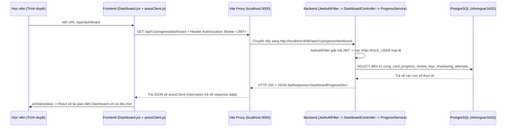
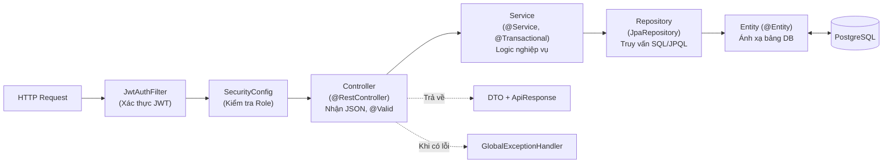
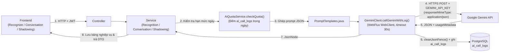

# Giáo trình Học & Làm Chủ Source Code — PQ Nihongo

> **Dành cho ai?** Tài liệu này được viết riêng cho bạn — người đã dùng AI hỗ trợ xây dựng PQ Nihongo và muốn **thật sự hiểu, kiểm soát, tự sửa và tự phát triển** toàn bộ codebase từ cơ bản đến nâng cao.
>
> **Cách học hiệu quả**: Hãy mở song song trình soạn thảo mã nguồn (VS Code / IntelliJ) với giáo trình này. Mỗi khi thấy đường dẫn file và đoạn code, hãy mở đúng file đó lên xem ngữ cảnh xung quanh.
>
> - Xem tổng quan dự án & API tại [`../README.md`](../README.md).
> - Xem hướng dẫn cài đặt & di chuyển PostgreSQL tại [`../database-setup/README.md`](../database-setup/README.md).

---

## Mục lục

- [Chương 1. Tổng quan cách một ứng dụng web hoạt động](#chương-1-tổng-quan-cách-một-ứng-dụng-web-hoạt-động)
- [Chương 2. Học cấu trúc Frontend (React 18 + Vite)](#chương-2-học-cấu-trúc-frontend-react-18--vite)
- [Chương 3. Học cấu trúc Backend (Spring Boot 3.3.5 + Java 17)](#chương-3-học-cấu-trúc-backend-spring-boot-335--java-17)
- [Chương 4. Học Database PostgreSQL](#chương-4-học-database-postgresql)
- [Chương 5. Phân tích luồng code thực tế (12 chức năng từ đầu đến cuối)](#chương-5-phân-tích-luồng-code-thực-tế-12-chức-năng-từ-đầu-đến-cuối)
- [Chương 6. Phân tích chuyên sâu hệ thống SRS 6 cấp độ](#chương-6-phân-tích-chuyên-sâu-hệ-thống-srs-6-cấp-độ)
- [Chương 7. Phân tích chuyên sâu tích hợp AI (Google Gemini)](#chương-7-phân-tích-chuyên-sâu-tích-hợp-ai-google-gemini)
- [Chương 8. Hướng dẫn tự sửa code trong 6 tình huống thực tế](#chương-8-hướng-dẫn-tự-sửa-code-trong-6-tình-huống-thực-tế)
- [Chương 9. Debug và bảo trì hệ thống](#chương-9-debug-và-bảo-trì-hệ-thống)
- [Chương 10. Bài tập thực hành tự học (từ Dễ đến Khó)](#chương-10-bài-tập-thực-hành-tự-học-từ-dễ-đến-khó)

---

## Chương 1. Tổng quan cách một ứng dụng web hoạt động

Trước khi đọc một dòng code nào, hãy nắm vững bức tranh lớn: **điều gì thực sự xảy ra khi bạn bấm một nút trên trình duyệt?**

### 1.1. Các khái niệm nền tảng (gắn trực tiếp với PQ Nihongo)

1. **Client (Máy khách)** và **Server (Máy chủ)**:
   - **Client** là trình duyệt web trên máy bạn (Chrome / Edge). Khi bạn truy cập `http://localhost:3000`, trình duyệt tải mã HTML/CSS/JavaScript của thư mục `frontend/` về chạy ngay trong tab trình duyệt.
   - **Server** là chương trình Java Spring Boot chạy ở thư mục `backend/` trên cổng `8080`. Server chạy liên tục ở nền, lắng nghe yêu cầu gửi đến và trả lời.
   - **Vì sao tách 2 phần thay vì viết gộp?** Vì trình duyệt là môi trường công khai — người dùng mở F12 có thể xem mọi dòng code Frontend. Do đó, mọi bí mật (`GEMINI_API_KEY`, mật khẩu PostgreSQL, khóa ký `APP_JWT_SECRET`) và mọi luật kiểm tra quyền **bắt buộc** phải nằm ở Backend.

2. **Frontend** và **Backend**:
   - **Frontend (`frontend/`)**: Lo "phần nhìn và tương tác" — vẽ nút bấm, ô nhập liệu, hiệu ứng lật thẻ Flashcard, mở micro ghi âm tiếng Nhật (`SpeechRecognition`) và phát âm thanh (`SpeechSynthesis`).
   - **Backend (`backend/`)**: Lo "bộ não nghiệp vụ và bảo mật" — kiểm tra bạn đã đăng nhập chưa, bạn là `USER` hay `ADMIN`, tính lịch ôn SRS 6 cấp độ, chấm điểm phát âm tiếng Nhật bằng Kuromoji, gọi Google Gemini AI và đọc/ghi cơ sở dữ liệu.

3. **HTTP Request và HTTP Response**:
   - Giao tiếp giữa Frontend và Backend dùng giao thức **HTTP** theo mô hình *Hỏi (Request) → Đáp (Response)*.
   - Một **HTTP Request** gồm 4 phần chính:
     - **Method (Phương thức)**: `GET` (lấy dữ liệu), `POST` (tạo mới / gửi hành động), `PUT` (cập nhật toàn bộ), `PATCH` (cập nhật một phần), `DELETE` (xóa).
     - **URL (Địa chỉ)**: ví dụ `POST /api/v1/srs/review`.
     - **Headers (Tiêu đề phụ)**: chứa thông tin kèm theo như `Authorization: Bearer <token>` (chứng minh danh tính) và `Content-Type: application/json`.
     - **Body (Thân dữ liệu)**: dữ liệu bạn gửi đi, ví dụ `{ "flashcardId": 12, "targetLevel": 3 }`.
   - Một **HTTP Response** gồm:
     - **Status Code (Mã trạng thái)**: `200` (Thành công), `400` (Dữ liệu sai), `401` (Chưa đăng nhập / token hết hạn), `403` (Không có quyền), `404` (Không tìm thấy), `429` (Vượt hạn mức AI), `500` (Lỗi server), `503` (Dịch vụ AI tạm gián đoạn).
     - **Body**: Dữ liệu trả về dưới dạng **JSON**.

4. **REST API** và **JSON**:
   - **REST API** là quy ước đặt tên URL theo tài nguyên (ví dụ `/api/v1/decks` cho bộ thẻ, `/api/v1/vocab/mine` cho sổ từ cá nhân) kết hợp với phương thức HTTP (`GET`/`POST`/`PUT`/`DELETE`).
   - **JSON (JavaScript Object Notation)** là định dạng văn bản nhẹ dùng để trao đổi dữ liệu giữa JavaScript (Frontend) và Java (Backend). Ví dụ một phản hồi thật từ `ApiResponse.java` của PQ Nihongo:
     ```json
     {
       "success": true,
       "data": { "totalSrsCards": 21, "rememberedCards": 4, "dueTodayCards": 6 },
       "timestamp": "2026-11-26T14:00:00Z"
     }
     ```
   - Backend Java dùng thư viện **Jackson** để tự động biến đổi Object Java (`SrsStatsDto`) ⇄ chuỗi JSON.

5. **Database (Cơ sở dữ liệu)**:
   - Bộ nhớ RAM của chương trình Java sẽ mất sạch khi tắt máy. **PostgreSQL** (`nihongoai`, cổng `5432`) lưu trữ dữ liệu lâu dài trên ổ cứng dưới dạng các bảng (table) có quan hệ chặt chẽ.

6. **Authentication (Xác thực)** vs **Authorization (Phân quyền)**:
   - **Authentication ("Bạn là ai?")**: Kiểm tra email + mật khẩu lúc đăng nhập, sau đó cấp **JWT Access Token** như một "thẻ ra vào". Mọi request sau đó đều đính thẻ này vào header `Authorization: Bearer ...`.
   - **Authorization ("Bạn được phép làm gì?")**: Sau khi biết bạn là ai, hệ thống xem vai trò (`ROLE_USER` hay `ROLE_ADMIN`). Trong PQ Nihongo, `ADMIN` **không được** gọi API học tập (`/api/v1/decks`, `/api/v1/srs/**`) và `USER` **không được** gọi API quản trị (`/api/v1/admin/**`).

### 1.2. Một vòng đời dữ liệu hoàn chỉnh trong PQ Nihongo

Ví dụ khi bạn mở trang Dashboard (`/app/dashboard`) trên trình duyệt:



---

## Chương 2. Học cấu trúc Frontend (React 18 + Vite)

Toàn bộ mã nguồn giao diện nằm trong `frontend/src/`. Hãy hiểu từng khái niệm React thông qua chính code thật của PQ Nihongo.

### 2.1. Điểm khởi đầu ứng dụng (`frontend/src/main.jsx`)

Khi trình duyệt mở `frontend/index.html`, dòng `<script type="module" src="/src/main.jsx"></script>` chạy `main.jsx` đầu tiên:

```jsx
// frontend/src/main.jsx (dòng 22-32)
ReactDOM.createRoot(document.getElementById('root')).render(
  <React.StrictMode>
    <QueryClientProvider client={queryClient}>
      <BrowserRouter>
        <AuthProvider>
          <App />
        </AuthProvider>
      </BrowserRouter>
    </QueryClientProvider>
  </React.StrictMode>
);
```

**Vì sao có nhiều lớp thẻ bọc lồng nhau như củ hành tây?**
- `<BrowserRouter>` (từ `react-router-dom`) cho phép mọi component bên trong đọc/thay đổi URL mà không tải lại cả trang web (SPA).
- `<AuthProvider>` (tự viết trong `auth/AuthContext.jsx`) phát sóng thông tin `user`, `token`, `theme`, `ttsSpeed` tới **mọi trang** mà không cần truyền tay qua từng cấp.
- `<App />` chứa bản đồ toàn bộ các đường dẫn (Route).

### 2.2. Component, JSX và Props

- **Component** là một hàm JavaScript trả về giao diện **JSX** (cú pháp giống HTML nhưng cho phép nhúng biểu thức JavaScript trong dấu `{ ... }`).
- **Props** là tham số đầu vào truyền từ component cha xuống component con (chỉ đọc, con không sửa trực tiếp props của cha).

Xem ví dụ thật từ `frontend/src/components/common/FuriganaText.jsx` (dòng 9–26):
```jsx
export const FuriganaText = ({ tokens, text, className = '', showFurigana = true }) => {
  if (tokens && Array.isArray(tokens)) {
    return (
      <span className={`furigana-rendered font-jp ${className}`}>
        {tokens.map((token, idx) => {
          if (!showFurigana || !token.hasFurigana || !token.reading || token.surface === token.reading) {
            return <span key={idx}>{token.surface}</span>;
          }
          return (
            <ruby key={idx}>
              {token.surface}
              <rt>{token.reading}</rt>
            </ruby>
          );
        })}
      </span>
    );
  }
```
- **Giải thích**: `tokens`, `text`, `className`, `showFurigana` là **Props**. Khi trang cha viết `<FuriganaText text="日本[にほん]" showFurigana={true} />`, React gọi hàm này và vẽ thẻ HTML chuẩn `<ruby>日本<rt>にほん</rt></ruby>` (hiển thị chữ nhỏ `にほん` trên đầu chữ `日本`).
- **Tại sao tách thành component dùng chung?** Vì cả Sổ từ vựng (`MyVocab.jsx`), Shadowing (`ShadowingList.jsx`, `ShadowingPractice.jsx`), Hội thoại AI (`ConversationRoom.jsx`) và Nhận diện ảnh (`Recognize.jsx`) đều cần hiển thị Furigana. Viết 1 lần, dùng mọi nơi; khi sửa lỗi hiển thị chỉ sửa 1 file duy nhất!

### 2.3. State và các Hooks quan trọng (`useState`, `useEffect`, `useCallback`, `useRef`, `useMemo`)

- **State (`useState`)**: "Trí nhớ riêng" của component. Khác với biến `let` thông thường, mỗi khi bạn gọi hàm cập nhật state (ví dụ `setPlaying(true)`), **React tự động vẽ lại (re-render)** component đó với giá trị mới.

Xem `frontend/src/components/common/AudioButton.jsx` (dòng 18–39):
```jsx
const [playing, setPlaying] = useState(false);
const auth = useAuth();
const effectiveSpeed = rate !== null && rate !== undefined ? rate : (auth?.ttsSpeed || getGlobalTtsSpeed());

const handleSpeak = (e) => {
  e.stopPropagation();
  if (playing) {
    stopJapaneseAudio();
    setPlaying(false);
    return;
  }
  speakJapanese(text, {
    audioUrl, rate: effectiveSpeed, speaker,
    onStart: () => setPlaying(true),
    onEnd: () => setPlaying(false),
    onError: () => setPlaying(false),
  });
};
```
- `e.stopPropagation()` ngăn cú click vào nút loa bị "lan" lên thẻ Flashcard cha (nếu không có dòng này, bấm nghe phát âm trên mặt thẻ sẽ vô tình lật luôn thẻ Flashcard!).

- **`useEffect`**: Chạy "tác vụ phụ" (side effects) sau khi component hiển thị hoặc khi biến phụ thuộc trong mảng `[...]` thay đổi — phổ biến nhất là **gọi API lấy dữ liệu** hoặc **dọn dẹp tài nguyên (cleanup)** khi rời trang.
  Ví dụ trong `frontend/src/pages/user/Dashboard.jsx` (dòng 35–67):
  ```jsx
  const fetchDashboard = useCallback(async () => {
    setLoading(true);
    try {
      const [dashRes, chartRes] = await Promise.allSettled([
        axiosClient.get('/progress/dashboard'),
        axiosClient.get(`/progress/chart?range=${range}`),
      ]);
      if (dashRes.status === 'fulfilled' && dashRes.value?.data) {
        setStats(dashRes.value.data);
      }
      ...
    } finally {
      setLoading(false);
    }
  }, [range]);

  useEffect(() => {
    fetchDashboard();
  }, [fetchDashboard]);
  ```
  - **Vì sao dùng `Promise.allSettled`?** Để gọi **song song** 2 API cùng lúc (nhanh hơn gọi nối tiếp), và nếu API biểu đồ có lỗi thì số liệu tổng quan Dashboard vẫn hiển thị bình thường.
  - **Vì sao dùng `useCallback(..., [range])`?** Để hàm `fetchDashboard` chỉ được tạo lại khi `range` (`7d`/`30d`/`90d`) thay đổi, tránh vòng lặp vô hạn trong `useEffect`.

- **`useMemo`**: Ghi nhớ kết quả tính toán nặng, chỉ tính lại khi dữ liệu đầu vào đổi.
  Ví dụ trong `frontend/src/pages/user/MyVocab.jsx` (dòng 97–107):
  ```jsx
  const filteredVocabs = useMemo(() => {
    const q = normalizeText(search);
    return allVocabs.filter((item) => {
      if (sourceFilter && item.source !== sourceFilter) return false;
      if (!q) return true;
      const kanji = normalizeText(item.word || item.japaneseText);
      const reading = normalizeText(item.reading);
      const meaning = normalizeText(item.meaningVi || item.vietnameseMeaning);
      return kanji.includes(q) || reading.includes(q) || meaning.includes(q);
    });
  }, [allVocabs, search, sourceFilter]);
  ```
  Nhờ `useMemo`, khi gõ vào ô tìm kiếm trong Sổ từ vựng, danh sách lọc **ngay lập tức** trên trình duyệt mà không spam hàng chục request lên Backend.

- **`useRef`**: Giữ một giá trị bền vững qua các lần re-render **mà không gây vẽ lại giao diện**, hoặc tham chiếu trực tiếp phần tử DOM (như `<input type="file" ref={fileInputRef} />` trong `Profile.jsx`, hay `cardShownAtRef = useRef(Date.now())` trong `StudySrs.jsx` để đo chính xác thời gian suy nghĩ `durationMs`, hay `recognitionRef` giữ đối tượng `SpeechRecognition` trong `ConversationRoom.jsx`).

### 2.4. Xử lý Form, Event Handling, Loading và Error

Xem mẫu chuẩn trong `frontend/src/pages/public/Login.jsx` (dòng 7–36):
```jsx
const [email, setEmail] = useState('');
const [password, setPassword] = useState('');
const [error, setError] = useState('');
const [loading, setLoading] = useState(false);

const handleSubmit = async (e) => {
  e.preventDefault();   // 1. Chặn trình duyệt tải lại trang mặc định của form HTML
  setError('');         // 2. Xóa thông báo lỗi cũ
  setLoading(true);     // 3. Khóa nút submit & hiện spinner (tránh bấm đúp)
  try {
    const user = await login(email, password);
    if (user?.role === 'ADMIN') navigate('/admin', { replace: true });
    else navigate(from && from.startsWith('/app') ? from : '/app/dashboard', { replace: true });
  } catch (err) {
    setError(err.response?.data?.message || err.message || 'Email hoặc mật khẩu không chính xác.');
  } finally {
    setLoading(false);  // 4. Dù thành công hay lỗi đều mở khóa nút
  }
};
```
Mỗi ô `<input value={email} onChange={(e) => setEmail(e.target.value)} />` được gọi là **Controlled Component**: giá trị hiển thị luôn đồng bộ 1-1 với state `email`.

### 2.5. Routing và bảo vệ tuyến đường (`App.jsx`, `ProtectedRoute.jsx`, `AdminRoute.jsx`)

Trong `frontend/src/App.jsx`, ứng dụng chia thành 3 nhóm Route lồng trong 3 Layout (`PublicLayout`, `UserLayout`, `AdminLayout`):
```jsx
// frontend/src/App.jsx (dòng 67-109, rút gọn)
<Route element={<PublicLayout />}>
  <Route path="/login" element={<Login />} />
  <Route path="/register" element={<Register />} />
  <Route path="/forgot-password" element={<ForgotPassword />} />
  <Route path="/reset-password" element={<ResetPassword />} />
</Route>

<Route element={<ProtectedRoute />}>
  <Route path="/app" element={<UserLayout />}>
    <Route path="dashboard" element={<Dashboard />} />
    ...
  </Route>
</Route>

<Route element={<AdminRoute />}>
  <Route path="/admin" element={<AdminLayout />}>
    <Route index element={<AdminDashboard />} />
    ...
  </Route>
</Route>
```
**Cách `ProtectedRoute.jsx` hoạt động (dòng 10–33)**:
- Khi `loading === true` (đang gọi `/users/me` kiểm tra token): hiện vòng xoay chờ (tránh chớp nháy đẩy nhầm về `/login`).
- Nếu `!user`: điều hướng sang `/login` và lưu lại trang muốn vào trong `state={{ from: location }}`.
- Nếu `user.role === 'ADMIN'`: đẩy sang `/admin` để tách biệt vai trò.
- Nếu hợp lệ (`USER`): render `<Outlet />` (hiển thị trang con bên trong).

### 2.6. Quản lý API tập trung và tự động làm mới Token (`frontend/src/api/axiosClient.js`)

Thay vì lặp lại việc gõ URL `http://localhost:8080/api/v1` và gắn header `Authorization` ở hàng chục trang, toàn bộ ứng dụng dùng chung 1 instance `axiosClient`:
1. **Request Interceptor (dòng 27–36)**: Trước khi gửi bất kỳ request nào, tự đọc `localStorage.getItem('access_token')` và gắn `Authorization: Bearer <token>`.
2. **Response Interceptor (dòng 39–102)**:
   - Khi thành công: trả thẳng `response.data` (chính là object `{ success, data, meta, message }` của Backend).
   - Khi nhận mã `401 Unauthorized` (do Access Token hết hạn sau 60 phút):
     - Nếu đang có 1 yêu cầu làm mới chạy (`isRefreshing === true`), các request lỗi `401` đến đồng thời được xếp vào hàng đợi `failedQueue`.
     - Chỉ gọi `POST /api/v1/auth/refresh` **đúng 1 lần** bằng `refresh_token` trong `localStorage`.
     - Nếu thành công: lưu cặp `access_token` & `refresh_token` mới, giải phóng hàng đợi `processQueue(null, newAccessToken)` và **tự động gửi lại** các request ban đầu mà người dùng không hề hay biết!
     - Nếu Refresh Token cũng hết hạn/bị thu hồi: xóa `localStorage` và chuyển về `/login`.

### 2.7. State toàn cục với Context (`frontend/src/auth/AuthContext.jsx`)

`AuthContext.jsx` lưu và chia sẻ 4 trạng thái cốt lõi toàn app:
- `user` & `token`: Khi tải lại trang (F5), `useEffect` (dòng 65–71) thấy còn `access_token` trong `localStorage` sẽ tự gọi `GET /users/me` để phục hồi thông tin người dùng.
- `theme` (`'light'` / `'dark'`): Lưu ở `localStorage['pq_theme']` và gắn thuộc tính `data-theme` vào thẻ `<html>` để `index.css` đổi bảng màu toàn ứng dụng.
- `ttsSpeed`: Đồng bộ tốc độ đọc tiếng Nhật giữa `localStorage['pq_tts_speed']`, biến toàn cục trong `utils/tts.js`, và cột `users.tts_speed` dưới PostgreSQL (qua `PATCH /users/me/tts-speed`).

---

## Chương 3. Học cấu trúc Backend (Spring Boot 3.3.5 + Java 17)

Backend được tổ chức theo **Package by Feature** (gom code theo từng chức năng: `auth/`, `vocab/`, `flashcard/`, `shadowing/`, `conversation/`, `recognition/`, `progress/`, `admin/`...) và bên trong mỗi chức năng tuân theo **Kiến trúc phân tầng (Layered Architecture)**.



### 3.1. Điểm khởi chạy (`NihongoAiApplication.java`)

```java
// backend/src/main/java/vn/vku/nihongoai/NihongoAiApplication.java
@SpringBootApplication
@EnableAsync
public class NihongoAiApplication {
    public static void main(String[] args) {
        loadDotEnv();
        SpringApplication.run(NihongoAiApplication.class, args);
    }
```
- `@SpringBootApplication` tự động quét mọi class trong package `vn.vku.nihongoai` và các sub-package để tạo **Spring Bean** (các đối tượng do Spring quản lý vòng đời).
- `loadDotEnv()` tự đọc file `.env` (ở thư mục hiện tại hoặc `../.env`) nạp vào Java System Properties trước khi Spring khởi tạo cấu hình.

### 3.2. Vai trò từng lớp (Layer) và mối quan hệ giữa chúng

1. **Controller (`*Controller.java`, gắn `@RestController`)**:
   - Là "cổng tiếp tân". Chỉ làm 3 việc: nhận tham số từ URL/Body, kích hoạt kiểm tra hợp lệ (`@Valid`), gọi Service xử lý và đóng gói kết quả trong `ApiResponse.ok(...)`.
   - Lấy người dùng hiện tại an toàn bằng `@AuthenticationPrincipal UserDetailsImpl userDetails` (tuyệt đối không tin `userId` gửi từ Client để chống giả mạo!).

2. **Service (`*Service.java`, gắn `@Service`)**:
   - Là "bộ não nghiệp vụ". Chứa mọi quy tắc tính toán (ví dụ tính lịch SRS trong `SrsService`, chấm điểm Levenshtein trong `ShadowingScoringService`, kiểm tra hạn mức AI trong `AiQuotaService`).
   - Dùng `@Transactional` để đảm bảo **tính nguyên tử**: nếu một hàm vừa lưu `card_progress` vừa ghi `review_logs` mà bước 2 bị lỗi, toàn bộ bước 1 sẽ tự động hoàn tác (rollback).

3. **Repository (`*Repository.java`, kế thừa `JpaRepository<Entity, ID>`)**:
   - Là "người thủ kho" giao tiếp với PostgreSQL. Chỉ cần khai báo interface (ví dụ `findByEmail(String email)` hoặc viết `@Query` JPQL), Spring Data JPA tự sinh code SQL lúc chạy.

4. **Entity (`@Entity`, `@Table`)**:
   - Là bản vẽ Java ánh xạ 1-1 với 1 bảng trong PostgreSQL. Ví dụ `backend/src/main/java/vn/vku/nihongoai/user/User.java`:
     ```java
     @Entity
     @Table(name = "users")
     public class User {
         @Id
         @GeneratedValue(strategy = GenerationType.IDENTITY)
         private Long id;

         @Column(nullable = false, unique = true)
         private String email;

         @Column(name = "password_hash", nullable = false, length = 100)
         private String passwordHash;
         ...
     }
     ```
   - Trong `application.yml`, dự án bật `ddl-auto: validate` (Hibernate đối chiếu mọi cột trong `@Entity` với bảng thật trong PostgreSQL — nếu lệch kiểu dữ liệu hoặc thiếu cột sẽ báo lỗi ngay khi khởi động) và `open-in-view: false` (tránh truy vấn ngầm chậm hiệu năng ngoài transaction).

5. **DTO (`dto/*.java` — Data Transfer Object)**:
   - **Vì sao KHÔNG trả trực tiếp Entity `User` ra API?** Vì `User` chứa cột nhạy cảm `passwordHash`, ngoài ra Entity có các quan hệ `@ManyToOne(fetch = LAZY)` dễ gây lỗi vòng lặp JSON hoặc `LazyInitializationException`. Do đó, mọi đầu vào (`*Request`) và đầu ra (`*Dto` / `*Response`) đều tách thành lớp DTO sạch sẽ.

### 3.3. Dependency Injection (Tiêm phụ thuộc)

Bạn sẽ thấy rất nhiều class có cấu trúc:
```java
@Service
@RequiredArgsConstructor
public class AuthService {
    private final UserRepository userRepository;
    private final PasswordEncoder passwordEncoder;
    private final JwtService jwtService;
```
- Bạn không bao giờ thấy từ khóa `new UserRepository()` hay `new JwtService()`.
- `@RequiredArgsConstructor` (của Lombok) tự sinh constructor nhận tất cả trường `private final`. Khi ứng dụng khởi động, Spring Boot tự tạo các bean và **tiêm (inject)** vào constructor đó. Cách này gọi là **Constructor Injection** — giúp code dễ viết Unit Test bằng Mockito (xem `SrsServiceTest.java`).
- Riêng trường hợp 2 Service phụ thuộc chéo nhau (như `SrsService` ↔ `ProgressService`), dự án dùng `@Lazy` tại constructor để phá vỡ vòng tròn khởi tạo.

### 3.4. Validation và Xử lý Ngoại lệ tập trung

- **Validation**: Gắn annotation chuẩn Jakarta trên DTO đầu vào, ví dụ `RegisterRequest.java`:
  ```java
  @NotBlank(message = "Email không được để trống")
  @Email(message = "Email không đúng định dạng")
  private String email;

  @NotBlank(message = "Mật khẩu không được để trống")
  @Size(min = 8, message = "Mật khẩu phải có tối thiểu 8 ký tự")
  private String password;
  ```
  Khi Controller gắn `@Valid @RequestBody RegisterRequest request`, nếu dữ liệu sai, Spring tự ném `MethodArgumentNotValidException` **trước khi** chạy vào Service.

- **Global Exception Handling (`common/GlobalExceptionHandler.java`)**:
  Gắn `@RestControllerAdvice` để bắt mọi lỗi từ toàn bộ Controller:
  - Lỗi nghiệp vụ do ta chủ động ném (`throw new AppException(ErrorCode.DUPLICATE_RESOURCE, "Email đã được đăng ký...")`) → trả đúng HTTP status định nghĩa trong `ErrorCode.java` (`409`, `404`, `401`, `429`, `503`...).
  - Lỗi validation → trả HTTP `400` kèm map chi tiết từng trường sai trong `details`.
  - Lỗi file vượt dung lượng → trả HTTP `413 Payload Too Large`.
  - Mọi lỗi không lường trước → ghi log lỗi và trả HTTP `500` với JSON an toàn thay vì trang lỗi HTML mặc định.

### 3.5. Nhóm Configuration & Security Filter

| File trong `config/` & `security/` | Nhiệm vụ cụ thể |
| :--- | :--- |
| `SecurityConfig.java` | Tắt CSRF (do dùng JWT stateless), bật CORS, định nghĩa bản đồ phân quyền Public / `USER` / `ADMIN`, gắn `JwtAuthFilter` trước filter đăng nhập mặc định, định nghĩa `BCryptPasswordEncoder(10)`. |
| `JwtAuthFilter.java` | Kế thừa `OncePerRequestFilter`, chạy **1 lần trên mỗi HTTP request**: cắt chuỗi sau `"Bearer "`, xác thực chữ ký JWT qua `JwtService`, kiểm tra tài khoản không bị `LOCKED`, nạp `Authentication` vào `SecurityContextHolder`. |
| `CorsConfig.java` | Cho phép trình duyệt ở `localhost:*` và `127.0.0.1:*` gửi request kèm header `Authorization` sang cổng `8080`. |
| `WebMvcConfig.java` | Ánh xạ đường dẫn URL `/uploads/**` trỏ thẳng tới thư mục vật lý `app.upload.dir` (`backend/uploads/`) và bật cache 7 ngày. |
| `WebClientConfig.java` | Tạo bean `geminiWebClient` trỏ tới `https://generativelanguage.googleapis.com` với timeout `30s` và bộ đệm tối đa `16MB` (đủ cho ảnh base64). |
| `DataInitializer.java` | Chạy `CommandLineRunner` mỗi lúc khởi động để tạo tài khoản `ADMIN` mặc định (từ `.env`), tài khoản `USER` mẫu, cài đặt AI và chủ đề ban đầu nếu DB chưa có. |

---

## Chương 4. Học Database PostgreSQL

Tất cả khái niệm cơ sở dữ liệu quan hệ dưới đây được minh họa bằng chính các bảng trong `backend/src/main/resources/db/migration/`.

### 4.1. Database, Schema, Table và Column
- **Database**: `nihongoai` (1 dự án có 1 database độc lập).
- **Schema**: `public` (như thư mục chứa tất cả bảng bên trong database).
- **Table (Bảng)** giống một trang tính Excel có cấu trúc cố định (ví dụ `users`, `flashcards`, `card_progress`), mỗi **Column (Cột)** có kiểu dữ liệu chặt chẽ (`BIGINT`, `VARCHAR(100)`, `INT`, `BOOLEAN`, `TIMESTAMP WITH TIME ZONE`, `TEXT`), mỗi **Row (Dòng)** là một bản ghi thực tế.

### 4.2. Khóa chính (Primary Key) và Khóa ngoại (Foreign Key)
- **Primary Key (`PRIMARY KEY`)**: Định danh duy nhất mỗi dòng trong bảng.
  - Đa số bảng dùng số tự tăng chuẩn SQL `id BIGINT GENERATED ALWAYS AS IDENTITY PRIMARY KEY` (hoặc `BIGSERIAL`).
  - Một số bảng dùng khóa tự nhiên hoặc khóa ghép: `system_settings(setting_key)`, `youtube_video_transcripts(video_id)`, và khóa chính ghép 2 cột `user_daily_stats PRIMARY KEY (user_id, stat_date)` (vì mỗi người dùng chỉ có đúng 1 dòng thống kê cho mỗi ngày!).
- **Foreign Key (`REFERENCES ...`)**: Tạo liên kết giữa 2 bảng để đảm bảo tính toàn vẹn dữ liệu:
  - `ON DELETE CASCADE` (ví dụ `flashcards.deck_id REFERENCES flashcard_decks(id) ON DELETE CASCADE`): Khi xóa một bộ thẻ, PostgreSQL tự xóa toàn bộ thẻ con thuộc bộ đó, không bao giờ để lại "thẻ mồ côi".
  - `ON DELETE SET NULL` (ví dụ `flashcard_decks.topic_id REFERENCES topics(id) ON DELETE SET NULL`): Khi xóa chủ đề, bộ thẻ không bị xóa theo mà chỉ đặt `topic_id = NULL`.

### 4.3. Các loại quan hệ trong PQ Nihongo
- **1-N (One-to-Many)**: Phổ biến nhất.
  - 1 `users` có nhiều `user_vocabularies`, nhiều `flashcard_decks`, nhiều `conversations`.
  - 1 `flashcard_decks` chứa nhiều `flashcards`.
  - 1 `shadowing_lessons` có nhiều `shadowing_dialogue_lines` (các câu thoại A/B).
  - 1 `youtube_video_transcripts` có nhiều `youtube_video_sentences`.
- **N-N (Many-to-Many) qua bảng trung gian có thuộc tính riêng**:
  - Một `users` học nhiều `flashcards`, và một `flashcards` (nếu trong bộ thẻ công khai) có thể được nhiều `users` học → nối qua bảng `card_progress` với ràng buộc `UNIQUE (user_id, flashcard_id)` để mỗi cặp `(người dùng, thẻ)` có đúng 1 trạng thái SRS (`srs_level`, `due_at`).

### 4.4. JOIN, Index, Transaction và Migration
- **JOIN**: Ghép dữ liệu từ nhiều bảng liên kết khi truy vấn. Ví dụ khi xem thẻ cần ôn, `CardProgressRepository` ghép `card_progress` → `flashcards` → `flashcard_decks` để vừa lấy chữ Kanji/nghĩa của thẻ, vừa biết tên bộ thẻ và trạng thái `due_at`.
- **Index (`CREATE INDEX`)**: Giống "mục lục ở cuối sách" giúp PostgreSQL tìm dòng cần lấy siêu nhanh thay vì quét từng dòng một. Ví dụ:
  - `idx_card_progress_user_level_due ON card_progress (user_id, srs_level, due_at)` (trong `V8`): Tối ưu trực tiếp câu truy vấn đếm và lấy thẻ đến hạn SRS.
  - `idx_review_user_time ON review_logs(user_id, reviewed_at DESC)`: Tối ưu trang Lịch sử ôn tập.
  - `idx_youtube_video_sentences_video ON youtube_video_sentences(video_id, sentence_order)`: Tối ưu tải transcript YouTube từ cache.
- **Transaction**: Một nhóm nhiều lệnh SQL phải thành công cùng nhau hoặc cùng hủy bỏ (đảm bảo ACID). Trong Spring Boot, chỉ cần đặt `@Transactional` trên method Service.
- **Migration (Flyway)**: Thay vì tạo bảng bằng tay trên pgAdmin (dễ quên hoặc sai khác giữa máy này với máy khác), mọi thay đổi cấu trúc được viết thành file SQL có đánh số thứ tự (`V1` → `V9`). Flyway ghi lại các file đã chạy vào bảng `flyway_schema_history` để đảm bảo mỗi file chỉ chạy đúng 1 lần.

---

## Chương 5. Phân tích luồng code thực tế (12 chức năng từ đầu đến cuối)

Đây là chương quan trọng nhất giúp bạn **lần theo đường đi thực tế của dữ liệu** trong codebase PQ Nihongo. Mọi đoạn code dưới đây đều trích nguyên văn từ mã nguồn hiện tại.

---

### Luồng 1. Đăng ký và Đăng nhập

```text
Login.jsx (Form) -> AuthContext.login() -> axiosClient.post('/auth/login')
  -> AuthController.login() -> AuthService.login()
  -> UserRepository.findByEmail() -> PostgreSQL (users)
  -> PasswordEncoder.matches() -> JwtService.generateAccessToken() + RefreshTokenRepository.save()
  -> Trả AuthResponse -> Frontend lưu localStorage & chuyển trang theo role
```

1. **Frontend — `frontend/src/auth/AuthContext.jsx` (dòng 73–85)**:
   ```jsx
   const login = async (email, password) => {
     const res = await axiosClient.post('/auth/login', { email, password });
     if (res.success && res.data) {
       const { accessToken, refreshToken, user: userData } = res.data;
       localStorage.setItem('access_token', accessToken);
       localStorage.setItem('refresh_token', refreshToken);
       setToken(accessToken);
       setUser(userData);
       applyTtsSpeedFromUser(userData);
       return userData;
     }
     throw new Error(res.message || 'Đăng nhập thất bại');
   };
   ```
   - **Đầu vào**: `email`, `password` do `Login.jsx` truyền vào khi submit form.
   - **Xử lý**: Gửi `POST /api/v1/auth/login`. Nhận `accessToken`, `refreshToken`, `userData`, lưu 2 token vào `localStorage`, cập nhật state `token`/`user` và đồng bộ tốc độ đọc tiếng Nhật `ttsSpeed` của user đó.
   - **Ai gọi / Ai nhận**: `Login.jsx` gọi `login(...)` và nhận về `userData` để điều hướng `/admin` hay `/app/dashboard`.

2. **Backend Controller — `backend/src/main/java/vn/vku/nihongoai/auth/AuthController.java` (dòng 21–31)**:
   ```java
   @PostMapping("/register")
   public ApiResponse<AuthResponse> register(@Valid @RequestBody RegisterRequest request) {
       return ApiResponse.ok(authService.register(request), "Đăng ký tài khoản thành công");
   }

   @PostMapping("/login")
   public ApiResponse<AuthResponse> login(@Valid @RequestBody LoginRequest request) {
       return ApiResponse.ok(authService.login(request), "Đăng nhập thành công");
   }
   ```

3. **Backend Service — `backend/src/main/java/vn/vku/nihongoai/auth/AuthService.java` (dòng 62–87)**:
   ```java
   @Transactional
   public AuthResponse login(LoginRequest request) {
       User user = userRepository.findByEmail(request.getEmail().trim().toLowerCase())
               .orElseThrow(() -> new AppException(ErrorCode.AUTH_INVALID_CREDENTIALS, "Email hoặc mật khẩu không chính xác"));

       if (!passwordEncoder.matches(request.getPassword(), user.getPasswordHash())) {
           throw new AppException(ErrorCode.AUTH_INVALID_CREDENTIALS, "Email hoặc mật khẩu không chính xác");
       }

       if (user.getStatus() == Status.LOCKED) {
           throw new AppException(ErrorCode.AUTH_ACCOUNT_LOCKED, "Tài khoản của bạn đã bị khóa");
       }

       user.setLastLoginAt(Instant.now());
       userRepository.save(user);

       UserDetailsImpl userDetails = UserDetailsImpl.fromUser(user);
       String accessToken = jwtService.generateAccessToken(userDetails);
       String refreshToken = createAndSaveRefreshToken(user);

       return AuthResponse.builder()
               .accessToken(accessToken)
               .refreshToken(refreshToken)
               .user(UserProfileResponse.from(user))
               .build();
   }
   ```
   - **Giải thích chi tiết**: Chuẩn hóa email về chữ thường để tránh đăng nhập sai do gõ hoa; dùng `passwordEncoder.matches` (BCrypt) để so sánh mật khẩu mà không cần giải mã hash; chặn tài khoản `LOCKED`; cập nhật `lastLoginAt`; sinh JWT Access Token (`JwtService`) và lưu SHA-256 hash của Refresh Token vào bảng `refresh_tokens`.
   - **Nếu sửa đoạn code này sẽ ảnh hưởng đến đâu?** Nếu đổi tên trường trong `AuthResponse` (ví dụ đổi `accessToken` thành `token`), `AuthContext.jsx` và `axiosClient.js` (refresh flow) sẽ không đọc được token và đăng nhập bị hỏng.

---

### Luồng 2. Phân quyền `USER` / `ADMIN`

```text
Mọi Request có JWT -> JwtAuthFilter (giải mã JWT + đọc Role từ DB)
  -> SecurityContextHolder (gắn ROLE_USER hoặc ROLE_ADMIN)
  -> SecurityConfig.securityFilterChain() (kiểm tra URL khớp Role)
  -> Cho qua tới Controller HOẶC chặn bằng HTTP 403 Forbidden
```

1. **Backend Filter — `backend/src/main/java/vn/vku/nihongoai/security/JwtAuthFilter.java` (dòng 33–52)**:
   ```java
   final String authHeader = request.getHeader("Authorization");
   if (authHeader == null || !authHeader.startsWith("Bearer ")) {
       filterChain.doFilter(request, response);
       return;
   }
   final String jwt = authHeader.substring(7);
   final String userEmail = jwtService.extractUsername(jwt);
   if (userEmail != null && SecurityContextHolder.getContext().getAuthentication() == null) {
       UserDetailsImpl userDetails = (UserDetailsImpl) userDetailsService.loadUserByUsername(userEmail);
       if (jwtService.isTokenValid(jwt, userDetails) && userDetails.isAccountNonLocked()) {
           UsernamePasswordAuthenticationToken authToken = new UsernamePasswordAuthenticationToken(
                   userDetails, null, userDetails.getAuthorities()
           );
           SecurityContextHolder.getContext().setAuthentication(authToken);
       }
   }
   ```
   - **Tại sao phải kiểm tra `userDetails.isAccountNonLocked()` ở đây?** Để ngay khi ADMIN khóa một tài khoản, JWT còn hạn của người đó cũng bị vô hiệu hóa ngay ở request kế tiếp!

2. **Backend Rules — `backend/src/main/java/vn/vku/nihongoai/config/SecurityConfig.java` (dòng 85–107)**:
   ```java
   .requestMatchers("/api/v1/users/**", "/api/v1/furigana/**").hasAnyRole("USER", "ADMIN")
   .requestMatchers("/api/v1/admin/**").hasRole("ADMIN")
   .requestMatchers(
           "/api/v1/vocab/**", "/api/v1/topics/**", "/api/v1/recognitions/**",
           "/api/v1/shadowing/**", "/api/v1/conversation/**", "/api/v1/conversations/**",
           "/api/v1/decks/**", "/api/v1/cards/**", "/api/v1/srs/**",
           "/api/v1/quiz/**", "/api/v1/progress/**", "/api/v1/dashboard/**"
   ).hasRole("USER")
   ```
3. **Frontend Guards — `frontend/src/auth/ProtectedRoute.jsx` & `AdminRoute.jsx`**:
   - Chặn giao diện ngay phía trình duyệt để mang lại trải nghiệm mượt, nhưng **lá chắn bảo mật thật sự** vẫn là `SecurityConfig.java` ở Backend.
   - **Nếu thay đổi**: Khi thêm một Controller mới ở Backend, bạn phải đảm bảo prefix URL nằm đúng nhóm quyền trong `SecurityConfig.java` (mặc định `.anyRequest().hasRole("USER")`).

---

### Luồng 3. Quản lý từ vựng cá nhân (Sổ từ vựng)

```text
MyVocab.jsx -> GET /api/v1/vocab/my (tải danh sách) & POST /api/v1/vocab/my (thêm từ)
  -> VocabController -> UserVocabularyService.addVocab()
  -> UserVocabularyRepository (kiểm tra trùng user_id + word + reading -> save)
  -> ProgressService.recordActivity(userId, "WORD_ADDED", 1) -> PostgreSQL (user_vocabularies, user_daily_stats)
```

1. **Frontend — `frontend/src/pages/user/MyVocab.jsx` (dòng 61–76)**:
   ```jsx
   const fetchAllMyVocab = async () => {
     setLoading(true);
     try {
       const res = await axiosClient.get('/vocab/my', { params: { page: 0, size: 1000 } });
       if (res.success && res.data) {
         const items = Array.isArray(res.data) ? res.data : res.data.content || [];
         setAllVocabs(items);
       }
     } finally {
       setLoading(false);
     }
   };
   ```
2. **Backend — `backend/src/main/java/vn/vku/nihongoai/vocab/UserVocabularyService.java` (dòng 40–75)**:
   ```java
   @Transactional
   public UserVocabularyDto addVocab(Long userId, CreateUserVocabRequest request) {
       User user = userService.getUserOrThrow(userId);
       String cleanWord = request.getWord().trim();
       String cleanReading = (request.getReading() != null && !request.getReading().isBlank())
               ? request.getReading().trim() : null;

       userVocabularyRepository.findByUserIdAndWordAndReading(userId, cleanWord, cleanReading)
               .ifPresent(existing -> {
                   throw new AppException(ErrorCode.DUPLICATE_RESOURCE, "Từ này đã có trong sổ từ của bạn");
               });

       UserVocabulary uv = UserVocabulary.builder()
               .user(user).word(cleanWord).reading(cleanReading)
               .meaningVi(request.getMeaningVi().trim())
               .source(request.getSource() != null ? request.getSource() : VocabSource.MANUAL)
               .isMastered(false).build();

       uv = userVocabularyRepository.save(uv);
       if (progressService != null) {
           progressService.recordActivity(userId, "WORD_ADDED", 1);
       }
       return UserVocabularyDto.from(uv);
   }
   ```
   - **Giải thích**: Kiểm tra chống trùng theo bộ 3 `(userId, word, reading)` khớp với constraint `UNIQUE (user_id, word, reading)` trong `V1__init_schema.sql`; sau khi lưu thì tự động gọi `progressService.recordActivity` để biểu đồ Dashboard cộng thêm 1 từ mới trong ngày.
   - **Thêm vào SRS hàng loạt**: Khi bấm đưa từ vào SRS trên `MyVocab.jsx`, Frontend gọi `POST /api/v1/vocab/my/add-to-srs` → `UserVocabularyService.addToSrs()` tạo thẻ `Flashcard` và khởi tạo `CardProgress` ở `srsLevel = 0`.
   - **Nếu thay đổi**: Sửa logic chống trùng cần chú ý khớp với ràng buộc `UNIQUE` dưới PostgreSQL để không bị lỗi SQL `DataIntegrityViolationException`.

---

### Luồng 4. Bộ thẻ Flashcards & Import Excel/CSV

```text
Decks.jsx (xem/tạo/clone bộ thẻ) & ImportDeck.jsx (2 bước: Preview -> Commit)
  -> DeckController / TemplateController -> DeckService / ImportService (ExcelParser, CsvParser)
  -> PostgreSQL (flashcard_decks, flashcards, import_jobs, card_progress)
```

1. **Frontend tải song song bộ thẻ + thống kê SRS — `frontend/src/pages/user/Decks.jsx` (dòng 39–43)**:
   ```jsx
   const [resMy, resSys, resStats] = await Promise.all([
     axiosClient.get('/decks?scope=mine'),
     axiosClient.get('/decks/system'),
     axiosClient.get('/srs/stats'),
   ]);
   ```
2. **Backend đếm chính xác số thẻ theo cấp độ SRS của từng bộ — `backend/src/main/java/vn/vku/nihongoai/flashcard/DeckService.java` (dòng 56–65)**:
   ```java
   private DeckDto buildDeckDtoWithSrsCounts(Deck deck, Long userId, Instant now) {
       long total = flashcardRepository.countByDeckId(deck.getId());
       long due = cardProgressRepository.countDueByDeckId(userId, deck.getId(), now);
       long syncedLevel0 = cardProgressRepository.countByUserAndLevel(userId, deck.getId(), 0);
       long unsyncedNew = flashcardRepository.countNewCardsByDeckId(userId, deck.getId());
       long level0Count = syncedLevel0 + unsyncedNew;
       long learningCount = cardProgressRepository.countLearningLevels1To4(userId, deck.getId());
       long masteredCount = cardProgressRepository.countByUserAndLevel(userId, deck.getId(), 5);
       return DeckDto.from(deck, userId, total, due, level0Count, learningCount, masteredCount);
   }
   ```
3. **Luồng Import 2 bước an toàn — `frontend/src/pages/user/ImportDeck.jsx` (dòng 43–77) → `TemplateController.java` (dòng 76–94)**:
   - **Bước 1 (Preview)**: Gửi `multipart/form-data` lên `POST /api/v1/decks/{id}/import/preview`. `ImportService` dùng `ExcelParser` (Apache POI) hoặc `CsvParser` (Commons CSV) đọc từng dòng, báo rõ dòng nào hợp lệ/lỗi, tạo bản ghi `import_jobs` trạng thái `PREVIEW` **chưa ghi vào `flashcards`**.
   - **Bước 2 (Commit)**: Người dùng kiểm tra xong, chọn chiến lược trùng (`SKIP` / `UPDATE`) rồi gửi `POST /api/v1/decks/{id}/import/commit` kèm `jobId` → mới thực sự chèn dữ liệu vào `flashcards`.
   - **Vì sao tách 2 bước?** Để người dùng không bị đổ hàng trăm dòng lỗi định dạng vào bộ thẻ của mình.

---

### Luồng 5. Ôn tập SRS 6 cấp độ

```text
StudySrs.jsx (lật thẻ -> bấm Level 1..5)
  -> POST /api/v1/srs/review { flashcardId, targetLevel, reviewMode, durationMs }
  -> SrsController.reviewCard() -> SrsService.processReview() -> applyLevel()
  -> Lưu card_progress + Chèn thêm dòng review_logs + Cập nhật user_daily_stats
  -> Trả SrsDueCardDto -> Frontend tải lại /srs/stats & chuyển sang thẻ kế tiếp
```

1. **Frontend — `frontend/src/pages/user/StudySrs.jsx` (dòng 234–248)**:
   ```jsx
   const handleRate = useCallback(async (targetLevel) => {
     if (!currentCard || submitting || !isFlipped) return;
     setSubmitting(true);
     try {
       const cardId = currentCard.flashcardId || currentCard.cardId || currentCard.id;
       const durationMs = Math.max(200, Date.now() - cardShownAtRef.current);
       await axiosClient.post('/srs/review', {
         flashcardId: cardId,
         targetLevel, // 1..5 (Level 1..Level 5)
         reviewMode: studyMode,
         durationMs,
       });
       await fetchStats();
   ```
   - Điều kiện `!isFlipped` đảm bảo học viên phải **lật thẻ xem đáp án trước** mới được bấm chấm điểm.
2. **Backend — `backend/src/main/java/vn/vku/nihongoai/flashcard/SrsService.java` (dòng 381–405)**:
   ```java
   progress = applyLevel(progress, targetLevel, now);
   progress = cardProgressRepository.save(progress);

   ReviewLog logEntry = ReviewLog.builder()
           .user(user).flashcard(flashcard)
           .rating(targetLevel).previousLevel(prevLevel).newLevel(targetLevel)
           .reviewMode(mode).prevIntervalDays(prevInterval)
           .newIntervalDays(progress.getIntervalDays())
           .easeFactor(progress.getEaseFactor())
           .durationMs(request.getDurationMs())
           .prevDueAt(prevDueAt).nextDueAt(progress.getDueAt())
           .build();
   reviewLogRepository.save(logEntry);

   if (progressService != null && !"MANUAL_LEVEL".equals(mode)) {
       progressService.recordActivity(userId, "CARD_REVIEWED", 1);
   }
   return SrsDueCardDto.from(progress, now);
   ```
   - **Nếu thay đổi**: Chi tiết toàn bộ thuật toán 6 cấp độ và ảnh hưởng được phân tích sâu ở **Chương 6**.

---

### Luồng 6. Shadowing tự nhập (Manual Custom Shadowing)

```text
ShadowingList.jsx (Tab Tự nhập)
  -> Bước 1 (Dịch): POST /api/v1/shadowing/custom/translate
     -> ShadowingService.translateCustomSentences() (Tách câu + Gemini dịch + Kuromoji sinh Hiragana)
  -> Bước 2 (Nghe): utils/tts.js -> speakJapaneseSequence() (đọc nối tiếp nhiều câu theo ttsSpeed)
  -> Bước 3 (Nói & Chấm): SpeechRecognition (ja-JP) -> POST /api/v1/shadowing/custom-score
     -> ShadowingScoringService.score() (Kuromoji + Levenshtein) -> trả accuracy & wordDiff tô màu
```

1. **Backend tách câu & dịch đủ 100% — `backend/src/main/java/vn/vku/nihongoai/shadowing/ShadowingService.java` (dòng 98–143)**:
   ```java
   List<String> sentences = splitJapaneseSentences(rawText);
   ...
   Map<Integer, String> translations = translateSentencesBatch(user, sentences);

   // Nếu AI bỏ sót bất kỳ câu nào -> gọi dịch bù đúng những câu bị thiếu
   List<Integer> missingIndices = new ArrayList<>();
   for (int i = 0; i < sentences.size(); i++) {
       int order = i + 1;
       if (translations.get(order) == null || translations.get(order).isBlank()) {
           missingIndices.add(order);
       }
   }
   ...
   String hira = furiganaService.toFullHiragana(ja);
   ```
   - **Tại sao có vòng lặp `missingIndices`?** Vì LLM đôi khi bỏ sót 1–2 câu khi dịch đoạn văn dài; vòng dịch bù đảm bảo không câu tiếng Nhật nào bị trống nghĩa tiếng Việt.

2. **Backend chấm điểm theo từng hình vị tiếng Nhật — `backend/src/main/java/vn/vku/nihongoai/shadowing/ShadowingScoringService.java` (dòng 60–116)**:
   - Dùng `FuriganaService.getTokenizer()` (Kuromoji) tách câu gốc và câu người dùng nói thành 2 mảng token.
   - Chạy quy hoạch động **Levenshtein** (`dp[m+1][n+1]`) với hàm so khớp thông minh `isMatch(t1, t2)`: coi là đúng nếu trùng mặt chữ **HOẶC** trùng cách đọc Hiragana (ví dụ người dùng nói `にほん` mà Web Speech trả `日本` vẫn tính `CORRECT`!).
   - Truy vết tạo danh sách `WordDiffItem` gồm 4 trạng thái: `CORRECT`, `WRONG`, `MISSING`, `EXTRA` và tính `accuracy = correctCount / originalTokens.size() * 100`.

---

### Luồng 7. YouTube Shadowing

```text
ShadowingList.jsx (Tab YouTube: nhập URL) -> extractYoutubeId()
  -> GET /api/v1/shadowing/youtube/captions?videoId=...
  -> YouTubeTranscriptService.processVideoTranscript()
     -> Bước 0: Kiểm tra PostgreSQL (youtube_video_transcripts / youtube_video_sentences)
     -> Nếu chưa có: Gọi YouTube Innertube API (caption .ja / a.ja) hoặc Gemini Multimodal
     -> Lưu PostgreSQL + Dịch lô 45 câu đầu qua Gemini
  -> Frontend hiển thị YouTube IFrame Player đồng bộ timestamp + gọi nền POST .../translate-batch
```

1. **Frontend — `frontend/src/pages/user/ShadowingList.jsx` (dòng 344–361)**:
   ```jsx
   const res = await axiosClient.get(`/shadowing/youtube/captions?videoId=${vid}`);
   if (res.success && res.data) {
     if (res.data.hasAutoCaptions && Array.isArray(res.data.segments) && res.data.segments.length > 0) {
       setYtSegments(res.data.segments);
       setYtFromCache(!!res.data.fromCache);
       ...
       if ((res.data.pendingCount ?? 0) > 0) {
         ytTranslateCancelRef.current = false;
         translateRemainingBatchesInBackground(vid);
       }
     }
   ```
   - **Vì sao dịch nền theo lô 45 câu (`translate-batch`)?** Video YouTube dài 15–30 phút có thể chứa vài trăm câu. Nếu chờ dịch hết cả video trong 1 request sẽ bị quá thời gian (timeout 30s). Chia lô 45 câu giúp học viên **xem và luyện ngay những phút đầu**, trong khi Frontend âm thầm gọi `POST /shadowing/youtube/{vid}/translate-batch?batchSize=45` cho các câu còn lại và lưu bền vững vào PostgreSQL.

2. **Backend kiểm tra cache PostgreSQL trước tiên — `backend/src/main/java/vn/vku/nihongoai/shadowing/YouTubeTranscriptService.java` (dòng 77–89)**:
   ```java
   Optional<YouTubeVideoTranscript> cachedOpt = transcriptRepository.findById(videoId);
   if (cachedOpt.isPresent()) {
       List<YouTubeVideoSentence> cachedSentences = sentenceRepository.findAllByVideoIdOrderBySentenceOrderAsc(videoId);
       if (!cachedSentences.isEmpty()) {
           YouTubeVideoTranscript cached = cachedOpt.get();
           long translatedSoFar = cachedSentences.stream()
                   .filter(s -> "TRANSLATED".equalsIgnoreCase(s.getTranslationStatus())).count();
           if (translatedSoFar == 0) {
               translatePendingSentencesInternal(user, cached, cachedSentences, DEFAULT_TRANSLATION_BATCH_SIZE);
           }
           return buildResponseFromEntities(cached, cachedSentences, true);
       }
   }
   ```
   - **Ảnh hưởng nếu sửa**: Nếu đổi tên trường trả về (`startTime`, `endTime`, `japaneseText`, `vietnameseTranslation`) trong `buildResponseFromEntities`, vòng lặp đồng bộ YouTube IFrame Player (`setInterval` mỗi 350ms tại `ShadowingList.jsx:159`) sẽ không highlight đúng câu đang phát.

---

### Luồng 8. Shadowing theo chủ đề & Hội thoại A/B

```text
ShadowingList.jsx (chọn bài) -> /app/shadowing/practice/:id (ShadowingPractice.jsx)
  -> GET /api/v1/shadowing/lessons/{id} -> ShadowingService.getLessonDetail() (trả lines vai A/B)
  -> Nghe cả đoạn bằng speakJapaneseSequence() (2 giọng khác nhau cho vai A và B)
  -> Bấm Micro -> POST /api/v1/shadowing/lessons/{id}/attempt
  -> ShadowingService.submitAttempt() -> ShadowingScoringService.score() -> Lưu shadowing_attempts
```

1. **Frontend phát hội thoại 2 vai & nộp chấm điểm — `frontend/src/pages/user/ShadowingPractice.jsx` (dòng 111–122 & 191–199)**:
   ```jsx
   const res = await axiosClient.post(`/shadowing/lessons/${id}/attempt`, {
     lineId: line.id || null,
     expectedTextJa: line.japaneseText,
     recognizedText: cleanText,
     playbackSpeed: ttsSpeed,
   });
   ```
   Và khi nghe cả đoạn hội thoại: `speakJapaneseSequence(lines.map(l => ({ text: l.japaneseText, audioUrl: l.audioUrl, speaker: l.speaker })), { rate: ttsSpeed, pauseMs: 350 })`. Bên trong `utils/tts.js:84`, hàm `getBestJapaneseVoice(speaker)` chọn `jaVoices[0]` cho vai `A` và `jaVoices[1]` cho vai `B` để phân biệt 2 nhân vật!

2. **Backend đảm bảo bài cũ câu đơn vẫn hoạt động mượt — `backend/src/main/java/vn/vku/nihongoai/shadowing/ShadowingService.java` (dòng 67–88)**:
   - Nếu bài có các dòng trong `shadowing_dialogue_lines`, lấy theo thứ tự `lineOrder` và tự bổ sung Hiragana bằng Kuromoji nếu cột `hiragana_text` đang trống.
   - Nếu là bài cũ chỉ có 1 câu ở `shadowing_lessons.text_ja`, tự bọc thành 1 dòng vai `A` để Frontend hiển thị thống nhất không bị lỗi.

---

### Luồng 9. Hội thoại AI 1-1 (Voice-Only)

```text
ConversationRoom.jsx (Bấm Micro nói tiếng Nhật -> dừng Micro)
  -> SpeechRecognition.onend -> sendVoiceText(finalRecognized)
  -> POST /api/v1/conversations/{id}/messages
  -> ConversationController.sendMessage() -> ConversationService.sendMessage()
     -> AiQuotaService.checkQuota() -> Lưu tin nhắn USER -> Lấy 10 tin nhắn gần nhất làm ngữ cảnh
     -> GeminiClient.generateChatJson() -> Lưu tin nhắn AI + Lưu conversation_corrections
  -> Trả AiMessageResponse -> Frontend hiển thị + tự phát giọng đọc tiếng Nhật của AI
```

1. **Frontend thu giọng nói & tự gửi — `frontend/src/pages/user/ConversationRoom.jsx` (dòng 167–180 & 340–346)**:
   ```jsx
   recognition.onend = () => {
     setIsRecording(false);
     if (autoSendVoiceOnEndRef.current) {
       autoSendVoiceOnEndRef.current = false;
       const finalRecognized = (latestVoiceTextRef.current || '').trim();
       if (!finalRecognized) {
         setVoiceStatus('idle');
         setError('Chưa nhận diện được giọng nói tiếng Nhật từ Micro...');
       } else if (previewBeforeVoiceSend) {
         setVoiceStatus('idle');
       } else if (sendVoiceFnRef.current) {
         setVoiceStatus('processing');
         sendVoiceFnRef.current(finalRecognized);
       }
     }
   };
   ```
   ```jsx
   const res = await axiosClient.post(`/conversations/${activeConversation.id}/messages`, {
     text: userText,
     content: userText,
     messageType: 'CHAT',
     levelMode: activeLevel,
     tutorMode: 'DAILY_JAPANESE',
   });
   ```

2. **Backend xây ngữ cảnh hội thoại 10 lượt gần nhất — `backend/src/main/java/vn/vku/nihongoai/conversation/ConversationService.java` (dòng 266–289)**:
   ```java
   List<ConversationMessage> recentMessages = messageRepository.findTop10ByConversationIdOrderByCreatedAtDesc(conv.getId());
   Collections.reverse(recentMessages);

   List<Map<String, Object>> contents = new ArrayList<>();
   for (ConversationMessage m : recentMessages) {
       if ("TUTOR_QUESTION".equalsIgnoreCase(m.getMessageType()) || "TUTOR_ANSWER".equalsIgnoreCase(m.getMessageType())) {
           continue;
       }
       String role = (m.getRole() == MessageRole.USER) ? "user" : "model";
       contents.add(Map.of("role", role, "parts", List.of(Map.of("text", m.getContentJa()))));
   }
   ...
   JsonNode aiNode = geminiClient.generateChatJson(user, systemInstruction, contents);
   ```
   - **Vì sao chỉ lấy 10 tin nhắn gần nhất và phải `Collections.reverse`?** Lấy giới hạn 10 tin để tiết kiệm token và giữ tốc độ phản hồi nhanh; `findTop10...Desc` trả về mới nhất trước nên phải đảo ngược để Gemini đọc đúng thứ tự thời gian từ cũ đến mới.

---

### Luồng 10. Quản lý chủ đề và bộ thẻ mẫu của `ADMIN`

```text
pages/admin/Topics.jsx & pages/admin/Decks.jsx
  -> GET/POST/PUT/PATCH/DELETE /api/v1/admin/topics & /api/v1/admin/decks
  -> AdminTopicController / AdminDeckController (yêu cầu ROLE_ADMIN)
  -> TopicRepository / DeckRepository / FlashcardRepository
  -> AuditService.log(...) -> PostgreSQL (topics, flashcard_decks, flashcards, audit_logs)
```

1. **Quản lý Chủ đề — `backend/src/main/java/vn/vku/nihongoai/admin/AdminTopicController.java` (dòng 34–74)**:
   - `GET /api/v1/admin/topics`: Trả về từng chủ đề kèm **số bộ thẻ và số bài Shadowing đang gắn** (`deckRepository.countByTopicId`, `shadowingLessonRepository.countByTopicId`).
   - `DELETE /api/v1/admin/topics/{id}`: Chặn xóa nếu chủ đề đang được sử dụng bởi bộ thẻ hoặc bài Shadowing để bảo vệ tính nhất quán dữ liệu.
   - Mọi thao tác thêm/sửa/xóa đều gọi `auditService.log(admin.getId(), "CREATE_TOPIC", "TOPIC", topic.getId(), dto)` lưu vết vào bảng `audit_logs`.

2. **Quản lý Bộ thẻ mẫu — `backend/src/main/java/vn/vku/nihongoai/admin/AdminDeckController.java` (dòng 68–94)**:
   ```java
   Deck deck = Deck.builder()
           .name(request.getName().trim())
           .description(request.getDescription() != null ? request.getDescription().trim() : null)
           .jlptLevel(request.getJlptLevel())
           .topic(topic)
           .status(status)
           .isSystem(true)
           .isPublic(status == DeckStatus.PUBLISHED)
           .isActive(status != DeckStatus.ARCHIVED)
           .build();
   deck = deckRepository.save(deck);
   auditService.log(admin.getId(), "CREATE_ADMIN_DECK", "DECK", deck.getId(), request);
   ```
   - **Ý nghĩa của `status` (`DRAFT` / `PUBLISHED` / `ARCHIVED`)**: Giúp ADMIN soạn nháp bộ thẻ mới (`DRAFT`), import thẻ xong kiểm tra kỹ rồi mới bấm xuất bản (`PUBLISHED` → `isPublic = true`) để học viên thấy trong mục Bộ thẻ mẫu. Khi ngừng dùng thì chuyển sang `ARCHIVED` thay vì xóa cứng làm mất lịch sử SRS của học viên đã học!

---

### Luồng 11. Upload ảnh đại diện (Avatar)

```text
Profile.jsx (chọn file ảnh -> kiểm tra MIME & <=5MB -> tạo FormData)
  -> POST /api/v1/users/me/avatar (multipart/form-data)
  -> UserController.uploadMyAvatar() -> UserService.uploadAvatar()
  -> LocalStorageService.storeFile(file, "avatars") -> ghi ra backend/uploads/avatars/
  -> Cập nhật users.avatar_url = "/uploads/avatars/..." -> Trả UserProfileResponse
  -> Frontend gọi updateUser(res.data) -> Navbar & Profile đổi ảnh ngay lập tức
```

1. **Frontend — `frontend/src/pages/user/Profile.jsx` (dòng 40–79)**:
   - Kiểm tra định dạng (`image/jpeg`, `image/png`, `image/webp`) và kích thước (`<= 5MB`) ngay trên trình duyệt để phản hồi tức thì.
   - Dùng `URL.createObjectURL(file)` để hiển thị ảnh xem trước ngay lập tức, sau đó gửi `FormData` chứa khóa `'file'` lên `/users/me/avatar`.
2. **Backend kiểm tra lại lần 2 & lưu file an toàn — `UserService.java` (dòng 71–89) & `LocalStorageService.java` (dòng 53–65)**:
   ```java
   // LocalStorageService.java
   String filename = subDir + "_" + System.currentTimeMillis() + "_"
           + UUID.randomUUID().toString().substring(0, 8) + extension;
   Path targetDir = this.rootDir.resolve(subDir).normalize();
   Files.createDirectories(targetDir);
   Path targetFile = targetDir.resolve(filename);
   if (!targetFile.startsWith(this.rootDir)) {
       throw new AppException(ErrorCode.VALIDATION_ERROR, "Đường dẫn tệp không hợp lệ");
   }
   Files.copy(file.getInputStream(), targetFile, StandardCopyOption.REPLACE_EXISTING);
   return "/uploads/" + subDir + "/" + filename;
   ```
   - **Vì sao phải kiểm tra định dạng & dung lượng ở cả Frontend LẪN Backend?** Vì người dùng có thể bỏ qua Frontend và gọi thẳng API bằng Postman/curl. Kiểm tra ở Frontend là để **trải nghiệm mượt**, kiểm tra ở Backend là để **bảo mật thật sự**.
   - Ảnh sau khi lưu được phục vụ cho thẻ `` nhờ `WebMvcConfig.java` (Backend) kết hợp proxy `/uploads` trong `vite.config.js` / `nginx.conf`.

---

### Luồng 12. Dashboard tiến độ học tập

```text
Dashboard.jsx -> Song song: GET /api/v1/progress/dashboard & GET /api/v1/progress/chart?range=7d
  -> DashboardController -> ProgressService.getDashboard() & getChart()
  -> Gọi SrsService.getStats(userId, null) (Single Source of Truth!)
  -> Đọc user_vocabularies, shadowing_attempts, conversations, image_recognitions, user_daily_stats
  -> Trả DashboardProgressDto & List<DailyStatChartDto> -> Recharts vẽ biểu đồ cột
```

1. **Backend tổng hợp từ nguồn duy nhất — `backend/src/main/java/vn/vku/nihongoai/progress/ProgressService.java` (dòng 92–129)**:
   ```java
   @Transactional
   public DashboardProgressDto getDashboard(Long userId) {
       User user = userService.getUserOrThrow(userId);
       long totalSaved = userVocabularyRepository.countByUserId(userId);
       long mastered = userVocabularyRepository.countByUserIdAndIsMastered(userId, true);

       // Lấy chỉ số SRS từ cùng một nguồn dữ liệu duy nhất với màn hình SRS
       SrsStatsDto srsStats = srsService.getStats(userId, null);
       long dueCards = srsStats.getDueTodayCards();
       int completedToday = (int) srsStats.getReviewedTodayCards();
       int goal = user.getDailyGoalCards() != null ? user.getDailyGoalCards() : 20;
       double progressPct = Math.min(100.0, Math.round(((double) completedToday / Math.max(1, goal) * 100.0) * 10.0) / 10.0);
       ...
   }
   ```
2. **Cách `user_daily_stats` được cập nhật**: Mỗi khi người học thêm từ (`WORD_ADDED`), ôn thẻ (`CARD_REVIEWED`), làm Quiz (`QUIZ`), luyện Shadowing (`SHADOWING`), mở hội thoại AI (`CONVERSATION`) hoặc nhận diện ảnh (`RECOGNITION`), Service tương ứng gọi `progressService.recordActivity(userId, type, delta)` theo múi giờ Việt Nam `Asia/Ho_Chi_Minh` (`Constants.TIME_ZONE_VN`).
   - **Nếu thay đổi**: Nhờ dùng chung `srsService.getStats(userId, null)`, số lượng `Đến hạn hôm nay` và `Tổng thẻ SRS` trên Dashboard, trang Bộ thẻ (`Decks.jsx`) và màn hình Ôn tập (`StudySrs.jsx`) luôn **khớp nhau 100%**. Không nên viết câu SQL đếm SRS riêng ở `ProgressService` kẻo sinh lệch số liệu giữa các màn hình!

---

## Chương 6. Phân tích chuyên sâu hệ thống SRS 6 cấp độ

**SRS (Spaced Repetition System — Hệ thống lặp lại ngắt quãng)** là trái tim của phân hệ ghi nhớ từ vựng trong PQ Nihongo. Ở phiên bản đầu (`V1`), database có cấu trúc SM-2 cũ, nhưng từ bản nâng cấp **`V8__final_srs6_and_dialogue_shadowing.sql`** và **`V9__align_srs_level_int_type.sql`**, toàn bộ hệ thống đã chuyển sang **mô hình SRS 6 cấp độ rõ ràng (`Level 0` đến `Level 5`)**, cài đặt tại `backend/src/main/java/vn/vku/nihongoai/flashcard/SrsService.java`.

### 6.1. Bảng quy tắc 6 cấp độ thực tế trong `SrsService.applyLevel()`

Xem trực tiếp code tại `SrsService.java` (dòng 67–125):

```java
switch (targetLevel) {
    case 0 -> { p.setState(CardState.NEW);      p.setIntervalDays(0);    p.setRepetitions(0); p.setDueAt(null); }
    case 1 -> { p.setState(CardState.LEARNING); p.setIntervalDays(0);    p.setRepetitions(1); p.setDueAt(now.plus(4, ChronoUnit.HOURS)); }
    case 2 -> { p.setState(CardState.REVIEW);   p.setIntervalDays(3);    p.setRepetitions(2); p.setDueAt(now.plus(3, ChronoUnit.DAYS)); }
    case 3 -> { p.setState(CardState.REVIEW);   p.setIntervalDays(7);    p.setRepetitions(3); p.setDueAt(now.plus(7, ChronoUnit.DAYS)); }
    case 4 -> { p.setState(CardState.REVIEW);   p.setIntervalDays(14);   p.setRepetitions(4); p.setDueAt(now.plus(14, ChronoUnit.DAYS)); }
    case 5 -> { p.setState(CardState.REVIEW);   p.setIntervalDays(9999); p.setRepetitions(5); p.setDueAt(null); }
}
```

| Cấp độ (`srs_level`) | Tên hiển thị (`StudySrs.jsx`) | `CardState` | Chu kỳ ôn lại (`due_at`) | `interval_days` | Có vào danh sách Đến hạn không? |
| :--- | :--- | :--- | :--- | :--- | :--- |
| **Level 0** | Từ mới | `NEW` | `NULL` (chưa lên lịch) | `0` | Không tính vào `dueTodayCards` (chỉ học khi bật `includeNew=true` hoặc `filter=NEW`) |
| **Level 1** | Đang học | `LEARNING` | `now + 4 giờ` | `0` | Có, khi `due_at <= now` |
| **Level 2** | Đang ghi nhớ | `REVIEW` | `now + 3 ngày` | `3` | Có, khi `due_at <= now` |
| **Level 3** | Ghi nhớ tốt | `REVIEW` | `now + 7 ngày` | `7` | Có, khi `due_at <= now` |
| **Level 4** | Ghi nhớ rất tốt | `REVIEW` | `now + 14 ngày` | `14` | Có, khi `due_at <= now` |
| **Level 5** | Đã thuộc (Vĩnh viễn) | `REVIEW` | `NULL` (vĩnh viễn) | `9999` | **Tuyệt đối KHÔNG** tự quay lại hàng chờ đến hạn |

### 6.2. Các quy tắc chuyển cấp và thiết kế thông minh

1. **Cho phép chọn thẳng bất kỳ cấp độ 1..5**:
   - Người học không bị ép tăng từng bước `0 → 1 → 2 → 3 → 4 → 5`. Nếu gặp một từ đã biết rõ từ trước, bạn có thể chọn thẳng **Level 5** ngay lần học đầu tiên.
2. **Đếm số lần quên (`lapses`)**:
   - Xem `SrsService.java` dòng 79–81:
     ```java
     if (prevLevel >= 2 && targetLevel == 1) {
         p.setLapses((p.getLapses() != null ? p.getLapses() : 0) + 1);
     }
     ```
   - Chỉ khi một thẻ đang ở mức nhớ (`Level 2..5`) mà bạn bị quên và hạ về `Level 1` thì `lapses` mới tăng `+1`. Chỉ số `lapses` này được dùng bởi `ProgressService.getWeakItems()` để phát hiện các "từ hay quên".
3. **Đồng bộ tự động thẻ chưa có `card_progress` (`ensureUserCardsSynced`)**:
   - Khi người dùng mới thêm thẻ vào bộ (hoặc import từ Excel), thẻ mới có thể chưa có dòng tương ứng trong `card_progress`.
   - Trước khi tính thống kê (`getStats`), lấy tổng quan (`getOverview`), hay mở phiên ôn (`getDueCards`, `getRelearnDeckCards`), `SrsService` luôn gọi `ensureUserCardsSynced(userId, deckId)` để tự tạo các dòng `card_progress` ở `srs_level = 0`, `due_at = null`.
4. **Cách xác định thẻ đến hạn (`getDueCards`)**:
   - Mặc định (`includeNew = false`): **chỉ** lấy thẻ có `srs_level BETWEEN 1 AND 4` và `due_at <= now`.
   - Khi `includeNew = true` (hoặc `filter = DUE_AND_NEW`): ưu tiên toàn bộ thẻ đến hạn trước, còn dư slot mới bổ sung thẻ `Level 0`.
   - Khi `filter = NEW` (hoặc `0`): chỉ lấy thẻ `Level 0`.
   - **Không bao giờ** trả về thẻ `Level 5` hoặc thẻ `Level 1..4` chưa tới hạn trong chế độ `DUE_REVIEW`.
5. **Xử lý thẻ đã thành thạo (`Level 5`) và chế độ Học lại bộ thẻ (`SET_RELEARN`)**:
   - Khi người dùng muốn ôn lại toàn bộ một bộ thẻ (kể cả những thẻ đã đạt `Level 5`), Frontend mở `/app/decks/:id/study?mode=relearn` → gọi `GET /api/v1/srs/decks/{deckId}/relearn`.
   - **Điểm tinh tế**: Việc mở chế độ `SET_RELEARN` **không hề tạo trùng thẻ** và **không tự động hạ cấp thẻ `Level 5`**. Cấp độ của thẻ chỉ thay đổi khi học viên thực sự bấm đánh giá một mức cụ thể trong phiên học lại (nếu bấm lại `Level 5` thì vẫn giữ `Level 5`; nếu bấm `Level 2` thì thẻ quay lại chu kỳ 3 ngày).
6. **Lịch sử ôn tập bất biến (`review_logs`)**:
   - `card_progress` chỉ lưu **trạng thái hiện tại** (1 dòng duy nhất cho mỗi cặp `user_id + flashcard_id`).
   - Còn `review_logs` là sổ cái **chỉ thêm mới, không bao giờ ghi đè**: mỗi lần đánh giá đều ghi lại `previous_level`, `new_level`, `review_mode` (`DUE_REVIEW`, `SET_RELEARN`, hoặc `MANUAL_LEVEL` khi đổi tay từ `SrsOverviewModal.jsx`), `prev_due_at`, `next_due_at`, `duration_ms` và `reviewed_at`.
   - Nhờ đó, thống kê `Đã ôn hôm nay` (`reviewedTodayCards`) và trang `Lịch sử ôn tập` luôn chính xác kể cả khi học viên ôn 1 thẻ nhiều lần trong ngày.

---

## Chương 7. Phân tích chuyên sâu tích hợp AI (Google Gemini)

PQ Nihongo tích hợp **Google Gemini API** cho 4 tác vụ thực tế:
1. **Nhận diện từ vựng qua ảnh** (`RecognitionService` → `GeminiClient.generateVisionJson`)
2. **Hội thoại Gia sư 1-1, Hỏi Gia sư tiếng Việt & Tóm tắt buổi học** (`ConversationService` → `GeminiClient.generateChatJson` / `generateSummary`)
3. **Dịch đoạn câu Shadowing tự nhập & Dịch lô 45 câu phụ đề YouTube** (`ShadowingService`, `YouTubeTranscriptService` → `GeminiClient.translateJapaneseBatch`)
4. **Chép lời video YouTube không có phụ đề (phương án dự phòng 3)** (`YouTubeTranscriptService` → `GeminiClient.transcribeYoutubeVideo`)

### 7.1. Luồng gọi AI chuẩn trong toàn dự án



### 7.2. Cách xây dựng Prompt ép trả JSON có cấu trúc (`PromptTemplates.java`)

Trong `backend/src/main/java/vn/vku/nihongoai/ai/PromptTemplates.java`, hệ thống không gửi câu hỏi tự do mà **quy định rõ schema JSON bắt buộc** ở 2 lớp:
- **Lớp Prompt**: Mô tả chính xác từng trường JSON cần trả về (ví dụ `VISION_SYSTEM_PROMPT` yêu cầu mảng `items` gồm `word`, `reading`, `romaji`, `meaningVi`, `partOfSpeech`, `hanViet`, `jlptLevel`, `exampleJa`, `exampleVi`, `exampleReading`, `confidence`; `CHAT_SYSTEM_INSTRUCTION` yêu cầu `replyJa`, `replyVi`, `corrections`, `suggestedReplies`, `newWords`).
- **Lớp Cấu hình API**: Trong `GeminiClient.java`, mọi request đều gửi kèm `"generationConfig": { "responseMimeType": "application/json" }` để ép Gemini trả về JSON thuần, sau đó vẫn có hàm phòng vệ `cleanJsonFence(rawText)` để gỡ bỏ cặp ```` ```json ... ``` ```` nếu model vô tình chèn markdown.

### 7.3. Cơ chế Fallback Model, Quản lý Quota và Xử lý lỗi

Xem trực tiếp `backend/src/main/java/vn/vku/nihongoai/ai/GeminiClient.java` (dòng 133–289):
- **Chọn Model động từ Database**: `resolveActiveModel(...)` đọc bảng `system_settings` (ADMIN có thể đổi ngay trên trang `/admin/settings` mà không cần sửa code!). Nếu DB còn lưu model đã ngừng hỗ trợ (`gemini-1.5-flash`, `gemini-1.5-pro`), tự chuyển về mặc định `gemini-3-flash-preview`.
- **Tự động thử Model dự phòng**: Khi gọi model chính thất bại, `callGeminiWithLog` tự thử lần lượt theo danh sách: `primaryModel` → `gemini-3-flash-preview` → `gemini-2.5-flash` → `gemini-3.1-flash-lite`.
- **Dừng sớm khi lỗi API Key**: Nếu Google trả `403` (key không hỗ trợ free tier / key bị lộ) hoặc `400` (`API_KEY_INVALID`), vòng lặp `break` ngay để không lãng phí thời gian và trả thông báo tiếng Việt hướng dẫn chi tiết (`buildFriendlyGeminiError`).
- **Kiểm soát chi phí theo người dùng (`AiQuotaService.java`)**: Trước mỗi cuộc gọi AI, đếm số lượt gọi trong ngày hôm nay (theo múi giờ Việt Nam `Asia/Ho_Chi_Minh`) trong `ai_call_logs`; so với `user.aiDailyLimit` (nếu ADMIN cấp riêng) hoặc `system_settings['ai.daily_limit.default']` (mặc định `30`). Vượt mức sẽ ném `ErrorCode.AI_QUOTA_EXCEEDED` (HTTP `429`).
- **Bảo vệ API Key**: `GEMINI_API_KEY` chỉ nằm ở file `.env` trên máy chủ Backend (đọc qua `resolveActiveApiKey()` / `@Value("${gemini.api-key:}")`), **tuyệt đối không có mặt** trong `frontend/` hay phản hồi API gửi về trình duyệt.

### 7.4. Phân biệt rõ: Code do dự án viết vs Phần do Google Gemini thực hiện

| Do mã nguồn PQ Nihongo viết & kiểm soát | Do Google Gemini API thực hiện |
| :--- | :--- |
| Chụp ảnh/upload, kiểm tra dung lượng/MIME, chuyển Base64, lưu file ở `backend/uploads/recog/` | Nhìn nội dung ảnh và suy luận đồ vật/từ tiếng Nhật tương ứng |
| Ghi âm giọng nói thành văn bản tiếng Nhật (`Web Speech API` của trình duyệt Chrome/Edge) | Hiểu nội dung cuộc hội thoại, sinh câu đáp tự nhiên, phát hiện lỗi ngữ pháp và gợi ý 2–3 câu trả lời |
| Quản lý hạn mức ngày (`AiQuotaService`), lưu lịch sử 10 tin nhắn gần nhất, ghi log token & độ trễ (`ai_call_logs`) | Dịch ngữ cảnh 45 câu phụ đề YouTube sang tiếng Việt tự nhiên |
| Sinh Furigana ngoại tuyến & chấm điểm phát âm Shadowing (`Kuromoji` + `Levenshtein` — **không tốn lượt AI!**) | Chép lời video YouTube khi không có phụ đề công khai (phương án dự phòng 3) |

---

## Chương 8. Hướng dẫn tự sửa code trong 6 tình huống thực tế

Khi bạn muốn tự thay đổi dự án mà không phải phụ thuộc hoàn toàn vào AI, hãy áp dụng đúng 6 công thức chuẩn dưới đây.

### Tình huống 1: Muốn thêm một nút bấm mới trên giao diện
- **Ví dụ**: Thêm nút "Học ngay Shadowing" trên `frontend/src/pages/user/Dashboard.jsx`.
- **Các bước**:
  1. Mở `frontend/src/pages/user/Dashboard.jsx`, tìm vị trí hiển thị khối thẻ/nút mong muốn.
  2. Import icon cần dùng từ `lucide-react` (nếu chưa có).
  3. Thêm thẻ `<Link to="/app/shadowing" className="btn btn-primary">...</Link>` (nếu là điều hướng) hoặc `<button type="button" onClick={handleAction}>...</button>` (nếu là hành động).
  4. Lưu file — Vite sẽ tự Hot Reload (HMR) hiển thị ngay trên `http://localhost:3000`.

### Tình huống 2: Muốn thêm một trang mới hoàn toàn
- **Ví dụ**: Thêm trang Thống kê lỗi hay gặp `/app/weak-points`.
- **Các bước**:
  1. Tạo file component mới `frontend/src/pages/user/WeakPoints.jsx` (export default `WeakPoints`).
  2. Mở `frontend/src/App.jsx`: import `WeakPoints` và khai báo `<Route path="weak-points" element={<WeakPoints />} />` bên trong `<Route path="/app" element={<UserLayout />}>`.
  3. Mở `frontend/src/components/common/Sidebar.jsx`: thêm 1 phần tử `{ to: '/app/weak-points', label: 'Điểm yếu cần ôn', icon: AlertTriangle }` vào mảng `mainNav`.
  *(Nếu là trang cho `ADMIN`, tạo trong `pages/admin/`, đăng ký dưới `/admin` trong `App.jsx` và thêm vào `AdminSidebar.jsx`.)*

### Tình huống 3: Muốn gọi một API đã có (hoặc mới) từ Frontend
1. Import `axiosClient` từ `../../api/axiosClient`.
2. Khai báo 3 state chuẩn: `const [data, setData] = useState(null)`, `const [loading, setLoading] = useState(true)`, `const [error, setError] = useState('')`.
3. Gọi API bên trong `useEffect` (với `GET`) hoặc hàm xử lý sự kiện (với `POST`/`PUT`/`PATCH`/`DELETE`):
   ```jsx
   const res = await axiosClient.get('/progress/weak-items'); // Không cần gõ /api/v1 vì baseURL đã có
   if (res.success && res.data) {
     setData(res.data);
   }
   ```
4. Bắt lỗi trong `catch (err)` bằng `err.response?.data?.message || 'Có lỗi xảy ra'`, và luôn tắt loading ở `finally { setLoading(false); }`.

### Tình huống 4: Muốn thêm một trường dữ liệu mới vào Database
- **Ví dụ**: Thêm cột `favorite BOOLEAN NOT NULL DEFAULT FALSE` vào bảng `user_vocabularies`.
- **Trình tự bắt buộc (KHÔNG sửa `V1`–`V9`!)**:
  1. **Migration**: Tạo file mới `backend/src/main/resources/db/migration/V10__add_favorite_to_user_vocab.sql`:
     ```sql
     ALTER TABLE user_vocabularies ADD COLUMN IF NOT EXISTS favorite BOOLEAN NOT NULL DEFAULT FALSE;
     ```
  2. **Entity**: Mở `backend/src/main/java/vn/vku/nihongoai/vocab/UserVocabulary.java` → thêm field `@Column(name = "favorite", nullable = false) @Builder.Default private Boolean favorite = false;`.
  3. **DTO**: Cập nhật `UserVocabularyDto.java` (thêm field + ánh xạ trong `from(...)`), và `CreateUserVocabRequest.java` / `UpdateUserVocabRequest.java` nếu cho phép truyền từ Frontend.
  4. **Service**: Cập nhật logic lưu/sửa trong `UserVocabularyService.java`.
  5. **Kiểm tra**: Khởi động lại Backend → xác nhận Flyway chạy `V10` thành công và Hibernate `ddl-auto: validate` pass.
  6. **Frontend**: Hiển thị hoặc chỉnh sửa trường `item.favorite` tại `frontend/src/pages/user/MyVocab.jsx`.

### Tình huống 5: Muốn sửa logic nghiệp vụ ở Backend
1. Tra cứu bảng "Bản đồ tìm file nhanh" ở `README.md` Mục 4 để tìm đúng file `*Service.java` (ví dụ muốn đổi khoảng thời gian ôn SRS Level 2 từ 3 ngày thành 2 ngày → mở `backend/src/main/java/vn/vku/nihongoai/flashcard/SrsService.java`, sửa nhánh `case 2 ->` trong `applyLevel()`).
2. Cập nhật Unit Test tương ứng (ví dụ `backend/src/test/java/vn/vku/nihongoai/flashcard/SrsServiceTest.java`).
3. Chạy `cd backend && .\mvnw.cmd test` để chắc chắn mọi test đều pass trước khi chạy ứng dụng.

### Tình huống 6: Thêm trọn vẹn một chức năng mới (Full-stack: DB → Backend → Frontend)
Luôn đi từ **dưới lên trên** để dễ kiểm thử từng tầng:
1. **Database**: Viết file Flyway `V10__...sql` tạo bảng/cột mới.
2. **Backend Entity + Repository**: Tạo `@Entity` và `interface ...Repository extends JpaRepository<...>`.
3. **Backend DTO + Service**: Tạo Request/Response DTO, viết logic nghiệp vụ trong `@Service`.
4. **Backend Controller + Security**: Tạo `@RestController`, kiểm tra prefix URL trong `SecurityConfig.java` xem đã đúng quyền `USER`/`ADMIN` chưa.
5. **Kiểm thử API độc lập**: Khởi động Backend, mở `http://localhost:8080/swagger-ui.html` gọi thử API trả về `200 OK` đúng JSON.
6. **Frontend**: Tạo trang/component, kết nối `axiosClient`, đăng ký Route trong `App.jsx` và kiểm tra trực tiếp trên trình duyệt + `npm run build`.

---

## Chương 9. Debug và bảo trì hệ thống

### 9.1. Đọc lỗi Frontend
- Mở **Chrome DevTools (`F12`) → Tab Console**:
  - Lỗi màu đỏ kiểu `TypeError: Cannot read properties of undefined (reading 'map')` nghĩa là bạn đang gọi `.map()` trên biến chưa có dữ liệu (`undefined`). Cách sửa: khởi tạo state là mảng rỗng `useState([])` và dùng `(items || []).map(...)`.
  - Lỗi Vite màn hình trắng kèm overlay đỏ: đọc đúng tên file và số dòng (ví dụ `StudySrs.jsx:142`), thường là lỗi cú pháp JSX hoặc thiếu `import`.

### 9.2. Kiểm tra Network (Tab Network trong F12)
Đây là công cụ quan trọng nhất để biết **lỗi thuộc về Frontend hay Backend**:
1. Mở F12 → tab **Network** → chọn bộ lọc **Fetch/XHR**.
2. Thực hiện thao tác đang bị lỗi → bấm vào dòng request màu đỏ (hoặc status khác `200`).
3. Kiểm tra 3 tab nhỏ:
   - **Headers**: URL có đúng `/api/v1/...` không? Header `Authorization: Bearer ...` có được gửi không?
   - **Payload**: Dữ liệu JSON Frontend gửi lên có đúng tên trường mà Backend DTO mong đợi không?
   - **Response**: Đọc chính xác trường `code`, `message` và `details` mà `GlobalExceptionHandler` trả về!

### 9.3. Đọc lỗi Backend và Log
- Khi Backend báo lỗi `500`, mở cửa sổ terminal đang chạy Spring Boot và tìm dòng `ERROR` hoặc `Caused by:`.
- **Mẹo đọc Stack Trace Java**: Đừng đọc từ trên xuống một cách máy móc — hãy lướt tìm dòng đầu tiên có tên package của dự án (`vn.vku.nihongoai....`) và số dòng (ví dụ `SrsService.java:351`) cùng dòng `Caused by:` ở dưới cùng. Đó chính là nguyên nhân gốc!

### 9.4. Kiểm thử API trực tiếp (không cần mở Frontend)
- Truy cập **Swagger UI** tại `http://localhost:8080/swagger-ui.html`: bấm nút **Authorize**, dán JWT Access Token lấy từ `POST /api/v1/auth/login`, rồi bấm **Try it out** trên bất kỳ endpoint nào.
- Hoặc test nhanh bằng PowerShell:
  ```powershell
  Invoke-RestMethod -Uri "http://localhost:8080/api/v1/auth/login" -Method Post `
    -ContentType "application/json" `
    -Body '{"email":"user@nihongoai.local","password":"user1234"}'
  ```

### 9.5. Kiểm tra SQL trực tiếp trên PostgreSQL
Khi nghi ngờ dữ liệu không khớp giữa giao diện và DB, mở `psql` kiểm tra dữ liệu thật:
```sql
-- Xem trạng thái SRS 6 cấp của một user
SELECT srs_level, COUNT(*) FROM card_progress WHERE user_id = 2 GROUP BY srs_level ORDER BY srs_level;

-- Xem 10 lần gọi AI gần nhất (kiểm tra lỗi Gemini)
SELECT id, feature, model, status, latency_ms, LEFT(error_message, 120) FROM ai_call_logs ORDER BY created_at DESC LIMIT 10;
```
*(Nếu cần xem câu SQL mà Hibernate sinh ra khi debug tạm thời, bạn có thể tạm bật `show-sql: true` trong `application-dev.yml`, debug xong nhớ tắt lại về `false`.)*

### 9.6. Xử lý 4 nhóm sự cố kinh điển
1. **Lỗi CORS (`Access to XMLHttpRequest ... has been blocked by CORS policy`)**:
   - Kiểm tra bạn có đang gọi thẳng `http://localhost:8080` từ một địa chỉ không nằm trong `CorsConfig.java` (`localhost:*`, `127.0.0.1:*`) không. Trong dev, nên để `VITE_API_BASE_URL=/api/v1` để đi qua Vite Proxy (không bao giờ dính CORS).
2. **Lỗi xác thực `401 Unauthorized` / `403 Forbidden`**:
   - `401`: Thiếu header `Authorization`, token hết hạn mà không có `refresh_token`, hoặc sai `APP_JWT_SECRET` sau khi khởi động lại Backend.
   - `403`: Bạn đang dùng tài khoản `ADMIN` gọi API của `USER` hoặc ngược lại (kiểm tra `SecurityConfig.java`), hoặc tài khoản đang bị `LOCKED`.
3. **Lỗi kết nối Database**:
   - Kiểm tra dịch vụ PostgreSQL đang chạy cổng `5432`, file `.env` có đúng `SPRING_DATASOURCE_URL`, `SPRING_DATASOURCE_USERNAME`, `SPRING_DATASOURCE_PASSWORD` (xem bảng sự cố chi tiết tại `database-setup/README.md` Mục 17).
4. **Kiểm tra Dependency an toàn**:
   - Frontend: `cd frontend && npm ls --depth=0` và `npm run build`.
   - Backend: `cd backend && .\mvnw.cmd dependency:tree` và `.\mvnw.cmd clean test`.
   - Không chạy `npm update` hay nâng phiên bản Spring Boot hàng loạt khi không có kế hoạch kiểm thử toàn diện.

---

## Chương 10. Bài tập thực hành tự học (từ Dễ đến Khó)

Hãy thực hiện lần lượt 8 bài tập sau (nên tạo một nhánh Git hoặc sao lưu bản sạch trước khi thử nghiệm để yên tâm vọc code!).

### Bài 1 (Dễ): Đọc hiểu một Component tái sử dụng
- **Mục tiêu**: Hiểu cách Props, State, Context và Utility phối hợp với nhau trong React.
- **File cần đọc**: `frontend/src/components/common/AudioButton.jsx` và `frontend/src/utils/tts.js`.
- **Các bước thực hiện**:
  1. Đọc từ dòng 1 đến dòng 76 của `AudioButton.jsx`.
  2. Xác định tất cả các Props mà component nhận vào và giá trị mặc định của từng Prop.
  3. Tìm xem `effectiveSpeed` được quyết định theo thứ tự ưu tiên nào giữa prop `rate`, `auth.ttsSpeed` và `getGlobalTtsSpeed()`.
- **Kết quả mong đợi**: Giải thích được bằng lời điều gì xảy ra khi người dùng bấm nút loa lần 1 (đang tắt → bật) và lần 2 (đang phát → dừng).
- **Câu hỏi tự kiểm tra**: Nếu bỏ dòng `e.stopPropagation();` ở dòng 23 của `AudioButton.jsx` thì lỗi gì xảy ra khi bấm nút loa nằm trên thẻ Flashcard?

### Bài 2 (Dễ): Thay đổi giao diện có kiểm soát
- **Mục tiêu**: Tự tin chỉnh sửa JSX/CSS mà không làm vỡ bố cục hay chức năng.
- **File cần đọc**: `frontend/src/pages/user/Dashboard.jsx` (dòng 76–105).
- **Các bước thực hiện**:
  1. Chạy dự án (`start-app.bat` hoặc chạy riêng Backend + Frontend) và đăng nhập tài khoản `USER`.
  2. Trong `Dashboard.jsx`, thêm một badge nhỏ hiển thị số `Tổng thẻ đã nhớ (Level 5): {stats?.rememberedSrsCards ?? 0}` bên cạnh lời chào.
  3. Chạy `cd frontend && npm run build` để đảm bảo không lỗi cú pháp.
- **Kết quả mong đợi**: Giao diện Dashboard cập nhật ngay khi lưu file và build production thành công.
- **Câu hỏi tự kiểm tra**: Vì sao nên viết `stats?.rememberedSrsCards ?? 0` thay vì `stats.rememberedSrsCards`?

### Bài 3 (Trung bình): Thêm ràng buộc Validation ở Backend
- **Mục tiêu**: Hiểu cách `@Valid` phối hợp với `GlobalExceptionHandler.java`.
- **File cần đọc**: `backend/src/main/java/vn/vku/nihongoai/vocab/dto/CreateUserVocabRequest.java`, `backend/src/main/java/vn/vku/nihongoai/common/GlobalExceptionHandler.java`.
- **Các bước thực hiện**:
  1. Đọc các annotation validation hiện có trên `CreateUserVocabRequest`.
  2. Thêm `@Size(max = 500, message = "Ghi chú không được vượt quá 500 ký tự")` lên trường `note` (hoặc kiểm tra giới hạn hiện có).
  3. Mở Swagger UI gọi `POST /api/v1/vocab/mine` với chuỗi `note` dài 600 ký tự.
- **Kết quả mong đợi**: Backend tự động trả HTTP `400 Bad Request` với `code: "VALIDATION_ERROR"` và thông báo lỗi chính xác trong `details.note`.
- **Câu hỏi tự kiểm tra**: Tại sao nếu quên ghi `@Valid` trước `@RequestBody` trong `VocabController.java` thì annotation `@Size` sẽ không có tác dụng?

### Bài 4 (Trung bình): Gọi một API Backend đã có sẵn lên giao diện
- **Mục tiêu**: Thực hành gọi API thật bằng `axiosClient`, quản lý state `loading`/`data` và hiển thị dữ liệu.
- **File cần đọc**: `backend/src/main/java/vn/vku/nihongoai/progress/DashboardController.java` (dòng 42–46), `ProgressService.java` (dòng 168–210), `frontend/src/pages/user/Dashboard.jsx`.
- **Các bước thực hiện**:
  1. Quan sát cấu trúc JSON trả về của `GET /api/v1/progress/weak-items` (`weakCards`, `weakShadowingLessons`, `weakGrammar`).
  2. Trong `Dashboard.jsx`, bổ sung gọi `axiosClient.get('/progress/weak-items')` trong `Promise.allSettled`.
  3. Hiển thị một thẻ "Điểm cần ôn tập lại" liệt kê tối đa 5 `weakCards`.
- **Kết quả mong đợi**: Dashboard hiển thị đúng danh sách các thẻ có `lapses > 0` từ PostgreSQL.
- **Câu hỏi tự kiểm tra**: Nếu học viên mới chưa có thẻ nào bị quên (`weakCards = []`), giao diện nên hiển thị gì để thân thiện?

### Bài 5 (Trung bình - Khá): Thêm một trường dữ liệu mới qua Flyway Migration
- **Mục tiêu**: Làm chủ quy trình thay đổi schema an toàn với Flyway + Hibernate `validate`.
- **File cần đọc**: `backend/src/main/resources/db/migration/V9__align_srs_level_int_type.sql`, `backend/src/main/java/vn/vku/nihongoai/vocab/UserVocabulary.java`, `UserVocabularyDto.java`.
- **Các bước thực hiện**:
  1. Tạo file `V10__add_is_pinned_to_user_vocab.sql` thêm cột `is_pinned BOOLEAN NOT NULL DEFAULT FALSE` vào `user_vocabularies`.
  2. Thêm trường `isPinned` vào `UserVocabulary.java` và `UserVocabularyDto.java`.
  3. Khởi động Backend và kiểm tra bảng `flyway_schema_history` có thêm version `10`.
- **Kết quả mong đợi**: Backend khởi động thành công, API `GET /api/v1/vocab/my` trả thêm trường `"isPinned": false`.
- **Câu hỏi tự kiểm tra**: Điều gì xảy ra nếu bạn thêm field `isPinned` vào `UserVocabulary.java` nhưng quên tạo file `V10__...sql`?

### Bài 6 (Khá): Viết một REST Endpoint mới đơn giản
- **Mục tiêu**: Tự tay viết đầy đủ một endpoint mới từ Controller đến Service.
- **File cần đọc**: `backend/src/main/java/vn/vku/nihongoai/user/UserController.java`, `UserService.java`, `config/SecurityConfig.java`.
- **Các bước thực hiện**:
  1. Thêm endpoint `GET /api/v1/users/me/quick-info` trong `UserController.java` trả về Map gồm `fullName`, `jlptLevel`, `dailyGoalCards`, `ttsSpeed`.
  2. Chạy Backend và kiểm thử endpoint mới trên Swagger UI với JWT của `USER` và `ADMIN`.
- **Kết quả mong đợi**: Trả về `200 OK` đúng định dạng `ApiResponse` cho cả `USER` và `ADMIN`, và trả `401` nếu không gửi JWT.
- **Câu hỏi tự kiểm tra**: Vì sao endpoint này không cần sửa `SecurityConfig.java` vẫn được bảo vệ bằng JWT? (Gợi ý: xem dòng 86 `SecurityConfig.java`.)

### Bài 7 (Khá - Nâng cao): Xây dựng một tính năng CRUD nhỏ hoàn chỉnh
- **Mục tiêu**: Kết hợp toàn bộ kỹ năng DB + Backend + Frontend để làm chủ 1 tính năng mới từ A–Z.
- **File cần đọc**: `backend/src/main/java/vn/vku/nihongoai/vocab/Topic.java`, `AdminTopicController.java`, `frontend/src/pages/admin/Topics.jsx`.
- **Các bước thực hiện**:
  1. Thiết kế bảng `study_notes (id, user_id, title, content, created_at)` bằng Flyway migration mới.
  2. Tạo `StudyNote` Entity, `StudyNoteRepository`, `StudyNoteService`, `StudyNoteController` (`/api/v1/notes`: `GET`, `POST`, `PUT /{id}`, `DELETE /{id}` — luôn lọc theo `userDetails.getId()` để người này không xem/sửa được ghi chú của người khác).
  3. Tạo trang `frontend/src/pages/user/StudyNotes.jsx`, gắn vào `App.jsx` và `Sidebar.jsx`.
- **Kết quả mong đợi**: Học viên thêm/sửa/xóa ghi chú học tiếng Nhật lưu bền vững trong PostgreSQL; `ADMIN` gọi `/api/v1/notes` bị chặn `403`.
- **Câu hỏi tự kiểm tra**: Làm thế nào để đảm bảo học viên A không thể xóa ghi chú thuộc về học viên B bằng cách gửi `DELETE /api/v1/notes/<id_cua_B>`?

### Bài 8 (Nâng cao): Tự truy vết trọn vẹn một luồng AI từ đầu đến cuối
- **Mục tiêu**: Tự đọc hiểu bất kỳ chức năng phức tạp nào trong codebase mà không cần hỏi AI.
- **File cần đọc**: `frontend/src/pages/user/Recognize.jsx`, `backend/src/main/java/vn/vku/nihongoai/recognition/RecognitionController.java`, `RecognitionService.java`, `ai/GeminiClient.java`, `ai/PromptTemplates.java`.
- **Các bước thực hiện**:
  1. Vẽ lại trên giấy sơ đồ từng bước từ lúc người dùng bấm chụp Camera trong `Recognize.jsx` đến khi danh sách từ vựng hiện ra và lưu vào `user_vocabularies`.
  2. Ghi chú chính xác: ảnh được lưu vào thư mục nào? Giới hạn mấy MB? Tên trường JSON nào chứa mảng từ vựng? Bảng PostgreSQL nào được ghi trong quá trình đó?
- **Kết quả mong đợi**: Tự liệt kê đủ 3 bảng PostgreSQL liên quan (`image_recognitions`, `ai_call_logs`, `user_daily_stats` — và `user_vocabularies` khi bấm Lưu) cùng cơ chế kiểm tra hạn mức ở `AiQuotaService`.
- **Câu hỏi tự kiểm tra**: Nếu Google Gemini API trả về lỗi `429 Too Many Requests`, người dùng trên trình duyệt sẽ nhìn thấy thông báo nào và thông báo đó được tạo ra từ dòng code nào ở Backend?
